# WattIf — Consommation électrique quotidienne en France : prévision à 7 jours, contrefactuels COVID et sobriété

Mini-projet de séries temporelles — Tek-Up, 3e année Data Science et IA — 12 octobre 2026

## Table des matières

- [Introduction](#introduction)
  - [Thématique et question de modélisation](#thématique-et-question-de-modélisation)
  - [Série retenue](#série-retenue)
  - [Découpage chronologique 90 % / 10 %](#découpage-chronologique-90---10-)
  - [Résultat principal](#résultat-principal)
  - [Organisation du rapport et auteurs](#organisation-du-rapport-et-auteurs)
- [1 — Données : source, période et transformations](#1--données--source-période-et-transformations)
  - [1.1 Sources et période](#11-sources-et-période)
  - [1.2 Transformations appliquées par le fournisseur](#12-transformations-appliquées-par-le-fournisseur)
  - [1.3 Transformations appliquées par le groupe](#13-transformations-appliquées-par-le-groupe)
  - [1.4 Découpage chronologique 90 % / 10 %](#14-découpage-chronologique-90---10-)
  - [1.5 Reproductibilité de la préparation](#15-reproductibilité-de-la-préparation)
- [2 — Analyse exploratoire](#2--analyse-exploratoire)
  - [2.1 Visualisation de la série](#21-visualisation-de-la-série)
  - [2.2 Décomposition (MSTL)](#22-décomposition-mstl)
  - [2.3 Autocorrélations (ACF et PACF)](#23-autocorrélations-acf-et-pacf)
  - [2.4 Valeurs aberrantes](#24-valeurs-aberrantes)
  - [2.5 Stationnarité (ADF et KPSS)](#25-stationnarité-adf-et-kpss)
  - [2.6 Relation entre consommation et température](#26-relation-entre-consommation-et-température)
- [3 — Modélisation classique](#3--modélisation-classique)
  - [3.1 ARIMA et SARIMA](#31-arima-et-sarima)
  - [3.2 Modèles multivariés : VAR, causalité de Granger, cointégration et VECM](#32-modèles-multivariés--var-causalité-de-granger-cointégration-et-vecm)
  - [3.3 Modèles de volatilité conditionnelle : ARCH et GARCH](#33-modèles-de-volatilité-conditionnelle--arch-et-garch)
  - [3.4 Réplication en R et comparaison avec Python](#34-réplication-en-r-et-comparaison-avec-python)
- [4 — Modélisation avancée](#4--modélisation-avancée)
  - [4.1 Réseaux de neurones récurrents : LSTM et GRU](#41-réseaux-de-neurones-récurrents--lstm-et-gru)
  - [4.2 Approche hybride : SARIMA + LSTM](#42-approche-hybride--sarima--lstm)
  - [4.3 Modèle additionnel : Prophet](#43-modèle-additionnel--prophet)
- [5 — IA générative et LLM](#5--ia-générative-et-llm)
  - [5.1 Démarche et outils utilisés](#51-démarche-et-outils-utilisés)
  - [5.2 Hypothèses de modèles à partir des statistiques descriptives](#52-hypothèses-de-modèles-à-partir-des-statistiques-descriptives)
  - [5.3 Explication vulgarisée pour un décideur](#53-explication-vulgarisée-pour-un-décideur)
  - [5.4 Recommandations de gestion et limites](#54-recommandations-de-gestion-et-limites)
  - [5.5 Comparaison entre l'interprétation du groupe et la réponse de ChatGPT](#55-comparaison-entre-linterprétation-du-groupe-et-la-réponse-de-chatgpt)
  - [5.6 Audit des affirmations des LLM](#56-audit-des-affirmations-des-llm)
  - [5.7 Apport et limites des LLM](#57-apport-et-limites-des-llm)
- [6 — Prévision et évaluation comparative](#6--prévision-et-évaluation-comparative)
  - [6.1 Conclusion sur le modèle final](#61-conclusion-sur-le-modèle-final)
  - [6.2 Protocole de comparaison](#62-protocole-de-comparaison)
  - [6.3 Tableau récapitulatif des modèles](#63-tableau-récapitulatif-des-modèles)
  - [6.4 Prévisions du 1er au 7 septembre 2026](#64-prévisions-du-1er-au-7-septembre-2026)
  - [6.5 Significativité des écarts : test de Diebold–Mariano](#65-significativité-des-écarts--test-de-dieboldmariano)
  - [6.6 Quel modèle pour quel usage ?](#66-quel-modèle-pour-quel-usage-)
- [7 — Extensions](#7--extensions)
  - [7.1 Corrélation glissante entre température et consommation](#71-corrélation-glissante-entre-température-et-consommation)
  - [7.2 Contrefactuels : premier confinement et sobriété](#72-contrefactuels--premier-confinement-et-sobriété)
- [8 — Discussion critique](#8--discussion-critique)
  - [8.1 Ce que les résultats montrent](#81-ce-que-les-résultats-montrent)
  - [8.2 Pourquoi les sensibilités à la température diffèrent](#82-pourquoi-les-sensibilités-à-la-température-diffèrent)
  - [8.3 Limites des modèles et du protocole](#83-limites-des-modèles-et-du-protocole)
  - [8.4 Avantages et inconvénients de l'IA générative pour l'analyse de séries temporelles en énergie](#84-avantages-et-inconvénients-de-lia-générative-pour-lanalyse-de-séries-temporelles-en-énergie)
- [9 — Conclusion](#9--conclusion)
  - [9.1 Ce que le projet établit](#91-ce-que-le-projet-établit)
  - [9.2 Recommandation d'usage](#92-recommandation-dusage)
  - [9.3 Limites générales](#93-limites-générales)
  - [9.4 Prolongements](#94-prolongements)
- [Annexe A — Tableaux détaillés](#annexe-a--tableaux-détaillés)
  - [A.1 Candidats SARIMA sur la validation interne](#a1-candidats-sarima-sur-la-validation-interne)
  - [A.2 SARIMA retenu : erreurs selon l'horizon](#a2-sarima-retenu--erreurs-selon-lhorizon)
  - [A.3 VECM : robustesse de la vitesse de correction](#a3-vecm--robustesse-de-la-vitesse-de-correction)
  - [A.4 Réplication R et Python : les 27 éléments comparés](#a4-réplication-r-et-python--les-27-éléments-comparés)
  - [A.5 Corrélation température–consommation selon le mois](#a5-corrélation-températureconsommation-selon-le-mois)
  - [A.6 Sensibilité à la température de chaque hiver](#a6-sensibilité-à-la-température-de-chaque-hiver)
  - [A.7 RMSE par horizon pour les dix modèles](#a7-rmse-par-horizon-pour-les-dix-modèles)
  - [A.8 Prévisions du 1er au 7 septembre 2026 avec intervalles à 95 %](#a8-prévisions-du-1er-au-7-septembre-2026-avec-intervalles-à-95-)
  - [A.9 Paires significatives en perte absolue seulement](#a9-paires-significatives-en-perte-absolue-seulement)
  - [A.10 Les 45 paires du test de Diebold–Mariano](#a10-les-45-paires-du-test-de-dieboldmariano)
  - [A.11 Questions de comparaison du sujet](#a11-questions-de-comparaison-du-sujet)
  - [A.12 Validation croisée temporelle d'AR-GARCH et du témoin AR](#a12-validation-croisée-temporelle-dar-garch-et-du-témoin-ar)
- [Annexe B — Échanges avec les LLM](#annexe-b--échanges-avec-les-llm)
  - [B.1 Essai préliminaire](#b1-essai-préliminaire)
  - [B.2 Premier tour (Claude) : prompts et réponses intégrales](#b2-premier-tour-claude--prompts-et-réponses-intégrales)
  - [B.3 Interprétation du groupe et second tour (ChatGPT)](#b3-interprétation-du-groupe-et-second-tour-chatgpt)
  - [B.4 Audit complet des affirmations des LLM](#b4-audit-complet-des-affirmations-des-llm)

---

# Introduction

## Thématique et question de modélisation

Nous avons choisi la thématique **environnementale et énergétique** et, dans celle-ci, la **consommation électrique quotidienne de la France** : cette série concentre une saisonnalité annuelle et hebdomadaire très marquée, une forte dépendance à la température, et deux ruptures liées à des événements publics (le premier confinement de 2020 et la crise énergétique de 2022 avec son plan de sobriété), ce qui permet de tester à la fois des modèles de prévision et une analyse contrefactuelle.

Nous poursuivons deux objectifs :

1. **Prévoir** la consommation à sept jours et comparer rigoureusement dix modèles : SARIMA, VAR, VECM, AR-GARCH, Prophet, LSTM, GRU, un hybride SARIMA + LSTM et deux références naïves (dernière valeur et semaine précédente).
2. **Mesurer des effets** : combien d'électricité la France n'a-t-elle *pas* consommée à cause du premier confinement et de la sobriété ? La méthode estime ce que la consommation aurait été sans le choc, à météo et calendrier identiques, puis mesure l'écart avec la consommation observée.

## Série retenue

La série cible est la consommation électrique quotidienne `conso_gwh`, en GWh/jour, du 1er janvier 2016 au 31 août 2026, soit **3 896 jours consécutifs** sans valeur manquante. Elle est accompagnée de la température moyenne nationale, de degrés-jours de chauffage et de climatisation, du jour de la semaine et des jours fériés (section 1). Les sources sont RTE (éCO2mix) pour la consommation et ODRÉ pour la température ; les transformations appliquées par les fournisseurs et par nous sont décrites en section 1.

## Découpage chronologique 90 % / 10 %

Le découpage est chronologique, jamais aléatoire, et commun à tous les modèles :

**Tableau 1 — Découpage chronologique commun.** Le test représente 10 % de la série (390 jours) et ne sert à aucun choix de modèle.


| Période | Dates | Jours |
|---|---|---|
| Apprentissage (90 %) | 1er janvier 2016 → 6 août 2025 | 3 506 |
| dont estimation interne | jusqu'au 11 juin 2025 | 3 450 |
| dont validation interne | 12 juin → 6 août 2025 | 56 |
| Test externe (10 %) | 7 août 2025 → 31 août 2026 | 390 |

Les modèles de prévision produisent des prévisions à un horizon de 1 à 7 jours, **par blocs de 7 jours** : les observations d'un bloc ne servent qu'à partir du bloc suivant. Le test comprend 55 blocs complets et un dernier bloc de 5 jours. Les prévisions finales portent sur le **1er–7 septembre 2026**, car la dernière observation est celle du 31 août 2026. Le modèle contrefactuel (section 7.2) est indépendant des modèles de prévision et n'utilise aucune donnée du test.

## Résultat principal

Sur le test (390 jours), AR-GARCH(1,2)-t a la plus petite erreur (RMSE 74,45 GWh/jour), mais aucun test de Diebold–Mariano corrigé (Holm) ne le distingue de SARIMA, LSTM, GRU, VAR(3) ni de l'hybride. SARIMA(2,1,1)(0,1,1)[7] est le modèle retenu par la règle de validation interne ; AR-GARCH est le meilleur observé sur le test, à égalité avec le GRU en validation croisée ; nous ne concluons pas à une supériorité durable. Le témoin « AR à variance constante » (RMSE 74,06 GWh/jour) fait aussi bien : la moyenne autorégressive avec calendrier explique l'essentiel du gain.

## Organisation du rapport et auteurs

**Tableau 2 — Plan du rapport et auteurs de chaque partie.** Chaque partie est portée par un membre du groupe ; les sections 8 et 9 sont communes.


| Section | Contenu | Auteur(e) |
|---|---|---|
| 1 | Données : source, période, transformations | Fayfa |
| 2 | Analyse exploratoire | Fayfa |
| 3.1 | ARIMA et SARIMA | Yosra |
| 3.2 | VAR, causalité de Granger, cointégration, VECM | Ghada |
| 3.3 | ARCH et GARCH | Ghada |
| 3.4 | Réplication en R et comparaison avec Python | Anwar |
| 4.1 | LSTM et GRU, validation croisée temporelle | Anas |
| 4.2 | Hybride SARIMA + LSTM | Anas |
| 4.3 | Prophet | Ghada |
| 5 | IA générative et LLM | Yosra |
| 6 | Prévision et évaluation comparative | Anas |
| 7 | Extensions : corrélation glissante et contrefactuels | Anwar (7.1), Fayfa (7.2) |
| 8 | Discussion critique | groupe |
| 9 | Conclusion | groupe |

Le code est fourni dans huit notebooks : sept en Python (préparation, analyse exploratoire, contrefactuels, visualisations, SARIMA, VAR/VECM/GARCH/Prophet, réseaux de neurones) et un en R (socle classique de la section 3 et extension 7.1). Le socle classique (section 3) est donc implémenté en R **et** en Python ; le socle avancé (section 4) et les extensions sont en Python, sauf l'extension 7.1, en R.


# 1 — Données : source, période et transformations

## 1.1 Sources et période

La consommation provient du jeu **« Données éCO2mix nationales consolidées et définitives »** de RTE, diffusé par ODRÉ (identifiant `eco2mix-national-cons-def`) ; la température provient du jeu **« Température quotidienne régionale »** d'ODRÉ (identifiant `temperature-quotidienne-regionale`). Les deux couvrent la France métropolitaine du 1er janvier 2016 au 31 août 2026 après coupure (la température s'étend jusqu'au 30 septembre 2026 et a été tronquée pour coïncider avec la consommation).

## 1.2 Transformations appliquées par le fournisseur

- **Consommation.** RTE publie des données *définitives* (après contrôle) et des données *consolidées* (plus récentes, encore susceptibles d'être révisées). La colonne `nature` conserve cette information : 3 653 jours sont « définitifs » (du 1er janvier 2016 au 31 décembre 2025) et 243 jours « consolidés » (du 1er janvier au 31 août 2026). **Le test externe contient donc des valeurs consolidées**, éventuellement révisées plus tard par RTE. Le fichier source compte 374 016 lignes au pas de 15 minutes, dont 187 009 sont vides : la consommation est mesurée toutes les 30 minutes (48 valeurs par jour).
- **Température.** ODRÉ fournit, pour chacune des 13 régions métropolitaines, une température minimale, maximale et moyenne quotidienne. Nous ne disposons d'aucune documentation du fournisseur sur d'éventuelles corrections d'homogénéisation et n'en appliquons aucune.

## 1.3 Transformations appliquées par le groupe

1. **Agrégation journalière.** Nous calculons la moyenne des puissances (MW) sur la journée, multipliée par 24 h et divisée par 1 000, pour obtenir des GWh/jour. La moyenne est indépendante du pas de mesure, contrairement à une somme. Chaque jour compte 48 mesures non vides, sauf le 1er janvier 2026 (47 mesures).
2. **Température nationale.** Moyenne simple des 13 régions, non pondérée par la population (limite : la Corse pèse autant que l'Île-de-France). 37 jours absents du fichier ODRÉ, en trous isolés de un ou deux jours, sont comblés par interpolation linéaire dans le temps et signalés par `temp_interpolee = 1`.
3. **Variables dérivées.** `hdd` = max(0, 18 − T) et `cdd` = max(0, T − 21), où T est la température moyenne en °C ; `ferie` (118 jours fériés français) ; `jour_semaine` (0 = lundi, …, 6 = dimanche).
4. **Série temporelle native.** Le fichier `data/daily.csv` est lu avec un `DatetimeIndex` journalier de fréquence déclarée (`asfreq('D')`) : 3 896 dates consécutives, sans doublon ni trou. Les jeux de données source et préparé sont décrits ci-dessous.

**Tableau 3 — Variables du jeu de données préparé.** Seules la consommation, la température et le calendrier sont utilisés par les modèles ; les autres colonnes servent à l'analyse exploratoire.


| Variable | Contenu | Unité |
|---|---|---|
| `conso_gwh` | consommation électrique (cible) | GWh/jour |
| `temp_moy`, `temp_min`, `temp_max` | température nationale moyenne, minimale, maximale | °C |
| `hdd`, `cdd` | degrés-jours de chauffage et de climatisation | °C |
| `ferie`, `jour_semaine` | jour férié, jour de la semaine | indicatrice, 0 à 6 |
| `nucleaire_gwh`, `gaz_gwh`, `eolien_gwh`, `solaire_gwh`, `taux_co2` | production par filière, intensité carbone | GWh/jour, g/kWh |
| `temp_interpolee`, `nature` | jour interpolé, statut RTE (définitif ou consolidé) | indicatrice, texte |

## 1.4 Découpage chronologique 90 % / 10 %

Le découpage décrit en introduction (tableau 1) donne **3 506 jours d'apprentissage et 390 jours de test**. Toutes les analyses exploratoires et tous les choix de modèles sont faits sur l'apprentissage ; le test n'est utilisé que pour mesurer les performances.

## 1.5 Reproductibilité de la préparation

Les fichiers bruts (`data/raw/`) ne sont pas fournis, en raison de leur taille. Si `data/raw/` est absent, le notebook `01_preparation_donnees.ipynb` affiche les adresses de téléchargement des deux fichiers et utilise `data/daily.csv`, qui est fourni. Les autres notebooks partent de `data/daily.csv`.


# 2 — Analyse exploratoire

Toutes les analyses de cette section portent sur l'apprentissage (du 1er janvier 2016 au 6 août 2025, 3 506 jours), afin qu'aucune information du test n'intervienne dans les choix de modélisation (notebook `02_eda.ipynb`).

## 2.1 Visualisation de la série

La consommation moyenne est de 1 258,93 GWh/jour pour un écart-type de 252,75 GWh/jour ; elle est asymétrique à droite (skewness 0,69) et plus aplatie qu'une loi normale (kurtosis excédentaire −0,43), ce qui reflète le mélange de jours d'été et d'hiver. La température moyenne nationale est de 13,34 °C (écart-type 6,16 °C).

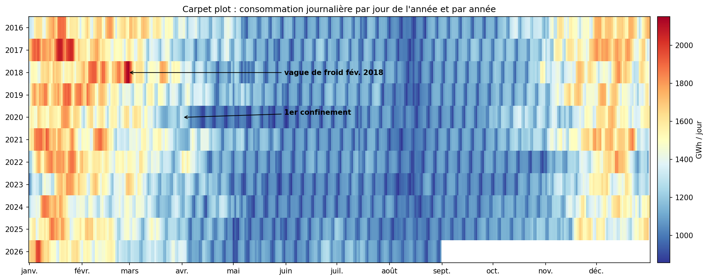

*Figure 1 — Consommation journalière, un pixel par jour.* Les rayures verticales régulières sont les week-ends, les bandes rouges les hivers ; le bleu inhabituel du printemps 2020 correspond au confinement et le refroidissement des couleurs d'hiver à partir de fin 2022 à la sobriété.


## 2.2 Décomposition (MSTL)

Une décomposition MSTL sépare la série en tendance, saisonnalité hebdomadaire (7 jours), saisonnalité annuelle (365 jours) et résidu. La force saisonnière vaut **0,90 pour le cycle annuel** et **0,45 pour le cycle hebdomadaire**.

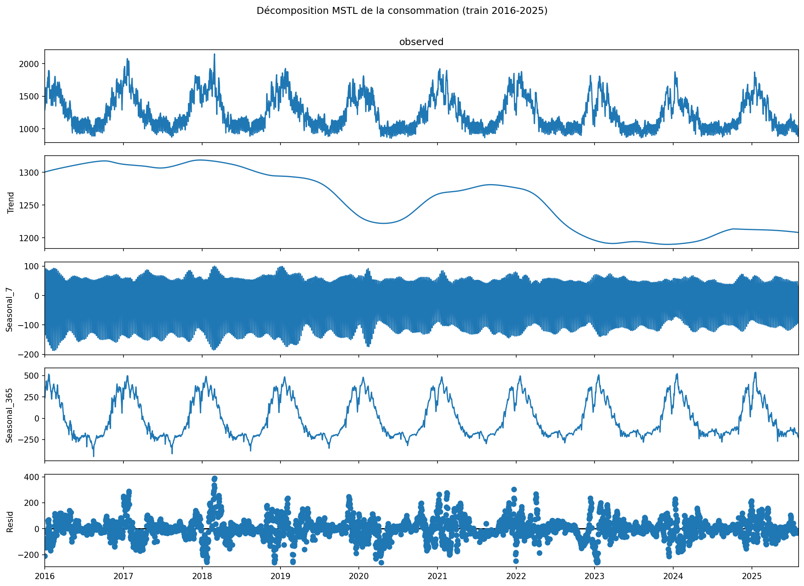

*Figure 2 — Décomposition MSTL de la consommation.* La saisonnalité annuelle (environ ±400 GWh/jour) domine ; la saisonnalité hebdomadaire (environ ±100 GWh/jour) abaisse la consommation le week-end ; la tendance montre une baisse en 2020, un rebond en 2021 puis une chute durable fin 2022.


Chaque composante se commente ainsi. La **tendance** est stable jusqu'en 2019, baisse en 2020 (confinements), rebondit en 2021 puis chute durablement fin 2022, d'environ 1 310 à 1 200 GWh/jour, sans retour au niveau d'avant la crise énergétique ; ces deux ruptures font l'objet de la section 7.2. La **saisonnalité annuelle** suit le cycle de chauffage. La **saisonnalité hebdomadaire** est nette mais plus modérée. Le **résidu** contient les chocs de météo et d'activité : il sert à détecter les valeurs aberrantes (section 2.4).

## 2.3 Autocorrélations (ACF et PACF)

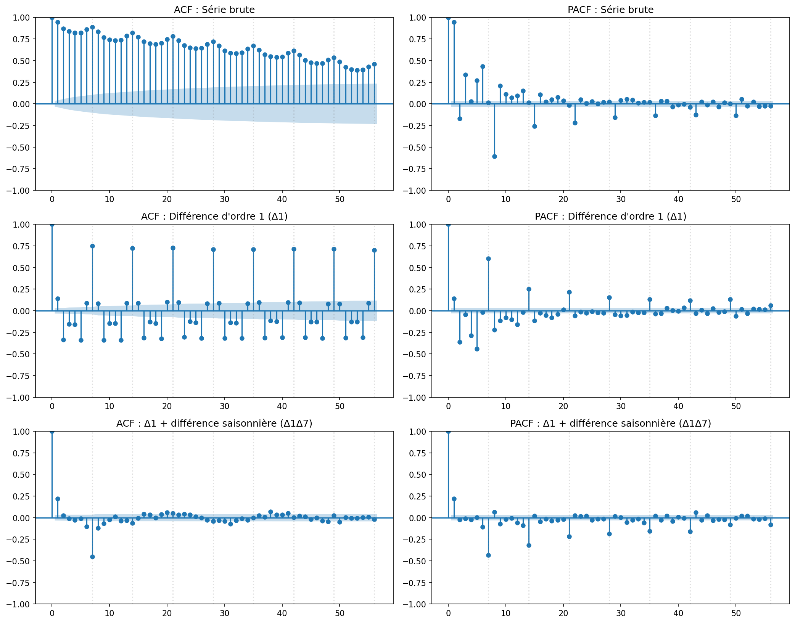

*Figure 3 — ACF et PACF de la série brute, différenciée et doublement différenciée.* L'ACF de la série brute décroît lentement avec des bosses tous les 7 jours ; après les différences simple et saisonnière, il ne reste que des pics aux retards 1 et 7.


- **Série brute.** L'ACF décroît très lentement (encore environ 0,45 au retard 56) avec des bosses tous les 7 jours : la série n'est pas stationnaire au sens strict et présente une saisonnalité hebdomadaire. La PACF montre un pic d'environ 0,95 au retard 1, puis des pics autour des retards 7 et 8.
- **Après une différence simple (Δ1).** La tendance disparaît, mais l'ACF garde des pics d'environ 0,70 aux retards 7, 14, 21, … qui ne décroissent pas : il reste une non-stationnarité saisonnière de période 7, qui justifie une différence saisonnière (D = 1, s = 7).
- **Après Δ1 et Δ7.** L'ACF retombe dans l'intervalle de confiance, sauf un pic d'environ +0,20 au retard 1 (composante non saisonnière d'ordre 1) et un pic d'environ −0,45 au retard 7 (MA saisonnier d'ordre 1). Les candidats naturels sont donc SARIMA(0,1,1)(0,1,1)[7], SARIMA(1,1,1)(0,1,1)[7] et SARIMA(1,1,0)(0,1,1)[7].
- **Limite.** La saisonnalité annuelle (365 jours) n'est pas captée par s = 7 : elle sera introduite par des régresseurs de calendrier dans les modèles multivariés.

## 2.4 Valeurs aberrantes

Nous appliquons un score z robuste (médiane et écart absolu médian, MAD) au résidu de la décomposition, avec le seuil |z| > 3,5. Il signale **133 jours (3,8 % de l'apprentissage)**, concentrés en hiver (53 en janvier, 24 en février, 22 en décembre). Ce ne sont pas des erreurs de mesure : les sur-consommations correspondent à des vagues de froid (fin février 2018, avec le maximum de 2 150,40 GWh le 28 février 2018) et les sous-consommations au premier confinement (par exemple le lundi de Pâques, 13 avril 2020), à des jours fériés ou à l'hiver doux et sobre de janvier 2023. **Traitement : conservation.** Supprimer ces jours effacerait précisément les chocs que nous voulons modéliser ; ils sont expliqués par les régresseurs de calendrier et de température (`hdd`, `cdd`, `ferie`).

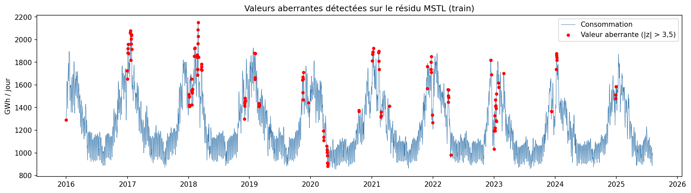

*Figure 4 — Valeurs aberrantes du résidu MSTL.* Les jours aberrants se regroupent en hiver, quand la sensibilité à la température est maximale, et au printemps 2020.


## 2.5 Stationnarité (ADF et KPSS)

**Tableau 4 — Tests de stationnarité ADF et KPSS.** La série brute est stationnaire « à la limite » (KPSS non rejeté à 5 % seulement) ; les séries différenciées sont stationnaires sans ambiguïté.


| Série | ADF (statistique) | ADF (p) | KPSS (statistique) | KPSS (p) |
|---|---|---|---|---|
| Consommation brute | −4,10 | 0,001 | 0,40 | 0,076 |
| Différence simple (Δ1) | −12,21 | < 0,001 | 0,02 | > 0,10 |
| Δ1 puis différence saisonnière (Δ1Δ7) | −18,40 | < 0,001 | 0,01 | > 0,10 |
| Température moyenne | −3,48 | 0,009 | 0,08 | > 0,10 |

L'ADF (hypothèse nulle : racine unitaire) rejette la non-stationnarité de la série brute, et le KPSS (hypothèse nulle : stationnarité) ne la rejette pas à 5 % (p = 0,076), mais la rejetterait à 10 % (0,403 > 0,347). Les tests concluent donc à une stationnarité limite, ce qui contraste avec la décroissance lente de l'ACF, que nous attribuons au cycle annuel plutôt qu'à une racine unitaire. Les recommandations automatiques divergent (`ndiffs` : d = 1 selon le KPSS, d = 0 selon l'ADF ; `nsdiffs` : D = 0 selon OCSB, D = 1 selon Canova-Hansen).

**Conclusion sur la différenciation.** Nous retenons **d = 1, D = 1, s = 7** (choix prudent, justifié par la limite du KPSS, par l'ACF lente et par les ruptures de 2020 et 2022), et nous comparons des variantes avec D = 0 ou d = 0 en section 3.1. Pour les modèles multivariés, les deux séries étant stationnaires en niveau, nous estimons le VAR en niveaux (section 3.2).

## 2.6 Relation entre consommation et température

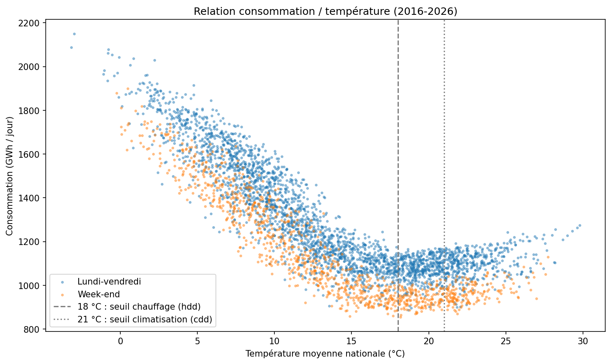

*Figure 5 — Consommation en fonction de la température.* La relation est en U très asymétrique : chaque degré en moins sous 15 °C ajoute environ 56,2 GWh/jour, alors que la remontée côté chaud reste faible.


La consommation moyenne passe de 1 720 GWh/jour pour une température moyenne comprise entre −5 et 5 °C à 1 041 GWh/jour entre 18 et 21 °C (minimum), puis remonte à 1 104 GWh/jour au-delà de 24 °C. La corrélation avec la consommation est de −0,83 pour la température brute, de 0,89 pour les degrés-jours de chauffage `hdd` (qui linéarisent la relation) et de −0,20 pour `cdd`. Les week-ends forment un nuage décalé vers le bas à température égale, ce qui justifie le jour de la semaine comme variable.


# 3 — Modélisation classique

Cette section est le socle économétrique du projet : SARIMA (3.1), modèles multivariés VAR et VECM (3.2), volatilité conditionnelle GARCH (3.3) et réplication en R (3.4). Chaque modèle est accompagné de son diagnostic de résidus complet : test de Ljung-Box (indépendance), test de Jarque-Bera (normalité) et test ARCH-LM (homoscédasticité conditionnelle).

## 3.1 ARIMA et SARIMA

### Identification et sélection

Les graphiques ACF/PACF de la section 2.3 suggèrent d = 1, D = 1, s = 7, un terme non saisonnier d'ordre faible et un MA saisonnier d'ordre 1. Nous comparons **onze candidats manuels** (dont quatre ajoutés après l'examen des premiers diagnostics), les variantes sans différenciation saisonnière ou sans différenciation, ainsi que les recherches automatiques `auto_arima` (`pmdarima`, Python) et `auto.arima` (`forecast`, R, section 3.4). Les candidats sont estimés sur 3 450 jours et classés par RMSE sur la validation interne (huit blocs de sept jours du 12 juin au 6 août 2025, paramètres fixes). Cette validation est exploratoire : elle chevauche la période déjà vue dans l'analyse exploratoire et a servi à ajouter quatre candidats ; elle ne mesure donc pas la généralisation. L'ordre est figé **avant** le test externe.

**Tableau 5 — Sélection du modèle SARIMA sur la validation interne.** Le SARIMA(2,1,1)(0,1,1)[7] a la plus petite RMSE de validation ; la différence avec les candidats voisins (42,68 à 43,05 GWh/jour) est minime, et les recherches automatiques sont nettement moins bonnes.


| Modèle | RMSE (GWh/jour) | MAE (GWh/jour) |
|---|---|---|
| SARIMA(2,1,1)(0,1,1)[7] (retenu) | 42,68 | 32,60 |
| SARIMA(2,1,2)(0,1,1)[7] | 42,81 | 32,74 |
| SARIMA(1,1,0)(0,1,1)[7] | 42,97 | 31,11 |
| SARIMA(0,1,1)(0,1,1)[7] (modèle « airline ») | 43,05 | 30,99 |
| `auto_arima`, Python : SARIMA(2,1,1)(1,0,0)[7] | 48,11 | 36,83 |
| `auto.arima`, R : SARIMA(1,0,1)(1,1,0)[7] | 49,77 | 38,83 |
| Naïf saisonnier (semaine précédente) | 55,22 | 44,04 |
| `auto_arima` sans saisonnalité : ARIMA(2,1,2) | 74,23 | 59,01 |
| Naïf « dernière valeur » | 88,59 | 67,73 |

La comparaison des deux approches automatiques montre que `pmdarima` et `auto.arima` ne retrouvent pas le modèle identifié par l'ACF/PACF : leurs recherches pas à pas explorent l'espace dans un ordre différent, et aucune ne bat le SARIMA(2,1,1)(0,1,1)[7]. Le tableau complet des 15 modèles (avec AIC et BIC, à interpréter avec prudence entre différenciations différentes) figure en annexe A (tableau 30). Une faible différence de RMSE entre candidats ne démontre pas une supériorité statistique.

### Diagnostic des résidus

Les résidus du modèle retenu, estimé sur l'apprentissage complet (3 498 résidus après exclusion des huit observations d'initialisation), sont soumis aux trois tests. Les degrés de liberté de Ljung-Box sont corrigés (p + q + P + Q = 4).

**Tableau 6 — Diagnostic des résidus du SARIMA(2,1,1)(0,1,1)[7].** Les trois hypothèses sont rejetées : les résidus sont autocorrélés, à queues épaisses et hétéroscédastiques.


| Test | Statistique | p-value |
|---|---|---|
| Ljung-Box, 7 retards | 49,17 | 1,2 × 10⁻¹⁰ |
| Ljung-Box, 14 retards | 72,71 | 1,3 × 10⁻¹¹ |
| Ljung-Box, 28 retards | 110,65 | 4,3 × 10⁻¹³ |
| Jarque-Bera | 3 005,24 | < 10⁻³⁰⁰ |
| ARCH-LM, 7 retards | 304,53 | 6,5 × 10⁻⁶² |

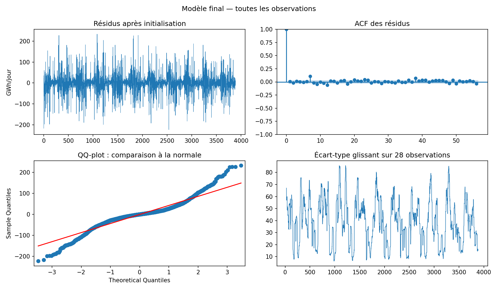

*Figure 6 — Diagnostic graphique des résidus du SARIMA final.* L'ACF des résidus est presque plate (pic résiduel au retard 7), mais le QQ-plot révèle des queues très épaisses et l'écart-type glissant varie fortement selon la saison.


L'autocorrélation résiduelle est faible en valeur absolue (pic d'environ 0,10 au retard 7) mais significative vu le nombre d'observations. Le kurtosis des résidus vaut 7,54 (loi normale : 3,00), et la variance dépend nettement de la saison : elle est plus élevée en hiver. **Le modèle est donc retenu comme meilleur candidat prédictif, non comme modèle statistiquement valide** ; ses intervalles gaussiens sont des approximations. L'effet ARCH motive la section 3.3.

### Évaluation externe

Le modèle est réestimé sur les 3 506 jours d'apprentissage puis prévoit les 390 jours de test par blocs de sept jours, à paramètres fixes. Sa **RMSE vaut 82,38 GWh/jour** (MAE 53,12 GWh/jour, MAPE 4,13 %), contre 113,93 pour le naïf saisonnier, soit un gain de 27,69 % de RMSE ; la couverture empirique de l'intervalle nominal à 95 % est de 94,36 %. L'erreur croît avec l'horizon, de 33,83 GWh/jour à h = 1 à 111,38 GWh/jour à h = 7 (annexe A, tableau 31). Ce gain est descriptif : il n'est pas testé ici ; le test de Diebold–Mariano figure en section 6.

### Limites

La validation interne couvre huit semaines d'été et a servi à des ajustements exploratoires. Le test couvre un seul hiver. Les jours fériés, les températures futures et le cycle annuel ne sont pas modélisés par le SARIMA hebdomadaire ; ils le sont dans les sections suivantes.


## 3.2 Modèles multivariés : VAR, causalité de Granger, cointégration et VECM

### Choix des variables et du calendrier

Nous modélisons conjointement la consommation `conso_gwh` et la température moyenne nationale `temp_moy` : la relation chauffage–consommation est le mécanisme principal de la série (section 2.6), et la température doit être prévue par le modèle lui-même puisque la météo future est inconnue. Les deux cycles de la consommation (hebdomadaire et annuel) sont introduits comme **régresseurs exogènes de calendrier connus à l'avance** (six indicatrices de jour de la semaine, le jour férié et trois harmoniques de Fourier annuelles), au lieu de centaines de retards. Ce choix n'introduit pas de fuite d'information, car le calendrier est connu pour le futur, contrairement à la météo.

### Stationnarité et ordre du VAR

L'ADF et le KPSS (tableau 4) concluent à la stationnarité en niveau des deux séries (consommation : ADF p = 0,001, KPSS p = 0,076, cas limite ; température : ADF p = 0,009). Le VAR est donc estimé **en niveaux**. Les critères d'information, calculés sur l'échantillon d'estimation (3 450 jours) pour laisser la validation interne vierge, proposent p = 3 (BIC), p = 9 (HQIC) et p = 13 (AIC et FPE) ; le gain d'AIC est considérable de p = 1 à p = 3 (7,645 à 7,441) puis négligeable (7,409 à p = 13). Nous départageons ces trois ordres par la règle commune au groupe, la RMSE minimale en validation interne.

**Tableau 7 — Choix de l'ordre du VAR.** Les trois ordres sont presque équivalents en validation ; la règle retient VAR(3), le plus parcimonieux.


| Ordre p | Critère d'origine | RMSE de validation (GWh/jour) | MAE de validation (GWh/jour) |
|---|---|---|---|
| 3 | BIC | 48,37 | 38,66 |
| 9 | HQIC | 48,53 | 36,43 |
| 13 | AIC, FPE | 48,74 | 37,50 |

Le VAR(3) final, réestimé sur les 3 506 jours d'apprentissage, est stable : le module maximal des valeurs propres de sa matrice compagne vaut 0,87, inférieur à 1.

### Diagnostic des résidus

**Tableau 8 — Diagnostic des résidus du VAR(3).** Les résidus de la température sont proches d'un bruit blanc ; ceux de la consommation sont autocorrélés, à queues épaisses et hétéroscédastiques.


| Équation | Ljung-Box (p, 7 retards) | Jarque-Bera (p) | Kurtosis | ARCH-LM (p) |
|---|---|---|---|---|
| Consommation | < 10⁻³⁰ | < 10⁻²⁰⁰ | 5,79 | 10⁻³² |
| Température | 0,129 | 10⁻⁹ | 3,48 | 6 × 10⁻⁴ |

Les tests multivariés concluent de même (portmanteau à 14 retards : p ≈ 10⁻⁴⁹). Les défauts de l'équation de consommation (autocorrélation aux retards 1 et 7, variance non constante) motivent la modélisation de la variance en section 3.3 et imposent de la prudence sur les intervalles gaussiens.

### Causalité au sens de Granger

**Tableau 9 — Tests de causalité de Granger.** La température cause la consommation de façon très nette ; le sens inverse, statistiquement significatif, est 18 fois plus faible et n'a pas de sens physique.


| Hypothèse | Statistique F | p-value |
|---|---|---|
| Température → consommation | 118,57 | 7 × 10⁻⁷⁵ |
| Consommation → température | 6,61 | 1,9 × 10⁻⁴ |

La température cause la consommation au sens de Granger quel que soit l'ordre testé (p < 10⁻³⁴ de p = 1 à 13). Le sens inverse est aussi significatif, mais sa statistique est 18 fois plus faible et sa p-value varie de 0,026 à 5 × 10⁻⁵ selon l'ordre ; la consommation ne détermine pas la météo, et ce résultat est probablement un artefact (la température nationale moyenne mesure imparfaitement la météo ressentie, et le test est très puissant avec 3 506 observations). Granger mesure une causalité **prédictive**, non physique ; les chocs du même jour sont corrélés à −0,46.

### Réponse impulsionnelle

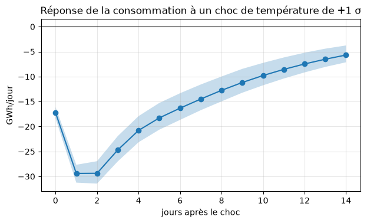

*Figure 7 — Réponse de la consommation à un choc de température.* Un choc de +1 écart-type (environ 1,25 °C) réduit la consommation de 17 GWh/jour le jour même et de 29 GWh/jour au pic, puis l'effet décroît lentement.


Avec la température ordonnée en premier (un choc de consommation ne change pas la météo du jour), un choc de température de +1 écart-type (environ 1,25 °C) réduit la consommation de 17 GWh/jour le jour même, de 29 GWh/jour au pic (jours 1 et 2) et de 14,5 GWh/jour au jour 7, soit environ −24 GWh/jour par °C de choc. Cet effet moyen sur l'année est plus faible que la pente hivernale de la section 2.6 (56 GWh/jour par °C sous 15 °C), car il inclut l'été, sans chauffage.

### Cointégration (Johansen) et VECM

Le test de Johansen (constante, deux retards en différences choisis par le BIC) rejette r ≤ 0 (statistique de la trace 337,72 contre un seuil à 95 % de 15,49) et r ≤ 1 (39,55 contre 3,84) : **le rang est 2, le rang plein**. Le résultat est identique avec 1 à 13 retards, avec constante ou tendance, et sur des séries corrigées du calendrier ; seule la spécification sans constante sur les données brutes, inadaptée (consommation moyenne de 1 254 GWh/jour), donne r = 1. Un rang plein signifie que les deux séries sont **déjà stationnaires** : il n'y a pas de tendance stochastique commune, donc pas de cointégration au sens strict, et un VAR en niveaux est la spécification cohérente.

Comme le sujet demande un VECM, nous l'estimons avec r = 1 **imposé**, en signalant que ce choix n'est pas soutenu par le test. Le nombre de retards en différences est choisi parmi 2, 8 et 12 (ordres du BIC, du HQIC et de l'AIC) par la même règle de validation interne (RMSE de 55,48, 62,37 et 53,44 GWh/jour) : **VECM(k = 12, r = 1)**. La relation d'équilibre est conso + 82,08 × température = constante. La **vitesse de correction** est α = −0,0181 (p = 0,004) : environ 1,8 % de l'écart à l'équilibre est résorbé chaque jour, soit une demi-vie d'environ 38 jours. Cette valeur n'est pas robuste : selon le nombre de retards, α vaut −0,052 (demi-vie de 13 jours), +0,007 (aucune correction) ou −0,018 (annexe A, tableau 32), et β varie du simple au double (de 61,8 à 134,1). Nous ne la lisons que comme un ordre de grandeur. Les résidus du VECM présentent les mêmes défauts que ceux du VAR (Ljung-Box p ≈ 10⁻¹⁶ et ARCH-LM p ≈ 10⁻²⁶ pour la consommation).

### Performance sur le test externe

Sur les 390 jours de test, par blocs de sept jours, le **VAR(3) obtient une RMSE de 78,96 GWh/jour** (MAE 54,67 GWh/jour, MAPE 4,31 %), avec une couverture de 93,1 % de l'intervalle nominal à 95 %. Le **VECM** est moins précis (RMSE 87,56 GWh/jour, MAE 58,71 GWh/jour, MAPE 4,61 %, couverture 91,3 %) : imposer une relation de cointégration que les données ne soutiennent pas contraint le modèle sans bénéfice. L'avantage apparent du VAR sur le SARIMA (82,38) peut venir en partie du calendrier que le SARIMA n'inclut pas ; l'écart n'est pas significatif (section 6).

### Limites

Le VAR(3) n'a pas les retards hebdomadaires 7 et 8 que l'AR creux de la section 3.3 exploite. Ses intervalles sont gaussiens et ignorent l'incertitude sur les paramètres. Le VECM suppose des séries I(1) cointégrées, hypothèse contredite par les tests : son interprétation (équilibre, vitesse de correction) est donc fragile. Pour une véritable question de cointégration, il faudrait des variables non stationnaires (niveaux de prix de l'énergie, production cumulée), hors du périmètre de ce projet.


## 3.3 Modèles de volatilité conditionnelle : ARCH et GARCH

### Effet ARCH dans les résidus

Le test ARCH-LM (7 retards) rejette l'homoscédasticité des résidus de tous les modèles précédents : SARIMA (p = 6,5 × 10⁻⁶²), équation de consommation du VAR (p ≈ 10⁻³²) et du VECM (p ≈ 10⁻²⁶). Les erreurs sont plus fortes en hiver (vagues de froid), ce qui justifie un modèle de variance conditionnelle σ²ₜ = ω + α ε²ₜ₋₁ + β σ²ₜ₋₁.

### Construction du modèle

Comme la série est une consommation et non un rendement financier, nous modélisons les **écarts à la saisonnalité** : (1) nous retirons la saisonnalité par régression sur le calendrier (Fourier annuel, jour de la semaine, jour férié), estimée sur l'apprentissage (R² = 0,823 ; écart-type des écarts 106 GWh/jour) ; (2) les écarts ont une variance non constante (ARCH-LM p ≈ 0) ; (3) la PACF présente des pics aux retards 1, 2, 7 et 8, et le meilleur BIC est obtenu par un **AR creux sur les retards 1, 2, 7, 8 et 14** (BIC 35 533,90), meilleur que AR(14) (35 597,80) et AR(21) (35 565,40) ; (4) un GARCH est estimé sur les résidus de cette moyenne, avec une loi normale puis une loi de Student.

**Tableau 10 — Comparaison de GARCH(1,1) et d'ordres supérieurs.** La loi de Student améliore massivement l'ajustement ; GARCH(1,2)-t a le meilleur BIC ; GARCH(2,1) n'apporte rien par rapport à GARCH(1,1).


| Modèle | Log-vraisemblance | BIC | Persistance α + β |
|---|---|---|---|
| GARCH(1,1), loi normale | −1 145,45 | 2 364,32 | 1,00 |
| GARCH(2,1), loi normale | −1 145,45 | 2 372,48 | 1,00 |
| GARCH(1,2), loi normale | −1 133,77 | 2 349,13 | 0,99 |
| GARCH(1,1), loi de Student | −873,83 | 1 829,24 | 1,00 |
| GARCH(2,1), loi de Student | −873,83 | 1 837,39 | 1,00 |
| **GARCH(1,2), loi de Student** | **−857,36** | **1 804,47** | 1,00 |

Le GARCH(1,1) est le modèle de référence demandé ; l'ordre (1,2) gagne 16,46 points de log-vraisemblance pour un seul paramètre supplémentaire, et la loi de Student (ν ≈ 4,10) traduit des queues très épaisses. Nous retenons **AR-GARCH(1,2)-t** (α₁ = 0,34 ; β₁ = 0,18 ; β₂ = 0,49). La persistance proche de 1 (quasi-IGARCH) reflète sans doute une volatilité saisonnière et par régimes que le modèle traduit par une mémoire extrême : c'est une limite.

### Diagnostic des résidus standardisés

**Tableau 11 — Résidus standardisés du GARCH.** Le GARCH(1,2)-t est le seul à rendre les résidus standardisés homoscédastiques à 5 % (p = 0,050 et 0,060) ; le GARCH(1,1) n'y parvient pas.


| Modèle | Ljung-Box sur z (p, 7 retards) | Ljung-Box sur z² (p, 7 retards) | ARCH-LM sur z (p) |
|---|---|---|---|
| AR creux, variance constante (témoin) | 0,85 | 3 × 10⁻¹¹⁶ | 2 × 10⁻⁸⁵ |
| AR-GARCH(1,1), loi de Student | 0,59 | 2 × 10⁻⁵ | 4 × 10⁻⁵ |
| **AR-GARCH(1,2), loi de Student** | 0,72 | 0,050 | 0,060 |

La moyenne est bien spécifiée (plus d'autocorrélation) et l'effet ARCH est presque entièrement capté par le (1,2)-t, mais le test de Jarque-Bera rejette encore la normalité des résidus standardisés (kurtosis 10,10) : même une loi de Student n'absorbe pas tous les jours extrêmes. Les p-values à la limite du seuil (0,050 et 0,060) ne valident pas l'hypothèse d'homoscédasticité ; elles indiquent seulement qu'on ne la rejette plus à 5 %.

### Volatilité conditionnelle et événements connus

Le notebook ne sauvegardait pas la série de la volatilité conditionnelle σₜ ; nous l'avons recalculée avec la même spécification (script `scripts/garch_volatilite.py`, résultats dans `exports/garch_volatilite_conditionnelle.csv`) et retrouvé la log-vraisemblance de −857,36. La médiane de σₜ sur l'apprentissage est de 31,78 GWh/jour.

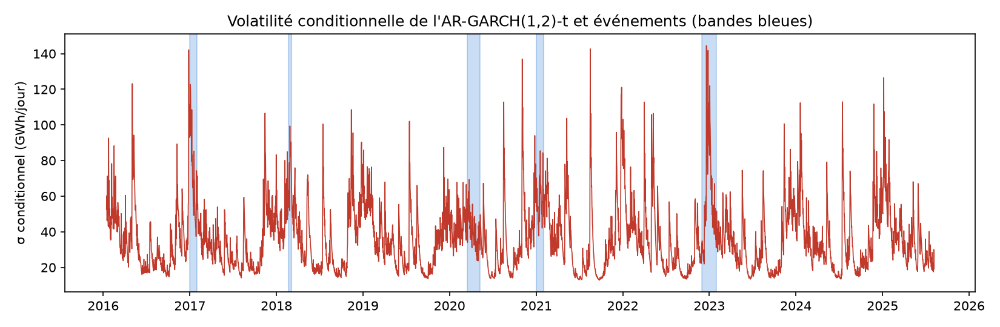

*Figure 8 — Volatilité conditionnelle de l'AR-GARCH(1,2)-t et événements.* La volatilité est maximale en hiver et culmine en décembre 2022 ; les épisodes de froid de 2017, 2018 et 2021 et l'hiver de sobriété sont bien en hausse, le confinement l'est moins.


**Tableau 12 — Volatilité conditionnelle moyenne pendant les événements documentés.** Pendant les vagues de froid et l'hiver 2022-23, le maximum de la volatilité atteint de 2,69 à 4,55 fois sa médiane ; pendant le confinement, il ne la double que brièvement (2,18 fois).


| Événement | Période | σ moyen (GWh/jour) | σ maximal (GWh/jour) | Date du maximum | Maximum / médiane |
|---|---|---|---|---|---|
| Vague de froid de janvier 2017 | 1–31 janvier 2017 | 71,93 | 122,65 | 3 janvier 2017 | 3,86 |
| Vague de froid « Moscou-Paris » | 20 février – 5 mars 2018 | 72,76 | 99,40 | 27 février 2018 | 3,13 |
| Premier confinement | 17 mars – 10 mai 2020 | 40,00 | 69,26 | 24 mars 2020 | 2,18 |
| Vague de froid de janvier 2021 | 1–31 janvier 2021 | 57,38 | 85,47 | 18 janvier 2021 | 2,69 |
| Hiver 2022-23 (sobriété) | 1er décembre 2022 – 31 janvier 2023 | 61,20 | 144,50 | 20 décembre 2022 | 4,55 |

La plus forte valeur de la série (144,50 GWh/jour le 20 décembre 2022) tombe dans l'hiver de sobriété. Les trois vagues de froid font passer la volatilité moyenne de la médiane (31,78) à 57,38–72,76 GWh/jour. Le premier confinement ne la fait monter qu'à 40,00 GWh/jour en moyenne, avec un pic à 69,26 GWh/jour le 24 mars 2020, au début de la mesure : le choc a été brutal mais court. **Le lien est partiel** : parmi les dix plus fortes valeurs (espacées d'au moins 30 jours, `exports/garch_pics_volatilite.csv`), une seule tombe dans les événements documentés (20 décembre 2022). Les autres (17 août 2021, 27 décembre 2016, 3 novembre 2020, 6 janvier 2025, 3 mai 2016, 27 décembre 2021, 16 juillet 2024, 17 août 2020, 2 avril 2022) ne sont pas expliquées par ces événements ; plusieurs tombent à la fin décembre ou à la mi-août, périodes où le calendrier est atypique, sans que nous l'ayons vérifié.

### Prévision

Sur le test externe, **AR-GARCH(1,2)-t obtient une RMSE de 74,45 GWh/jour** (MAE 48,61 GWh/jour, MAPE 3,78 %) et une couverture de 95,9 % de l'intervalle nominal à 95 % (largeur moyenne 300 GWh/jour). Le témoin à variance constante obtient une RMSE de 74,06 GWh/jour (MAE 49,16 GWh/jour) et une couverture de 93,3 % (largeur 286 GWh/jour). **Le GARCH n'améliore donc pas la prévision ponctuelle** : c'est la moyenne autorégressive avec calendrier qui fait le travail. Il **calibre mieux les intervalles** (95,9 % contre 93,3 % pour un niveau nominal de 95 %).

### Limites

La persistance proche de 1 signale que la composante saisonnière de la variance n'est pas modélisée explicitement. Des pistes non évaluées : variance saisonnière (indicatrices d'hiver), GJR-GARCH pour une réponse asymétrique, régimes de volatilité.


## 3.4 Réplication en R et comparaison avec Python

Le sujet demande le socle classique en R **et** en Python. Nous avons donc refait en R (version 4.5.2, notebook `06_section3_R.ipynb`) la stationnarité, le SARIMA (`forecast`, `tseries`, `urca`), le VAR, le test de Johansen et le VECM (`vars`, `urca`) et l'AR-GARCH (`rugarch`), avec les mêmes données, le même découpage (3 506 jours d'apprentissage, 390 jours de test), la même validation interne et la même graine (42), pour vérifier que les conclusions ne dépendent pas du logiciel. Le modèle Prophet n'est pas répliqué en R.

**Tableau 13 — Comparaison des résultats R et Python (extrait).** Les deux implémentations coïncident à la troisième décimale ; seuls les paramètres du GARCH s'écartent légèrement, à cause d'optimiseurs différents.


| Élément | Python | R |
|---|---|---|
| ADF de la consommation brute | −4,10 | −4,10 |
| KPSS de la consommation brute | 0,40 | 0,40 |
| SARIMA retenu : RMSE de test (GWh/jour) | 82,38 | 82,38 |
| Ordre du VAR retenu (BIC) | 3 | 3 |
| Granger température → consommation (F) | 118,57 | 118,57 |
| Johansen, statistique de la trace pour r = 0 | 337,72 | 337,72 |
| VECM : demi-vie de correction (jours) | 37,90 | 37,92 |
| AR-GARCH(1,2)-t : RMSE de test (GWh/jour) | 74,45 | 74,44 |
| AR-GARCH : couverture à 95 % | 95,9 % | 95,6 % |

**25 éléments sur 27 sont identiques à 0,1 % près** (annexe A, tableau 33). Les deux seuls écarts supérieurs à 0,1 % concernent le GARCH (paramètre α₁ : 0,35 % ; couverture : 0,27 %, soit un jour sur 390), dus aux optimiseurs de `rugarch` et d'`arch`. Les conclusions sont toutes identiques : le résultat ne dépend pas du logiciel.

**Différences de méthode.** `auto.arima` retient SARIMA(1,0,1)(1,1,0)[7] tandis que `pmdarima` retient SARIMA(2,1,1)(1,0,0)[7] : les recherches pas à pas n'explorent pas l'espace dans le même ordre, et aucune ne bat le modèle identifié par l'ACF/PACF (RMSE de validation de 49,77 et de 48,11 GWh/jour contre 42,68). Les statistiques de Johansen sont identiques, mais les valeurs critiques diffèrent (8,18 en R, 3,84 en Python pour r ≤ 1) car les tables ne sont pas les mêmes ; la conclusion (rang plein) est inchangée.

**Pièges de convention rencontrés.** Avant de comparer deux logiciels, il faut aligner : (1) la procédure ADF (pour la température : −3,37 avec `urca::ur.df` contre −3,48 avec la procédure de `statsmodels`, que la version finale reproduit) ; (2) les tables de valeurs critiques de Johansen ; (3) la correspondance entre le nombre de retards en différences et l'ordre du VAR en niveaux ; (4) l'ordre des paramètres (ARCH, GARCH).

**La réplication comme relecture.** Elle a révélé une erreur d'affichage dans le notebook Python du VAR : une valeur d'environ 0,25 présentée comme « module max des racines » était en réalité le module minimal des valeurs propres ; le module maximal vaut 0,87 (le VAR est stable, la conclusion n'était pas affectée). L'affichage a été corrigé dans le notebook ; la valeur de 0,87 est celle de la sortie R, retrouvée à l'identique (0,8656) en réexécutant la cellule en Python. Elle a aussi révélé que le solveur par défaut de `rugarch` n'est pas reproductible.

**Limite.** R et Python utilisent les mêmes données et le même protocole : cette comparaison valide les implémentations, non le choix des modèles ni leur robustesse sur une autre période.


# 4 — Modélisation avancée

Cette section traite des réseaux de neurones récurrents (4.1), d'une approche hybride économétrique et neuronale (4.2) et de Prophet (4.3). Les réseaux et l'hybride sont implémentés en Python (PyTorch, notebook `07_lstm_gru.ipynb`).

## 4.1 Réseaux de neurones récurrents : LSTM et GRU

### Mise en forme des données et architecture

Un **LSTM** (*Long Short-Term Memory*) garde une mémoire interne contrôlée par trois portes (oubli, entrée, sortie). Un **GRU** (*Gated Recurrent Unit*) la simplifie avec deux portes et compte donc moins de paramètres. Les deux réseaux ont la même taille et le même protocole ; seule la cellule récurrente diffère. Chaque exemple est une **fenêtre glissante** de 28 jours (consommation passée et calendrier) ; la cible est la consommation du jour suivant. Le calendrier (sinus et cosinus du jour de la semaine, indicatrice de jour férié) est connu à l'avance ; **aucune donnée météo ni valeur future n'est utilisée**. La consommation est **centrée-réduite** avec la moyenne et l'écart-type de la seule période d'apprentissage de chaque ajustement. La prévision est **récursive par blocs de 7 jours** : dans un bloc, chaque prévision sert d'entrée pour le jour suivant, et les vraies valeurs ne sont ajoutées qu'au bloc suivant. Les paramètres du réseau restent fixes pendant tout le test.

**Tableau 14 — Hyperparamètres des réseaux récurrents et justification.** Une seule architecture a été essayée : seuls les entrées et le nombre d'époques ont été choisis sur la validation.


| Hyperparamètre | Valeur | Justification |
|---|---|---|
| Taille de fenêtre | 28 jours | quatre cycles hebdomadaires complets ; valeur fixée a priori, non optimisée |
| Nombre de couches récurrentes | 1 | peu d'exemples (environ 3 400 fenêtres) : un réseau plus profond surajusterait ; non comparé à une architecture plus profonde |
| Unités cachées | 32 | 4 900 paramètres pour le LSTM et 3 684 pour le GRU, de l'ordre du nombre d'exemples ; non optimisé |
| Dropout | aucun | non testé ; l'arrêt anticipé joue le rôle de régularisation |
| Optimiseur, taux d'apprentissage, lot | Adam, 0,001, 64 | valeurs standard |
| Époques | 40 au plus, arrêt anticipé (patience 7) | meilleure époque retenue sur la validation uniquement |
| Graines | 5 (42 à 46) | la prévision est la moyenne de 5 réseaux, ce qui réduit la dépendance à l'initialisation |

### Procédure d'entraînement et courbes de perte

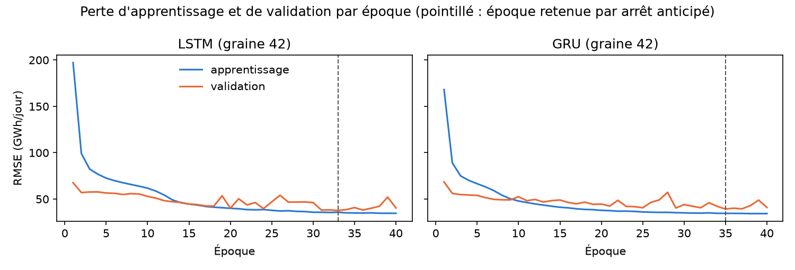

*Figure 9 — Perte d'apprentissage et de validation du LSTM et du GRU.* La perte d'apprentissage décroît régulièrement ; la validation se stabilise vers l'époque 33 (LSTM) et 35 (GRU), puis oscille sans progresser.


La perte d'apprentissage (erreur quadratique moyenne des mini-lots, exprimée en RMSE) passe d'environ 170–200 GWh/jour à 35 GWh/jour, tandis que la RMSE de validation passe d'environ 68 à 38–39 GWh/jour ; le premier point de la courbe d'apprentissage est élevé car il moyenne la perte pendant la première époque, réseau non entraîné compris. Au-delà de l'époque retenue (33 pour le LSTM et 35 pour le GRU avec la graine 42, ce qui reproduit les valeurs du notebook), la validation oscille entre 38 et 52 GWh/jour (LSTM) et entre 39 et 49 GWh/jour (GRU) sans progresser, alors que l'apprentissage reste plat : l'arrêt anticipé limite ce début de surapprentissage.

### Choix des entrées sur la validation

**Tableau 15 — Choix des entrées sur la validation interne.** Le calendrier améliore nettement les deux réseaux : il est retenu.


| Modèle | Entrées | RMSE de validation (GWh/jour) |
|---|---|---|
| LSTM | consommation seule | 46,55 |
| LSTM | consommation et calendrier | **39,37** |
| GRU | consommation seule | 50,06 |
| GRU | consommation et calendrier | **38,88** |

### Validation croisée temporelle (walk-forward)

Nous évaluons la robustesse par une validation croisée **à fenêtre croissante** (walk-forward), jamais par un k-fold aléatoire. Chaque pli apprend sur toute la série disponible jusqu'à sa date d'origine, puis prévoit les **56 jours suivants** par blocs de 7 jours. Les cinq plis sont **entièrement situés dans l'apprentissage** (le test externe n'est jamais utilisé) et comprennent **trois plis d'hiver et deux plis d'été**. Les hyperparamètres, les entrées, la normalisation par pli, les cinq graines et le nombre d'époques (celui retenu par arrêt anticipé au notebook 07, appliqué sans nouvel arrêt) sont identiques pour tous les plis. Le SARIMA est réestimé sur chaque pli ; le naïf saisonnier n'a aucun paramètre.

**Tableau 16 — Validation croisée temporelle : RMSE par pli (GWh/jour).** Le GRU bat le SARIMA dans les cinq plis et le LSTM dans quatre ; tous les modèles se dégradent fortement en hiver.


| Pli | Période de test | Saison | Jours d'apprentissage | LSTM | GRU | SARIMA | Naïf saisonnier |
|---|---|---|---|---|---|---|---|
| 1 | 20/12/2021 – 13/02/2022 | hiver | 2 180 | 130,09 | **124,44** | 145,91 | 204,24 |
| 2 | 19/12/2022 – 12/02/2023 | hiver | 2 544 | 190,43 | **183,12** | 203,72 | 221,90 |
| 3 | 12/06/2023 – 06/08/2023 | été | 2 719 | 34,33 | **27,42** | 31,89 | 40,02 |
| 4 | 16/12/2024 – 09/02/2025 | hiver | 3 272 | **103,87** | 108,83 | 115,27 | 164,84 |
| 5 | 12/06/2025 – 06/08/2025 | été | 3 450 | 39,37 | **38,87** | 42,67 | 55,22 |
| | **Moyenne des cinq plis** | | | 99,62 | **96,54** | 107,89 | 137,24 |
| | Moyenne des plis d'hiver | | | 141,46 | **138,80** | 154,97 | 196,99 |
| | Moyenne des plis d'été | | | 36,85 | **33,14** | 37,28 | 47,62 |
| | Rang moyen (1 = meilleur) | | | 2,0 | **1,2** | 2,8 | 4,0 |

Les deux réseaux font mieux que le SARIMA en moyenne (96,54 pour le GRU et 99,62 pour le LSTM contre 107,89 GWh/jour) et que le naïf saisonnier (137,24). Le GRU est le meilleur modèle dans quatre plis sur cinq (le LSTM dans le quatrième) ; le LSTM est battu par le SARIMA dans le pli d'été 3. Ces classements sont stables d'un pli à l'autre, ce qui renforce la conclusion du test externe, mais plusieurs réserves s'imposent. Les erreurs d'hiver (de 104 à 222 GWh/jour selon le pli et le modèle) sont environ quatre fois plus grandes que celles d'été (de 27 à 55 GWh/jour) : ce sont les fenêtres de 56 jours les plus difficiles, et leurs RMSE ne sont pas comparables à la RMSE du test (390 jours, toutes saisons). L'écart-type entre plis (64 GWh/jour pour le GRU) est dominé par la saison. Cinq plis ne permettent pas de test de significativité fiable : ces différences restent **descriptives**. Enfin, le pli 5 coïncide avec la validation interne qui a servi à choisir les entrées et les époques : il reproduit exactement les valeurs de validation du notebook (39,37, 38,87 et 42,67) et est donc légèrement optimiste pour les réseaux.

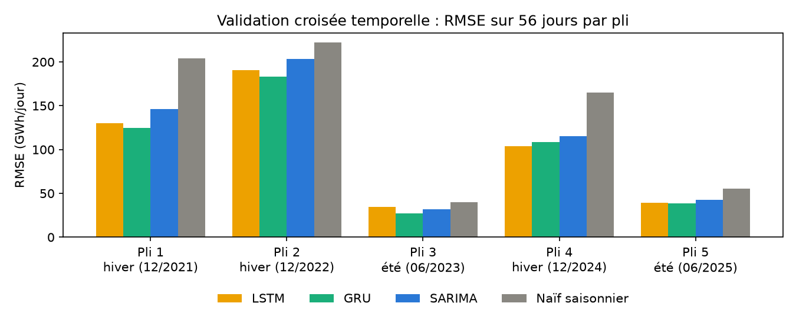

*Figure 10 — RMSE par pli de la validation croisée temporelle.* Dans chaque pli, le naïf saisonnier est le moins précis ; l'écart entre réseaux et SARIMA est plus marqué en hiver.


### Résultats sur le test externe

Les réseaux sont réentraînés jusqu'au 6 août 2025 avec le nombre d'époques retenu, puis prévoient les 390 jours de test (section 6, tableau 22). Le **LSTM obtient une RMSE de 75,07 GWh/jour** (MAE 50,26 GWh/jour, MAPE 3,96 %) et le **GRU de 76,40 GWh/jour** (MAE 52,40 GWh/jour, MAPE 4,16 %), contre 82,38 GWh/jour pour le SARIMA ; le gain de RMSE du LSTM sur le naïf saisonnier est de 34,1 %. Sur le test, le LSTM devance donc le GRU, alors que c'est l'inverse dans quatre plis de la validation croisée : l'écart entre les deux réseaux est trop faible pour les départager (test de Diebold–Mariano, section 6, p corrigée de 1,00). Les réseaux fournissent des prévisions ponctuelles, sans intervalle.

### Limites

Une seule architecture a été essayée (une couche, 32 unités, fenêtre de 28 jours, sans dropout) ; un réglage plus large demanderait une validation plus longue pour ne pas surajuster. La validation interne est courte et estivale (56 jours) : elle ne contient pas de vague de froid, alors que les plus grosses erreurs surviennent en hiver. Aucune météo n'est utilisée.


## 4.2 Approche hybride : SARIMA + LSTM

### Principe

Le SARIMA(2,1,1)(0,1,1)[7] de la section 3.1 fournit une première prévision ; un LSTM apprend à prévoir son **erreur** eₜ = yₜ − ŷₜ(SARIMA), et la prévision hybride est ŷₜ(SARIMA) + êₜ. L'idée est de laisser l'économétrie traiter la saisonnalité hebdomadaire et le réseau capter la structure non linéaire restante. Pour que le LSTM apprenne sur des erreurs semblables à celles du test, nous générons des erreurs de prévision par blocs de 7 jours, à paramètres fixes, du 5 janvier 2017 (après un an de démarrage du filtre) à la fin de chaque période d'ajustement, soit environ 3 000 erreurs. Le SARIMA est estimé jusqu'au 11 juin 2025 pour la validation, jusqu'au 6 août 2025 pour le test et jusqu'au 31 août 2026 pour la prévision finale ; le LSTM des erreurs est chaque fois réentraîné (mêmes hyperparamètres que ceux du tableau 14).

**Nature pseudo hors échantillon de l'hybride.** Les paramètres du SARIMA sont estimés sur la même période que celle où nous générons ses erreurs d'apprentissage : les paramètres ont vu les données, seuls les états du filtre sont mis à jour hors échantillon. Ces erreurs sont donc *pseudo hors échantillon* et peuvent être un peu plus petites que celles du test, ce qui avantage légèrement l'apprentissage du LSTM. Le SARIMA recalculé dans le notebook coïncide avec celui de la section 3.1 : les écarts maximaux sont de 0,0094 GWh en validation, de 0,0192 GWh sur le test et de 0,0003 GWh pour la prévision finale.

### Validation et test

**Tableau 17 — Hybride SARIMA + LSTM : validation et test.** L'hybride améliore la RMSE de validation (36,60 contre 42,67) puis la RMSE de test de 3,0 %, mais pas la MAE ni la MAPE.


| Modèle | Entrées du LSTM des erreurs | RMSE de validation | RMSE de test | MAE de test | MAPE de test |
|---|---|---|---|---|---|
| SARIMA seul | — | 42,67 | 82,38 | 53,12 | 4,13 % |
| SARIMA + LSTM | consommation seule | 44,81 | — | — | — |
| SARIMA + LSTM | consommation et calendrier (retenu) | **36,60** | **79,92** | 53,84 | 4,27 % |

Toutes les erreurs sont en GWh/jour. Comme pour les réseaux directs, le calendrier est retenu sur la validation. L'hybride réduit la RMSE du SARIMA de 3,0 % sur le test, mais **pas sa MAE ni sa MAPE**, qui augmentent légèrement. La différence de RMSE n'est pas significative : p = 0,595 brute et 1,00 après correction de Holm (perte quadratique), et le test avec la perte absolue donne le même verdict (p corrigée de 1,00). L'hybride n'est pas non plus distinguable du LSTM seul (p brute de 0,23). Les modèles emboîtés (SARIMA et hybride) demandent en outre une interprétation prudente des tests.

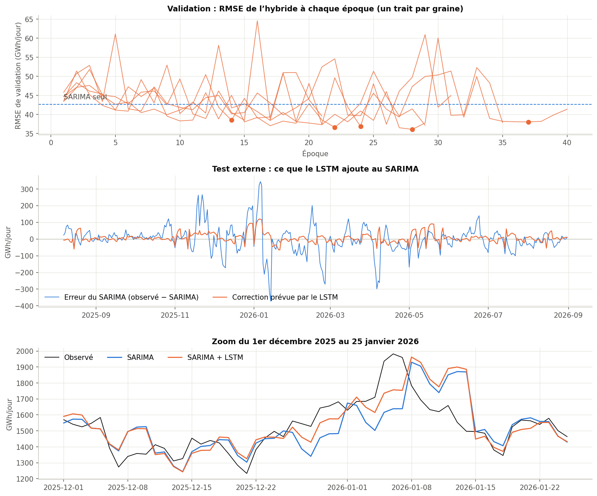

*Figure 11 — Prévisions de l'hybride SARIMA + LSTM.* L'hybride suit de près le SARIMA ; la correction du LSTM reste modeste.


### Limites

Les erreurs d'apprentissage sont pseudo hors échantillon ; la validation est courte et estivale ; l'hybride ne fournit pas d'intervalle de prévision ; le gain de RMSE n'est pas établi statistiquement.


## 4.3 Modèle additionnel : Prophet

Prophet décompose la série en une tendance linéaire par morceaux, des saisonnalités (annuelle, hebdomadaire) et des effets de jours fériés (colonne `ferie`). Il n'a pas de terme autorégressif. Nous comparons en validation interne deux niveaux de flexibilité de la tendance (`changepoint_prior_scale` de 0,05 et de 0,5) et deux modes de saisonnalité (additif et multiplicatif).

**Tableau 18 — Choix des hyperparamètres de Prophet sur la validation interne.** La tendance flexible additive est la meilleure ; la série contient des ruptures (2020, 2022-23) que la tendance rigide suit mal.


| Flexibilité de la tendance | Mode | RMSE de validation (GWh/jour) | MAE de validation (GWh/jour) |
|---|---|---|---|
| 0,05 | additif | 60,28 | 45,07 |
| 0,05 | multiplicatif | 57,13 | 41,94 |
| **0,5** | **additif** | **51,90** | 38,83 |
| 0,5 | multiplicatif | 52,48 | 38,34 |

Prophet n'ayant pas d'état à actualiser, il est **réajusté tous les 7 jours** sur l'historique disponible (56 ajustements pour le test), alors que les autres modèles gardent des paramètres fixes ; cet avantage de protocole doit être gardé en tête dans la comparaison. Les résidus d'apprentissage sont très autocorrélés et hétéroscédastiques (Ljung-Box et ARCH-LM : p ≈ 0 ; kurtosis 4,94), ce qui est attendu sans terme autorégressif.

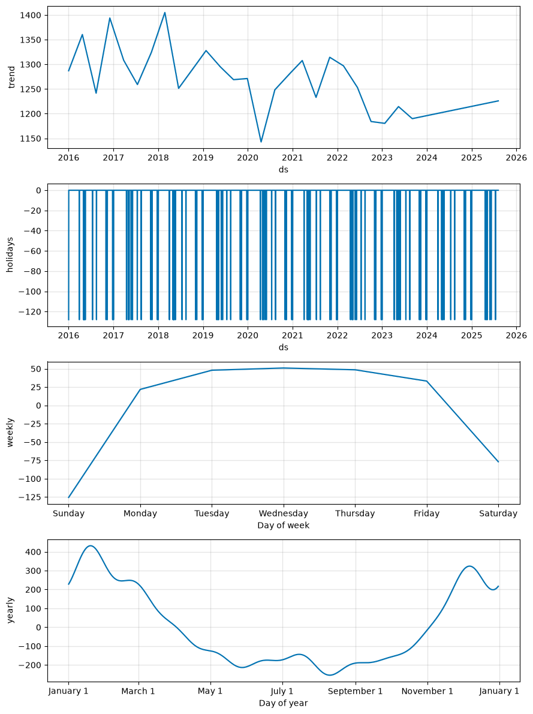

*Figure 12 — Composantes de Prophet.* Prophet capte la tendance (baisse en 2020 et 2022-23), la saisonnalité annuelle et le creux du week-end, mais ces composantes ne remplacent pas une mémoire à court terme.


Sur le test, **Prophet obtient une RMSE de 101,79 GWh/jour** (MAE 75,06 GWh/jour, MAPE 5,91 %) et une couverture de 88,5 % (intervalles trop étroits : seule l'incertitude de la tendance et du bruit est prise en compte). Une variante à ajustement unique, qui prévoit directement jusqu'à 390 jours, obtient une RMSE de 97,57 GWh/jour avec une couverture de 97,4 % mais des intervalles de 890,7 GWh/jour de large : elle n'est pas comparable au protocole à sept jours. Prophet fait mieux que les références naïves (109,13 et 113,93 GWh/jour) mais moins bien que le SARIMA (82,38) ; il est utile pour lire la tendance et les saisonnalités, pas pour la prévision à sept jours, faute de mémoire à court terme (RMSE de 99,63 GWh/jour dès l'horizon 1). Prophet n'a pas été répliqué en R.


# 5 — IA générative et LLM

Cette section évalue l'usage d'un LLM comme outil d'aide à l'analyse, selon les quatre points du sujet : hypothèses de modèles à partir des statistiques descriptives (5.2), explication vulgarisée (5.3), recommandations de gestion avec limites explicites (5.4), comparaison avec une interprétation rédigée par le groupe et recherche des erreurs des LLM (5.5 et 5.6). Les prompts, les réponses intégrales et l'interprétation du groupe sont en annexe B.

## 5.1 Démarche et outils utilisés

**Premier tour : Claude (Anthropic), modèle Claude Opus 5.5 (identifiant `claude-opus-5-5`), le 11 octobre 2026.** Trois prompts complets lui ont été soumis ; ils sont générés à partir des fichiers de résultats par `scripts/preparer_prompts_llm.py` : (a) hypothèses de modèles à partir des statistiques descriptives, (b) vulgarisation de la comparaison finale pour un décideur, (c) recommandations de gestion du réseau, avec limites formulées par le LLM. Chaque prompt demande de n'utiliser que les chiffres fournis.

**Second tour : ChatGPT (OpenAI).** Après ce premier tour et la lecture des résultats du projet, le groupe a rédigé sa propre interprétation de la comparaison finale (annexe B), puis a soumis le prompt (b), sans le modifier, à ChatGPT.

- **L'interprétation du groupe précède ChatGPT, pas Claude.** L'exigence du sujet (une interprétation rédigée avant de solliciter le LLM) est remplie pour le second tour ; elle ne l'est pas pour le premier, dont les réponses étaient connues du groupe au moment d'écrire.
- **Claude n'était pas neutre, et l'audit n'est pas indépendant.** Claude a aussi servi d'outil d'aide pendant la préparation du projet (code, mise en forme), et la vérification de la section 5.6 a été menée avec lui, y compris pour la réponse de ChatGPT. Chaque verdict renvoie donc à un fichier de résultats et à une valeur recalculée par `scripts/audit_reponses_llm.py` ; les principaux écarts de la réponse de ChatGPT ont d'abord été relevés par le groupe.
- **Un essai préliminaire** (9 octobre 2026, deux prompts sur le seul SARIMA, autre outil) est conservé en annexe B ; il n'entre pas dans l'analyse.

## 5.2 Hypothèses de modèles à partir des statistiques descriptives

**Tableau 19 — Statistiques descriptives transmises au LLM (apprentissage, 3 506 jours).** La consommation est asymétrique à droite et plus aplatie qu'une loi normale ; la série brute est stationnaire à la limite, ses différences le sont nettement.


| Série | Moyenne | Variance | Écart-type | Skewness | Kurtosis excédentaire | ADF (statistique ; p) | KPSS (statistique ; p) |
|---|---|---|---|---|---|---|---|
| Consommation (GWh/jour) | 1 258,93 | 63 882,41 | 252,75 | 0,69 | −0,43 | −4,10 ; 0,001 | 0,40 ; 0,076 |
| Consommation, différence simple | −0,09 | 7 160,41 | 84,62 | 0,44 | 0,44 | −12,21 ; < 0,001 | 0,02 ; > 0,10 |
| Consommation, différences simple et saisonnière | −0,11 | 3 601,69 | 60,01 | 0,08 | 2,52 | −18,40 ; < 0,001 | 0,01 ; > 0,10 |
| Température moyenne (°C) | 13,34 | 37,91 | 6,16 | 0,05 | −0,94 | −3,48 ; 0,009 | 0,08 ; > 0,10 |

À partir de ces seules statistiques (prompt a), le LLM propose :

- **Différenciation** : d = 1, D = 1, s = 7 comme choix prudent, à comparer à d = 0 ou D = 0, en notant que l'ADF et le KPSS ne testent pas une racine unitaire saisonnière ;
- **SARIMA de période 7** : (0,1,1)(0,1,1)[7], (1,1,1)(0,1,1)[7] et (1,1,0)(0,1,1)[7], les ordres devant être confirmés par l'ACF et la PACF ;
- **Régression dynamique** avec température et calendrier, la forme du lien restant à vérifier ;
- **VAR en niveaux** sur la consommation et la température, sans VECM si les séries sont stationnaires ;
- **GARCH(1,1)**, puis loi de Student et ordres supérieurs si un effet ARCH subsiste, motivé par le kurtosis de 2,52 des variations ;
- **LSTM ou GRU** de petite taille (fenêtre de 7 à 28 jours), validés par walk-forward ;
- les **références naïves** et un modèle à saisonnalités multiples si un cycle annuel est confirmé.

Ces hypothèses recoupent largement la démarche du projet. Deux écarts sont à relever : le modèle finalement retenu, SARIMA(2,1,1)(0,1,1)[7], n'est pas dans la liste, et le LLM qualifie la structure hebdomadaire de « forte » alors que c'est la saisonnalité annuelle qui domine (force de 0,90 contre 0,45), ce que les statistiques transmises ne lui permettaient pas de voir.

## 5.3 Explication vulgarisée pour un décideur

À partir du tableau de comparaison et des tests de Diebold–Mariano (prompt b), le LLM explique qu'AR-GARCH a la plus petite erreur (74,45 GWh/jour, « environ 6 % » de la consommation moyenne), qu'une erreur plus petite n'est pas une supériorité démontrée, et que le choix doit aussi tenir compte des intervalles, de la lisibilité et du coût. Extrait :

> « Deux modèles peuvent avoir des erreurs différentes sur une année simplement par hasard. Le test de Diebold–Mariano mesure si l'écart est trop grand pour être dû au hasard. […] On ne peut pas dire qu'il sera encore le meilleur l'an prochain : le test porte sur une seule période de 390 jours, et l'écart avec ses concurrents directs n'est pas démontré. »

L'explication rend bien la distinction entre « meilleur observé » et « meilleur démontré » ; une affirmation est fausse, sur les intervalles « les mieux calibrés » (section 5.6). Elle dépasse la longueur demandée (environ 400 mots) et lisse trois points : la couverture de 95,9 % est une moyenne qui masque l'hiver, « les modèles qui tiennent compte du passé récent » ne battent pas tous la persistance de façon significative, et le coût des réseaux est sous-estimé (section 5.6).

## 5.4 Recommandations de gestion et limites

Le prompt (c) demande des recommandations à partir des prévisions du 1er au 7 septembre 2026, en invitant le LLM à formuler lui-même leurs limites. Il en propose six : (1) utiliser AR-GARCH comme référence et raisonner sur son intervalle ; (2) dimensionner la marge de sécurité sur la borne haute de l'intervalle (de 1 128,01 GWh le 1er septembre à 1 186,42 GWh le 7) et refaire la prévision chaque jour, l'erreur passant de 37,9 à 96,2 GWh/jour entre les horizons 1 et 7 ; (3) placer les opérations de maintenance le dimanche, jour de creux (de 906,98 à 938,23 GWh selon les modèles) ; (4) surveiller les jours où les modèles divergent ; (5) écarter Prophet et les méthodes naïves ; (6) garder un réseau de neurones en parallèle.

**Limites formulées par le LLM.** Le témoin fait aussi bien qu'AR-GARCH en précision ; la couverture de 95,9 % est une moyenne qui ne vaut pas forcément pour chaque saison ; un intervalle à 95 % laisse un jour sur vingt en dehors ; des modèles d'accord entre eux peuvent se tromper ensemble ; rien ne permet d'anticiper une vague de froid ; le niveau de marge acceptable dépend de la capacité disponible et du coût d'une défaillance, absents des données.

**Limites que nous ajoutons.**

- **La marge du LLM est insuffisante en hiver.** Sur le test, la couverture d'AR-GARCH tombe à 91,11 % de décembre à février (contre 97,33 % le reste de l'année), et sa RMSE y atteint 121,62 GWh/jour (contre 52,62) ; la plus forte erreur est de 329,35 GWh le 14 janvier 2026. Une marge calée sur la borne haute serait donc dépassée environ un jour sur onze en hiver, précisément quand le réseau est tendu.
- **La semaine prévue est une semaine facile.** Début septembre, les modèles s'accordent à moins de 35 GWh/jour près ; ces recommandations ne disent rien de leur comportement lors d'un épisode de froid, que la validation croisée montre environ quatre fois plus difficile à prévoir (section 4.1).
- **Le choix d'AR-GARCH n'est pas démontré.** Aucun test corrigé ne le distingue de ses concurrents ; en validation croisée, il fait jeu égal avec le GRU sans le devancer (annexe A).
- **Les données de 2026 sont consolidées**, donc révisables, et les valeurs réelles de septembre ne sont pas disponibles : aucune de ces recommandations n'a pu être confrontée à la réalité.
- **Les recommandations restent génériques** : sans capacité disponible, sans coût d'une défaillance ni prévision météo, le LLM ne peut proposer aucun seuil chiffré de marge. Elles ne constituent pas une aide à la décision d'exploitation.

## 5.5 Comparaison entre l'interprétation du groupe et la réponse de ChatGPT

Notre interprétation (environ 150 mots, sans chiffre) et la réponse de ChatGPT au prompt (b) (environ 470 mots) sont en annexe B. Le groupe avait lu tous les résultats ; ChatGPT n'a reçu que le tableau de test et les tests de Diebold–Mariano, sans rien sur la baisse d'après 2022.

- **Convergences.** Les deux textes retiennent AR-GARCH sans le dire démontré meilleur, limitent le rôle du GARCH à la mesure de l'incertitude et rappellent qu'il n'y a qu'une année de test. Cela prouve peu : ces idées se lisaient dans le prompt et dans les réponses de Claude.
- **Divergences.** *La saison* : pour le groupe, « tout se joue en hiver » ; pour ChatGPT, « la plupart des jours, la prévision est juste à environ 4 % près ». Les fichiers donnent raison au groupe : 65,4 % des jours du test sont prévus à 4 % près, mais 47,8 % en hiver, et les 90 jours d'hiver portent 61,6 % de l'erreur quadratique. *La météo* : le groupe écrit « sans prévisions météo », ChatGPT « aucun modèle n'utilise la météo », ce qui est faux. *Les réseaux* : ChatGPT juge que les modèles classiques font « au moins aussi bien », alors que la validation croisée penche pour les réseaux (section 4.1) ; le groupe ne les classe pas.
- **Ce que ChatGPT apporte et que notre texte n'a pas.** Des chiffres, la correction des comparaisons multiples et une réserve juste : « une fourchette très large couvre facilement », et le prompt ne donnait pas les largeurs (300 GWh/jour en moyenne pour AR-GARCH, 347 pour le SARIMA).
- **Simplifications, erreurs et causalités.** ChatGPT simplifie cinq fois, se trompe deux fois et généralise abusivement deux fois (tableau 21). Il n'avance aucune explication causale : c'est notre texte qui en contient.

**Limites de notre propre interprétation.**

- **Des causes non testées.** « (habitudes, prix, industrie) » est une hypothèse : la section 7.1 mesure une baisse de niveau d'environ 98 GWh/jour sans séparer ces causes. « Sans prévisions météo, les modèles se font surprendre par chaque vague de froid » est plausible, non testé et incomplet : sur les douze plus fortes erreurs d'AR-GARCH, sept sont des surestimations un jour de redoux (11,7 °C en moyenne), cinq des sous-estimations par temps froid (1,5 °C).
- **Des formules plus fortes que les résultats.** « La sensibilité au froid est restée la même » : le test ne détecte pas de changement de pente (p = 0,756), ce qui ne démontre pas l'égalité. « Ses intervalles sont les plus fiables » : AR-GARCH est le seul à atteindre 95 % et tient le mieux en hiver (91,1 % contre 86,7 % pour le SARIMA), mais le SARIMA est plus proche de 95 % sur l'ensemble du test ; les deux LLM font la même erreur.
- **Une portée surestimée.** Quand ce texte a été écrit, les plis de validation croisée ne portaient pas encore sur AR-GARCH, et il ne cite aucun chiffre.

## 5.6 Audit des affirmations des LLM

Nous avons relevé 52 affirmations chiffrées ou causales, 32 dans les trois réponses de Claude (dont 10 pour le prompt b) et 20 dans celle de ChatGPT, et confronté chacune à un fichier du projet (audit complet en annexe B).

**Tableau 20 — Bilan de l'audit par outil.** Les deux outils commettent les deux mêmes erreurs ; ChatGPT ajoute deux généralisations abusives.


| LLM | Affirmations | Correctes | Simplifiées | Fausses | Généralisations abusives | Causalités non fondées |
|---|---|---|---|---|---|---|
| Claude, prompts (a), (b) et (c) | 32 | 20 | 10 | 2 | 0 | 0 |
| ChatGPT, prompt (b) | 20 | 11 | 5 | 2 | 2 | 0 |

Sur les nombres cités, 156 des 170 de Claude et 25 des 28 de ChatGPT figurent dans le prompt ; les autres sont des seuils, des ordres de modèle, des arrondis ou des calculs exacts. **Deux erreurs de Claude avaient échappé au premier audit**, qui portait sur 29 affirmations et n'en jugeait aucune fausse : elles sont apparues en appliquant à ses réponses les contrôles faits pour ChatGPT.

**Tableau 21 — Affirmations fausses, généralisées ou simplifiées les plus importantes.** Aucune de ces erreurs ne porte sur un chiffre inventé.


| LLM (prompt) | Affirmation | Verdict | Correction |
|---|---|---|---|
| ChatGPT (b), Claude (b) | Couverture d'AR-GARCH « la plus proche » de 95 %, intervalles « les mieux calibrés » | fausse | SARIMA : 94,36 %, à 0,64 point de 95 % ; AR-GARCH : 95,90 %, à 0,90 point |
| ChatGPT (b), Claude (c) | « Aucun modèle n'utilise la météo » | fausse | Le prompt disait « aucune prévision météo » ; le VAR et le VECM utilisent la température observée |
| ChatGPT (b) | Les modèles classiques font « au moins aussi bien » que les réseaux | généralisation abusive | Vrai pour AR-GARCH seul : VAR, SARIMA et VECM (78,96 à 87,56) sont derrière le LSTM (75,07) et le GRU (76,40) |
| ChatGPT (b) | Ils « battent nettement » les règles naïves et Prophet | généralisation abusive | 4 comparaisons sur 12 significatives après Holm en perte quadratique, aucune contre le naïf saisonnier |
| ChatGPT (b), Claude (b) | Temps de calcul faibles (« moins de 16 secondes ») | simplifiée | Vrai par ajustement ; 38,7 s (LSTM), 75,9 s (GRU) et 99,6 s (Prophet) pour le protocole |
| ChatGPT (b) | RMSE d'environ 5,9 % de la consommation moyenne ; « un jour ordinaire, l'écart typique est de 49 GWh » | simplifiée | 6,15 % de la moyenne du test (le prompt imposait celle de l'apprentissage) ; 49 GWh est la MAE, l'erreur médiane est de 29,88 GWh/jour |

**Lecture critique.** Aucun chiffre n'est inventé : les erreurs viennent de la lecture des chiffres du prompt (comparer deux écarts à 95 %, reprendre « prévision météo » en « météo », étendre à une famille de modèles un résultat donné pour un seul). Les deux bilans ne se comparent pas terme à terme : trois prompts contre un, une seule réponse par outil, un découpage plus fin pour ChatGPT.

## 5.7 Apport et limites des LLM

**Ce qu'ils ont apporté.** Un cadrage rapide (familles de modèles à tester et diagnostics à faire, qui recoupent la démarche du projet), une vulgarisation claire de notions difficiles (erreur quadratique, intervalle à 95 %, différence non significative) et des limites justes, formulées spontanément. Nous n'avons pas mesuré le temps gagné.

**Ce qu'ils n'ont pas su faire.** Trouver le modèle retenu, qui exigeait l'ACF, la PACF et une validation. Voir ce que les chiffres transmis ne contenaient pas : saisonnalité annuelle dominante, ruptures de 2020 et 2022, dégradation des intervalles en hiver. Chiffrer une marge de sécurité. Vérifier leurs propres affirmations.

**Ce que montre la comparaison des deux outils.** Sur le même prompt, ChatGPT respecte mieux la longueur demandée (environ 470 mots contre 580) et formule une réserve que Claude n'a pas, mais il généralise davantage. Les deux commettent la même erreur sur la couverture : l'accord de deux LLM ne vaut pas vérification. Le second outil a surtout servi de révélateur : c'est en auditant ChatGPT que nous avons retrouvé deux erreurs de Claude, manquées par un audit mené avec Claude lui-même. Écrire notre interprétation avant de lire ChatGPT nous a montré ce qu'il ne pouvait pas voir (l'hiver), et sa réponse chiffrée a fait ressortir nos affirmations non testées. Aucun des deux ne remplace les calculs, les diagnostics ni la relecture critique de chaque chiffre.


# 6 — Prévision et évaluation comparative

Cette section compare les dix modèles sur le test externe (notebook `07_lstm_gru.ipynb`, dossier `exports/lstm_gru/`). Les temps et les nombres de paramètres proviennent de `scripts/mesures_complexite.py` (`exports/complexite_modeles.csv`).

## 6.1 Conclusion sur le modèle final

Sur le test (390 jours), AR-GARCH(1,2)-t a la plus petite erreur (RMSE 74,45 GWh/jour), mais aucun test de Diebold–Mariano corrigé (Holm) ne le distingue de SARIMA, LSTM, GRU, VAR(3) ni de l'hybride. SARIMA(2,1,1)(0,1,1)[7] est le modèle retenu par la règle de validation interne ; AR-GARCH est le meilleur observé sur le test, à égalité avec le GRU en validation croisée ; nous ne concluons pas à une supériorité durable. Le témoin « AR à variance constante » (AR sur les retards 1, 2, 7, 8 et 14, même calendrier, sans GARCH) obtient une RMSE de **74,06 GWh/jour**, légèrement meilleure : le gain vient de la moyenne autorégressive avec calendrier, non de la modélisation de la variance, qui améliore en revanche la couverture des intervalles (95,9 % contre 93,3 %), sans les rendre assez larges en hiver (section 6.6).

## 6.2 Protocole de comparaison

Tous les modèles prévoient **les mêmes 390 jours** (du 7 août 2025 au 31 août 2026), avec les mêmes 55 blocs complets de 7 jours, un dernier bloc de 5 jours et les mêmes horizons de 1 à 7 jours ; le code vérifie dates, observations et horizons. Les différences de protocole à garder en tête sont les suivantes.

- **Prophet est réajusté chaque semaine**, alors que SARIMA, VAR, VECM, AR-GARCH et les réseaux gardent des **paramètres fixes** pendant tout le test (seuls leurs états ou leurs entrées sont actualisés) : Prophet bénéficie de réestimations que les autres n'ont pas.
- **L'hybride SARIMA + LSTM est pseudo hors échantillon** (section 4.2).
- **Les tests de Diebold–Mariano utilisent 385 jours** (55 blocs complets de 7 jours), contre **390 jours pour les métriques** : les cinq derniers jours (bloc incomplet) sont exclus des tests pour garder sept horizons à chaque origine.
- **Calendrier** : VAR, VECM, AR-GARCH, Prophet et les réseaux utilisent des régresseurs de calendrier que le SARIMA de la section 3.1 n'a pas ; la comparaison les avantage et ne prouve pas qu'ils soient intrinsèquement meilleurs.
- Aucun modèle n'utilise de prévision météo.

## 6.3 Tableau récapitulatif des modèles

**Tableau 22 — Comparaison des modèles sur le test externe (390 jours).** AR-GARCH a la plus petite erreur et la seule couverture qui atteint 95 % sur ce test ; les réseaux sont juste derrière mais plus coûteux et opaques ; Prophet et les naïfs sont nettement en retrait.


| Modèle | MSE | RMSE | MAE | MAPE (%) | Couverture à 95 % | Paramètres | Temps d'un ajustement (s) | Interprétabilité |
|---|---|---|---|---|---|---|---|---|
| AR-GARCH(1,2)-t | 5 543,30 | **74,45** | 48,61 | 3,78 | 95,9 % | 25 | 0,10 | élevée |
| LSTM | 5 634,84 | 75,07 | 50,26 | 3,96 | — | 4 900 | 7,73 (× 5) | faible |
| GRU | 5 836,62 | 76,40 | 52,40 | 4,16 | — | 3 684 | 15,18 (× 5) | faible |
| VAR(3) | 6 234,26 | 78,96 | 54,67 | 4,31 | 93,1 % | 40 | 0,02 | élevée |
| SARIMA + LSTM | 6 387,63 | 79,92 | 53,84 | 4,27 | — | 4 905 | 10,60 (× 6) | moyenne |
| SARIMA(2,1,1)(0,1,1)[7] | 6 786,82 | 82,38 | 53,12 | 4,13 | 94,4 % | 5 | 2,08 | élevée |
| VECM(12, r = 1) | 7 667,09 | 87,56 | 58,71 | 4,61 | 91,3 % | 79 | 0,02 | moyenne |
| Prophet (réajusté chaque semaine) | 10 361,04 | 101,79 | 75,06 | 5,91 | 88,5 % | 55 | 1,78 (× 56) | élevée |
| Persistance (dernière valeur) | 11 909,59 | 109,13 | 76,63 | 6,46 | — | 0 | 0 | totale |
| Naïf saisonnier (semaine précédente) | 12 979,43 | 113,93 | 76,66 | 5,97 | — | 0 | 0 | totale |
| *Témoin : AR creux, variance constante* | 5 485,24 | 74,06 | 49,16 | 3,84 | 93,3 % | 21 | 0,01 | élevée |

Les erreurs (MSE en (GWh/jour)², autres en GWh/jour) sont calculées sur les 390 jours. Le temps est celui d'un ajustement sur les 3 506 jours d'apprentissage, sur un seul fil de calcul ; le facteur entre parenthèses est le nombre d'ajustements du protocole (5 graines pour les réseaux, 56 réajustements hebdomadaires pour Prophet, SARIMA et 5 réseaux pour l'hybride). Le témoin n'est pas dans le classement à dix modèles ; il est donné pour mémoire (21 paramètres : régression de calendrier, AR creux et variance constante). Les temps varient d'environ 15 % d'une exécution à l'autre. L'hybride a une RMSE inférieure à celle du SARIMA mais une MAE et une MAPE supérieures ; l'ordre des modèles voisins change donc selon la métrique.

**Interprétabilité.** Nous la jugeons élevée quand les paramètres ont une lecture directe : coefficients autorégressifs du SARIMA, du VAR et de l'AR-GARCH (avec réponse impulsionnelle et variance conditionnelle), composantes visualisables de Prophet. Elle est moyenne pour le VECM, dont l'équilibre et la vitesse de correction ne sont pas robustes, et pour l'hybride, qui mêle un SARIMA lisible à un réseau opaque. Elle est faible pour le LSTM et le GRU, dont les milliers de poids n'ont pas de lecture individuelle.

### Erreur selon l'horizon

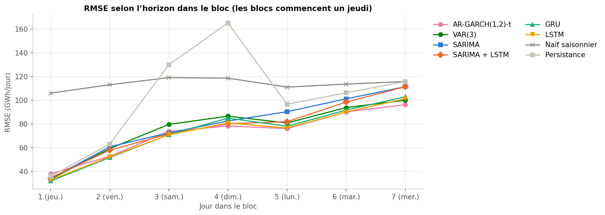

*Figure 13 — RMSE selon l'horizon de prévision.* À l'horizon 1, les modèles dynamiques sont à égalité ; l'erreur croît ensuite, et l'avantage d'AR-GARCH apparaît aux horizons les plus longs.


À l'horizon 1, les modèles dynamiques (réseaux, VAR, SARIMA, VECM, persistance) sont à égalité, avec une RMSE de 32 à 38 GWh/jour : la persistance de la consommation suffit. L'erreur croît ensuite jusqu'à 96–111 GWh/jour à l'horizon 7 ; Prophet, sans mémoire à court terme, est mauvais dès l'horizon 1 (99,63 GWh/jour). Le détail est en annexe A (tableau 36).

## 6.4 Prévisions du 1er au 7 septembre 2026

Chaque modèle est réestimé sur toutes les observations jusqu'au 31 août 2026 et prévoit les sept jours suivants (horizon h = 7) ; ces prévisions ne concernent pas octobre. Les valeurs réelles de septembre ne figurent pas dans `data/daily.csv` : aucune erreur ne peut donc être calculée.

**Tableau 23 — Prévisions de consommation du 1er au 7 septembre 2026 (GWh/jour).** Les huit modèles s'accordent à moins de 35 GWh/jour près chaque jour ; tous reproduisent le creux du week-end (5 et 6 septembre).


| Date | SARIMA | SARIMA + LSTM | LSTM | GRU | AR-GARCH | VAR(3) | VECM | Prophet |
|---|---|---|---|---|---|---|---|---|
| 1er septembre (mardi) | 1 086,54 | 1 093,08 | 1 095,60 | 1 087,80 | 1 079,10 | 1 097,54 | 1 100,64 | 1 090,11 |
| 2 septembre (mercredi) | 1 090,60 | 1 096,77 | 1 096,01 | 1 090,15 | 1 082,29 | 1 102,98 | 1 110,17 | 1 094,77 |
| 3 septembre (jeudi) | 1 085,84 | 1 083,02 | 1 100,61 | 1 087,40 | 1 082,22 | 1 099,00 | 1 108,48 | 1 094,20 |
| 4 septembre (vendredi) | 1 074,40 | 1 069,49 | 1 086,72 | 1 070,77 | 1 064,36 | 1 083,43 | 1 086,69 | 1 080,21 |
| 5 septembre (samedi) | 977,91 | 969,79 | 980,75 | 962,05 | 954,01 | 973,08 | 977,74 | 972,48 |
| 6 septembre (dimanche) | 938,23 | 930,29 | 936,71 | 910,15 | 906,98 | 923,66 | 933,00 | 925,55 |
| 7 septembre (lundi) | 1 056,45 | 1 044,81 | 1 078,25 | 1 046,23 | 1 049,73 | 1 067,23 | 1 071,65 | 1 071,15 |

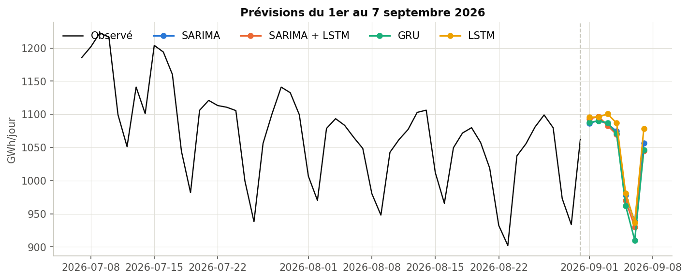

*Figure 14 — Prévisions du 1er au 7 septembre 2026.* Les prévisions des huit modèles forment un faisceau étroit autour du profil hebdomadaire attendu.


Les **intervalles de prévision à 95 %** des modèles qui en fournissent (SARIMA, VAR, VECM, AR-GARCH, Prophet) figurent en annexe A (tableau 37) ; les réseaux et l'hybride ne donnent que des prévisions ponctuelles. Les intervalles sont nominaux : ils sont gaussiens (sauf AR-GARCH, de loi de Student) et ignorent l'incertitude sur les paramètres.

## 6.5 Significativité des écarts : test de Diebold–Mariano

Une RMSE plus faible sur la période observée ne démontre pas une meilleure précision attendue. Le test de **Diebold–Mariano** compare deux modèles sur la perte moyenne de chaque bloc complet de 7 jours (horizons 1 à 7 mélangés), avec une variance HAC de Newey–West à poids de Bartlett (3 retards hebdomadaires) et l'approximation normale. Nous testons **les 45 paires** de modèles, avec la correction de Holm sur toute la famille, séparément pour chaque perte ; une analyse de sensibilité à 1, 2 et 4 retards est exportée.

**L'étiquette « non significatif » porte sur la perte quadratique** : les conclusions formelles du notebook utilisent cette perte et les p-values corrigées ; la perte absolue est un complément exploratoire. Le nombre de rejets à 5 % sur les 45 paires dépend de la perte (p corrigées : 7 en perte quadratique, 17 en perte absolue ; p brutes : 23 et 24).

**Tableau 24 — AR-GARCH contre chacun des autres modèles (Diebold–Mariano).** Après correction de Holm, AR-GARCH n'est distingué ni de SARIMA, ni de LSTM, GRU, VAR(3) ou de l'hybride ; il l'est de Prophet et de la persistance, et du naïf saisonnier en perte absolue seulement.


| Modèle comparé | p brute, perte quadratique | p corrigée, perte quadratique | p corrigée, perte absolue |
|---|---|---|---|
| LSTM | 0,913 | 1,000 | 1,000 |
| GRU | 0,712 | 1,000 | 1,000 |
| VAR(3) | 0,054 | 1,000 | 0,097 |
| SARIMA + LSTM | 0,265 | 1,000 | 1,000 |
| SARIMA | 0,037 | 0,890 | 1,000 |
| VECM(12, r = 1) | 0,036 | 0,890 | 0,053 |
| Prophet | 0,001 | 0,029 | 0,0005 |
| Persistance | < 0,001 | < 0,001 | < 0,001 |
| Naïf saisonnier | 0,004 | 0,157 | 0,0005 |

**Cas où la perte absolue donne une conclusion différente.** Dix paires sont significatives après Holm en perte absolue seulement (annexe A, tableau 38) : toutes opposent un modèle dynamique au naïf saisonnier (AR-GARCH, SARIMA, LSTM, GRU, hybride, VAR(3) : p corrigées de 0,0005 à 0,040 en perte absolue contre 0,157 à 0,391 en perte quadratique), à Prophet (LSTM, SARIMA, VAR(3)) ou, pour le VECM, à la persistance. Les différences entre modèles dynamiques ne ressortent dans aucun cas. Les 45 paires figurent en annexe A (tableau 39). La correction de Holm sur 45 paires est très prudente : elle réduit fortement la puissance, et une différence non significative ne démontre pas l'équivalence des modèles.

Les comparaisons demandées par le sujet (LSTM contre GRU, meilleur réseau contre SARIMA et contre le naïf saisonnier, hybride contre SARIMA, VAR(3) contre SARIMA) ne sont pas significatives en perte quadratique après correction ; en perte absolue, seule la comparaison du meilleur réseau au naïf saisonnier l'est (p corrigée de 0,008 ; annexe A, tableau 40).

## 6.6 Quel modèle pour quel usage ?

Pour un **gestionnaire de réseau** qui doit anticiper la consommation à sept jours, la performance brute ne départage pas les cinq meilleurs modèles (écarts de RMSE de 74,45 à 82,38 GWh/jour, non significatifs après correction). Le choix repose donc sur les autres critères.

**Tableau 25 — Choix du modèle selon le cas d'usage.** AR-GARCH reste recommandé, malgré des intervalles trop étroits en hiver ; le GRU et le LSTM sont les meilleurs challengers, au prix de l'interprétabilité et sans intervalles.


| Critère | AR-GARCH(1,2)-t | SARIMA | VAR(3) | LSTM / GRU | Prophet |
|---|---|---|---|---|---|
| Précision (RMSE de test) | meilleure (74,45) | 82,38 | 78,96 | 75,07 / 76,40 | 101,79 |
| Couverture des intervalles à 95 % sur le test | 95,9 % (86,9 % sur les plis d'hiver de la validation croisée) | 94,4 % | 93,1 % | aucun | 88,5 % (trop étroits) |
| Interprétabilité | élevée | élevée | élevée | faible | élevée |
| Coût d'un ajustement | 0,10 s | 2,08 s | 0,02 s | 7,73 s / 15,18 s, × 5 graines | 1,78 s × 56 |
| RMSE moyenne de la validation croisée : cinq plis (plis d'hiver) | 96,74 (136,65) | 107,89 (154,97) | non mesurée | 99,62 / 96,54 (141,46 / 138,80) | non mesurée |

**Notre recommandation** est de retenir un modèle de type **AR-GARCH(1,2)-t** comme modèle opérationnel : il est le meilleur observé sur le test, à égalité avec le GRU en validation croisée (RMSE moyenne de 96,74 contre 96,54 GWh/jour ; annexe A, tableau 41), interprétable, quasi instantané, et le seul de ces deux modèles à fournir des intervalles. **Ces intervalles sont toutefois trop étroits en hiver** : leur couverture, de 95,9 % sur le test, n'est que de 86,9 % sur les plis d'hiver de la validation croisée et de 67,9 % pendant l'hiver 2022-23. En exploitation, il faudrait les élargir en hiver ou modéliser une variance saisonnière. Le **SARIMA** reste la référence statistique justifiée par la règle de validation, et le **GRU ou le LSTM** le meilleur challenger : ils battent le SARIMA dans la quasi-totalité des plis de la validation croisée, surtout en hiver, mais sans intervalles, sans interprétation et pour un coût plus élevé. Combiner les prévisions (par exemple moyenne d'AR-GARCH et d'un réseau) est une piste naturelle, non évaluée ici. **Prophet n'est pas adapté** à la prévision à sept jours. Cette recommandation reste conditionnelle : un seul hiver de test, des écarts non significatifs, et une validation croisée où AR-GARCH n'est le meilleur dans aucun pli.


# 7 — Extensions

Les extensions du sujet sont traitées de trois manières : des **variables exogènes** (jour férié, jour de la semaine et harmoniques annuelles pour le VAR, le VECM, l'AR-GARCH, Prophet et les réseaux ; température comme variable endogène du VAR ; degrés-jours `hdd` et `cdd` dans les contrefactuels), l'**étude de la corrélation dynamique** entre température et consommation (7.1) et l'**analyse contrefactuelle** des effets du premier confinement et de la sobriété (7.2). Nous n'avons pas appliqué de détection d'événements par embeddings de texte.

## 7.1 Corrélation glissante entre température et consommation

Cette extension, implémentée en R (`06_section3_R.ipynb`), étudie si le lien température–consommation est stable ou change selon la saison et au fil des années.

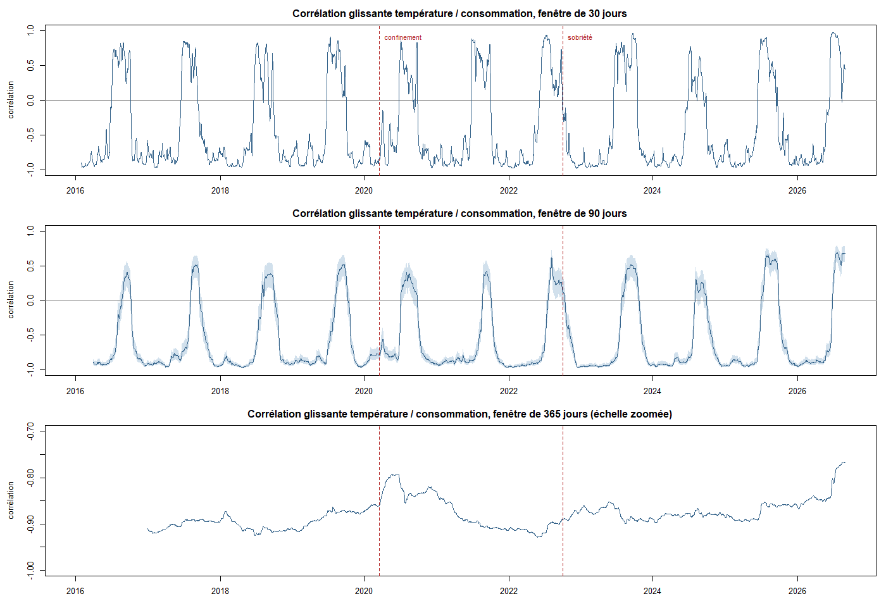

*Figure 15 — Corrélation glissante entre température et consommation (30, 90 et 365 jours).* Le lien est négatif de l'automne au printemps (on chauffe) et devient positif chaque fin d'été (on climatise) ; sur 365 jours il reste fort, avec deux affaiblissements en 2020 et en 2026.


- **Le lien dépend de la saison.** Sur 90 jours, la corrélation reste autour de −0,90 d'octobre à juin et devient positive chaque fin d'été, jusqu'à +0,69. C'est la courbe en U de la section 2.6 vue dans le temps. Sur 30 jours, les bascules sont plus brutales (de −0,98 à +0,97) : la fenêtre est courte et sensible à une seule vague de chaleur ou de froid.
- **Sur 365 jours**, le lien reste fort (de −0,93 à −0,77), avec deux affaiblissements : 2020 (le confinement réduit la consommation sans lien avec la météo) et 2026 (l'été 2026 est le plus chaud de la série : 260 degrés-jours de climatisation de juin à août, contre 137 au précédent maximum, en 2022).
- **Le lien n'est pas une coïncidence de calendrier** : une fois l'effet du calendrier retiré (jusqu'à −301 GWh/jour pour un dimanche férié par rapport à un mardi), la corrélation sur toute la période passe de −0,83 à −0,86 ; elle garde la même forme saisonnière sur les variations journalières (annexe A, tableau 34).
- **D'un hiver à l'autre**, la corrélation d'hiver est stable (de −0,88 à −0,95), sauf en 2019-2020 (−0,68), qui inclut le début du confinement, et la pente reste comprise entre −40,2 et −56,5 GWh/jour par °C sans tendance (annexe A, tableau 35). En revanche, la consommation estimée à 8 °C passe de 1 513–1 575 GWh/jour (hivers 2016-17 à 2019-20) à 1 424–1 469 GWh/jour depuis l'hiver 2022-23.

**Tableau 26 — Effet de la sobriété sur la sensibilité au froid.** À température égale, la consommation d'hiver a baissé d'environ 98 GWh/jour depuis octobre 2022, sans changement significatif de pente (p = 0,756).


| Terme de la régression d'hiver | Estimation (GWh/jour) | Écart-type | p-value |
|---|---|---|---|
| Constante | 1 929,55 | 16,22 | < 0,001 |
| Température (pente avant octobre 2022, par °C) | −48,42 | 1,69 | < 0,001 |
| Après octobre 2022 (décalage de niveau) | −98,42 | 22,78 | < 0,001 |
| Température × après (changement de pente, par °C) | +0,71 | 2,30 | 0,756 |

La courbe consommation–température s'est donc **décalée vers le bas sans changer de pente** : la sobriété a surtout abaissé la consommation de base (intervalle à 95 % de la baisse : environ 54 à 143 GWh/jour). La régression attribue à la sobriété toute baisse survenue après octobre 2022 : le prix de l'énergie et le ralentissement industriel ne sont pas séparés.

## 7.2 Contrefactuels : premier confinement et sobriété

Cette analyse (`03_contrefactuels.ipynb`) répond à la question : combien d'électricité la France n'a-t-elle pas consommée à cause du premier confinement de 2020 et de la crise énergétique ? Le principe est celui de la méthode de l'INSEE : apprendre la relation « normale » entre consommation, météo et calendrier sur une période sans choc, prédire ce qu'aurait été la consommation pendant le choc, puis mesurer l'écart **réel − contrefactuel** (un écart négatif signifie que la France a consommé moins que prévu).

### Modèle de référence et validation

Le modèle est une régression linéaire (moindres carrés) de la consommation journalière sur 20 variables explicatives et une constante : degrés-jours de chauffage `hdd`, `hdd` lissé sur 3 jours (inertie thermique des bâtiments), `cdd` ; jour de la semaine (6 indicatrices), jour férié, période de Noël et 1–20 août ; quatre paires de termes de Fourier annuels. Aucune tendance n'est ajoutée : elle dégrade la validation (extrapolation risquée). Ce modèle est **indépendant des modèles de prévision** ; pour ne pas toucher à la période de test, l'analyse de la sobriété s'arrête à l'hiver 2024-25.

**Tableau 27 — Validation du modèle contrefactuel en période sans choc.** Le modèle prédit une année inconnue avec une erreur de 2,6 %, mais il « détecte » à tort un écart d'environ −1,1 % sur un hiver sans choc : c'est son biais.


| Test | Erreur moyenne (MAPE) | Biais | R² d'apprentissage |
|---|---|---|---|
| 2019 (appris sur 2016-2018) | 2,58 % | −1,20 % | 0,978 |
| Placebo : hiver 2018-19 (appris jusqu'en septembre 2018) | 2,49 % | −1,09 % | 0,979 |

Ce **biais en période normale**, que nous attribuons à un léger recul tendanciel de la consommation, signifie qu'un écart n'est attribuable à un choc que s'il dépasse nettement 1 à 1,5 %, et que les effets estimés peuvent être **surestimés d'environ 1 point**.

### Résultats

**Tableau 28 — Effet du premier confinement.** Le premier confinement a réduit la consommation d'environ 8,06 TWh (−12,2 %) ; sur la fenêtre de l'INSEE, −13,48 % contre −14 % publié.


| Fenêtre | Réel (TWh) | Contrefactuel (TWh) | Écart (TWh) | Écart (%) |
|---|---|---|---|---|
| Confinement complet, 17 mars – 10 mai 2020 | 58,04 | 66,10 | −8,06 | −12,20 |
| Fenêtre INSEE, 23 mars – 26 avril 2020 | 37,44 | 43,27 | −5,83 | −13,48 |

Le modèle est appris du 1er janvier 2016 au 29 février 2020, avant toute mesure sanitaire. L'effet est maximal fin mars puis s'atténue : la consommation résidentielle augmente (télétravail) et l'activité reprend. En retirant le biais du modèle, l'effet propre du confinement est d'environ −11 %. La valeur de −14 % de l'INSEE (note de conjoncture de mai 2020) est citée dans le notebook et n'a pas été revérifiée pour ce rapport.

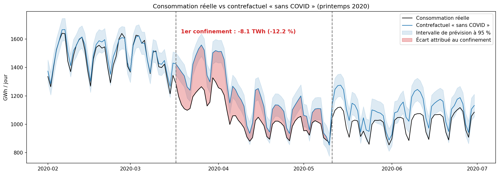

*Figure 16 — Contrefactuel du premier confinement.* La consommation observée passe sous le contrefactuel dès la mi-mars 2020, avec un écart maximal fin mars, puis l'écart se résorbe.


**Tableau 29 — Effet de la crise énergétique et de la sobriété.** La baisse est de 8,27 % en 2022-23 et ne disparaît pas ensuite (7,19 % puis 6,57 %), ce qui suggère une part structurelle.


| Hiver | Réel (TWh) | Contrefactuel (TWh) | Écart (TWh) | Écart (%) |
|---|---|---|---|---|
| 2022-23 | 243,54 | 265,49 | −21,96 | −8,27 |
| 2023-24 | 244,42 | 263,36 | −18,95 | −7,19 |
| 2024-25 | 252,26 | 269,99 | −17,74 | −6,57 |

Le modèle est appris sur 2016-2019 uniquement (comportement d'avant les crises, COVID exclu). À météo et calendrier égaux, la consommation de l'hiver 2022-23 est inférieure de 8,27 % (environ 22 TWh) à celle qu'aurait produite le comportement de 2016-2019 ; le notebook cite une estimation de RTE d'« environ 9 % » par rapport à 2014-2019 (non revérifiée ici), cohérente malgré des périodes de référence proches mais non identiques. Le décrochage commence en septembre-octobre 2022 et culmine en novembre 2022 (−10,4 % d'après le notebook). **La baisse ne disparaît pas** (−7,19 % en 2023-24, −6,57 % en 2024-25) : une partie de la sobriété semble devenue structurelle (habitudes, équipements, industrie électro-intensive), hypothèse que ce modèle ne permet pas de démontrer. La régression d'hiver du tableau 26, obtenue par une autre méthode, va dans le même sens. Avant la crise (2021-22), les écarts restent entre 0 et −4 %, ce qui borne l'incertitude de la mesure.

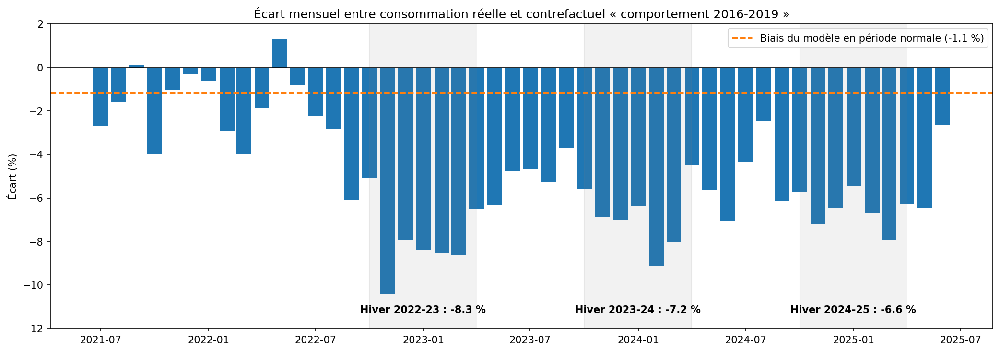

*Figure 17 — Écart mensuel entre consommation réelle et contrefactuel.* La consommation est inférieure au contrefactuel à partir de l'automne 2022, de façon durable, avec un creux de −10,4 % en novembre 2022.


### Limites

Le biais d'environ −1 % pourrait surestimer les effets. Les résidus de la régression sont autocorrélés : les intervalles de prévision à 95 % sont probablement trop étroits. La température nationale n'est pas pondérée par la population. Le contrefactuel attribue au choc tout ce que le modèle n'explique pas (prix de l'électricité, activité économique, évolution du parc : pompes à chaleur, véhicules électriques). Les références officielles (INSEE, RTE) sont reprises du notebook.


# 8 — Discussion critique

## 8.1 Ce que les résultats montrent

1. **Le calendrier compte probablement autant que le choix du modèle.** Les modèles des sections 3.2 à 4.3 utilisent le jour férié et un cycle annuel que le SARIMA n'a pas. Le témoin (AR avec calendrier, sans GARCH, RMSE 74,06 GWh/jour) fait aussi bien que le meilleur modèle : une part importante du gain vient vraisemblablement de l'information de calendrier et d'une moyenne bien choisie (retards 1, 2, 7, 8 et 14), plutôt que de la sophistication du modèle. Nous n'avons pas isolé cet effet par une expérience dédiée (par exemple un SARIMA avec les mêmes régresseurs) : c'est une hypothèse, pas un résultat.
2. **Le GARCH sert à quantifier l'incertitude, pas à prévoir la moyenne.** Il améliore la couverture (95,9 % contre 93,3 %) d'intervalles qui restent trop étroits en hiver, pas la RMSE. Son lien avec les événements connus est partiel (section 3.3).
3. **La température explique beaucoup la consommation (Granger, réponse impulsionnelle), mais le VAR(3) prévoit moins bien (78,96 GWh/jour) que l'AR creux avec calendrier (74,06).** Deux explications possibles, non départagées : sans météo future, la température prévue par le VAR apporte peu à sept jours ; et le VAR(3) n'a pas les retards hebdomadaires 7 et 8.
4. **Les réseaux de neurones sont compétitifs sans être meilleurs de façon établie.** Le LSTM (75,07) et le GRU (76,40) se classent juste derrière AR-GARCH sur le test, et battent le SARIMA dans la quasi-totalité des plis de la validation croisée, mais aucune différence n'est significative après correction de Holm. Le calendrier est ce qui les améliore le plus en validation (39,37 contre 46,55 GWh/jour pour le LSTM).
5. **L'hybride apporte un gain faible et ambigu** (RMSE −3,0 % par rapport au SARIMA, MAE et MAPE en légère hausse, différence non significative).
6. **Le VECM n'est pas adapté** : le rang de Johansen est plein et la vitesse de correction n'est pas robuste (de 13 jours à aucune correction selon le nombre de retards).
7. **Prophet est le moins adapté** à la prévision à sept jours parmi les modèles statistiques, faute de mémoire à court terme.
8. **Les résultats ne dépendent pas du logiciel** : la réplication en R reproduit 25 éléments sur 27 à 0,1 % près.

## 8.2 Pourquoi les sensibilités à la température diffèrent

Le rapport cite quatre sensibilités de la consommation à la température : environ **−56 GWh/jour par °C** (section 2.6, pente sous 15 °C), **−48 GWh/jour par °C** (section 7.1, pente d'hiver avant la sobriété), **−24 GWh/jour par °C** (section 3.2, réponse impulsionnelle du VAR) et **−82 GWh/jour par °C** (section 3.2, relation de long terme du VECM). Elles ne mesurent pas la même chose : les deux premières sont des pentes observées par temps froid, sur des échantillons différents (jours sous 15 °C sur toute la période pour −56, jours d'hiver pour −48) ; la réponse impulsionnelle est un effet moyen sur toute l'année, été sans chauffage compris, ce qui l'atténue ; la relation du VECM est imposée avec un rang que le test de Johansen ne soutient pas, et varie du simple au double selon le nombre de retards (de 61,8 à 134,1). Elles ne sont donc pas comparables.

## 8.3 Limites des modèles et du protocole

- **Hypothèses violées.** Tous les modèles laissent des résidus non normaux ; le SARIMA, le VAR, le VECM et Prophet gardent de l'hétéroscédasticité (que seul le GARCH traite), et le VAR, le VECM et Prophet de l'autocorrélation. Le diagnostic demandé est réalisé, mais il contredit les hypothèses ; les intervalles gaussiens sont des approximations.
- **Instabilité des estimations.** La vitesse de correction du VECM change de signe selon le nombre de retards ; la persistance du GARCH proche de 1 traduit une variance saisonnière non modélisée ; les paramètres du GARCH diffèrent légèrement entre `arch` et `rugarch`.
- **Échantillon.** Un seul découpage chronologique et un test de 390 jours, soit un seul hiver : une vague de froid exceptionnelle peut dominer les erreurs. La validation interne (huit semaines d'été) est peu représentative de l'hiver et a été partiellement réutilisée pendant le développement ; les ordres du VAR sont choisis sur un échantillon que l'analyse exploratoire avait déjà vu. La validation croisée temporelle (cinq plis de 56 jours) corrige en partie ce défaut pour les réseaux, le SARIMA et AR-GARCH seulement.
- **Protocoles légèrement différents.** Prophet est réajusté chaque semaine, les autres modèles gardent des paramètres fixes ; l'hybride est pseudo hors échantillon ; les tests de Diebold–Mariano portent sur 385 jours et les métriques sur 390.
- **Tests.** Aucun écart entre modèles dynamiques voisins n'est significatif après Holm ; la perte quadratique est celle des conclusions formelles, et la perte absolue en donne une autre pour dix paires. Les tests asymptotiques sur 55 blocs et la correction sur 45 paires limitent leur puissance.
- **Données.** Les 243 derniers jours (2026) sont des données consolidées, éventuellement révisées. Aucune prévision météo n'est utilisée.
- **Reproductibilité.** Les notebooks ont été exécutés dans des environnements différents (README) ; de petites différences numériques sont possibles.

## 8.4 Avantages et inconvénients de l'IA générative pour l'analyse de séries temporelles en énergie

**Avantages.**
- *Exploration rapide d'hypothèses* : à partir de statistiques descriptives, un LLM peut proposer des familles de modèles et des diagnostics à envisager, ce qui accélère la phase de cadrage et rappelle des pistes oubliées.
- *Vulgarisation et communication* : reformuler des résultats (erreur, intervalle, significativité) pour un décideur est une tâche où un LLM est à l'aise, utile dans un secteur où les décisions sont prises par des non-statisticiens.
- *Productivité* : structuration d'un rapport, génération et relecture de code, traduction entre R et Python.

**Inconvénients et risques.**
- *Hallucination statistique* : un LLM peut produire des p-values, des ordres de modèle ou des causalités plausibles mais non vérifiées ; en énergie, la tentation est grande d'attribuer une baisse de consommation à une cause unique (sobriété, prix, météo) alors que les données ne permettent pas de les séparer (section 7.2).
- *Absence d'accès aux données réelles* : le LLM ne voit que ce qu'on lui transmet ; il ne peut ni vérifier la qualité des données, ni détecter une rupture non décrite, et ses connaissances sur des événements récents (crise de 2022, hivers suivants) peuvent être incomplètes.
- *Simplification excessive* : une vulgarisation fidèle à la moyenne peut masquer l'incertitude (intervalles, un seul hiver de test) et pousser à une surconfiance.
- *Reproductibilité et traçabilité* : une même requête peut donner des réponses différentes ; pour un usage opérationnel (réseau électrique), les décisions doivent reposer sur des résultats calculés et auditables, pas sur un texte généré.
- *Confidentialité et coût* : des données d'exploitation sensibles ne doivent pas être transmises à un service externe sans précaution.

**Notre position.** Le LLM est un outil de cadrage et de communication ; il ne remplace ni les calculs, ni les diagnostics, ni la vérification de chaque affirmation contre les fichiers de résultats (section 5.6).


# 9 — Conclusion

## 9.1 Ce que le projet établit

**Prévision à 7 jours (sections 3 à 6).** Sur le test (390 jours), AR-GARCH(1,2)-t a la plus petite erreur (RMSE 74,45 GWh/jour), mais aucun test de Diebold–Mariano corrigé (Holm) ne le distingue de SARIMA, LSTM, GRU, VAR(3) ni de l'hybride. SARIMA(2,1,1)(0,1,1)[7] est le modèle retenu par la règle de validation interne ; AR-GARCH est le meilleur observé sur le test, à égalité avec le GRU en validation croisée ; nous ne concluons pas à une supériorité durable. Le témoin « AR à variance constante » (RMSE 74,06 GWh/jour) fait aussi bien : l'essentiel du gain vient d'une moyenne autorégressive avec calendrier, non de la sophistication du modèle. Les huit modèles ont une RMSE inférieure à celle de la persistance (109,13) et du naïf saisonnier (113,93) ; l'écart avec la persistance est significatif en perte quadratique pour six d'entre eux (pas pour le VECM ni Prophet) et l'écart avec le naïf saisonnier ne l'est qu'en perte absolue. La validation croisée temporelle confirme l'avantage des réseaux sur le SARIMA : le GRU est meilleur dans les cinq plis et le LSTM dans quatre, surtout en hiver, sans que cela soit testé statistiquement.

**Contrefactuels (section 7.2).** À météo et calendrier égaux, le premier confinement a réduit la consommation d'environ 8,06 TWh (−12,20 % du 17 mars au 10 mai 2020 ; −13,48 % sur la fenêtre de l'INSEE, contre −14 % publié). La sobriété de l'hiver 2022-23 correspond à −21,96 TWh (−8,27 %) ; la baisse persiste en 2023-24 (−18,95 TWh, −7,19 %) et en 2024-25 (−17,74 TWh, −6,57 %). Une régression indépendante (section 7.1) montre que la consommation de base a baissé d'environ 98 GWh/jour sans changement significatif de la sensibilité au froid (−48,42 contre −47,71 GWh/jour par °C, p = 0,756). Ces effets sont possiblement surestimés d'environ 1 point (biais du modèle en période normale).

**Reproductibilité entre logiciels (section 3.4).** Les analyses statistiques refaites en R donnent les mêmes conclusions que Python : 25 éléments sur 27 sont identiques à 0,1 % près.

## 9.2 Recommandation d'usage

Pour un gestionnaire de réseau qui prévoit la consommation à sept jours, nous recommandons un modèle de type AR-GARCH(1,2)-t, à condition d'élargir ses intervalles en hiver, avec le SARIMA comme référence statistique et le GRU ou le LSTM comme challengers (section 6.6). Prophet n'est pas adapté à cet horizon.

## 9.3 Limites générales

- **Un seul hiver de test** : les classements entre modèles voisins peuvent changer d'une année à l'autre ; la supériorité observée d'AR-GARCH n'est pas établie statistiquement.
- **Validation courte et estivale** (56 jours), partiellement réutilisée pendant le développement ; la validation croisée temporelle (cinq plis de 56 jours) ne porte que sur les réseaux, le SARIMA, AR-GARCH et le naïf saisonnier.
- **Pas de météo future** : c'est la principale source d'erreur en hiver. Les modèles qui utilisent le calendrier ont un avantage sur le SARIMA.
- **Protocoles légèrement différents** (Prophet réajusté chaque semaine, hybride pseudo hors échantillon, tests sur 385 jours contre 390 pour les métriques).
- **Diagnostics résiduels défavorables** pour tous les modèles statistiques : les intervalles gaussiens à 95 % sont des approximations, sans garantie de couverture future.
- **Cointégration non soutenue** : le VECM n'est estimé à r = 1 que parce que le sujet le demande.
- **Contrefactuels** : température non pondérée par la population, biais d'environ −1 %, attribution au choc de tout ce que le modèle n'explique pas.
- **Données** : 243 jours consolidés (2026) dans le test ; données brutes absentes du dépôt (le notebook de préparation affiche les adresses de téléchargement).

## 9.4 Prolongements

Évaluer les modèles sur plusieurs hivers ; intégrer une prévision météo externe ; ajouter les mêmes régresseurs de calendrier au SARIMA pour isoler leur effet ; modéliser une variance saisonnière ou élargir en hiver les intervalles d'AR-GARCH ; combiner les prévisions ; élargir la recherche d'architectures des réseaux avec une validation plus longue ; pondérer la température par la population dans les contrefactuels. Ces pistes ne sont pas évaluées ici.

Les prévisions du 1er au 7 septembre 2026 sont une référence descriptive, non une aide à la décision d'exploitation du réseau : elles reposent sur un seul test, des intervalles approximatifs et aucune donnée météo.


<div class="saut"></div>

# Annexe A — Tableaux détaillés

## A.1 Candidats SARIMA sur la validation interne

**Tableau 30 — Quinze modèles comparés sur la validation interne (3 450 jours d'estimation, huit blocs de sept jours).** Les AIC et BIC sont donnés à titre informatif : on ne les compare pas entre différenciations différentes.


| Modèle | RMSE (GWh/jour) | MAE (GWh/jour) | AIC | BIC |
|---|---|---|---|---|
| SARIMA(2,1,1)(0,1,1)[7] | 42,67 | 32,60 | 35 807,95 | 35 838,67 |
| SARIMA(2,1,2)(0,1,1)[7] | 42,81 | 32,74 | 35 808,26 | 35 845,12 |
| SARIMA(1,1,0)(0,1,1)[7] | 42,97 | 31,11 | 35 876,30 | 35 894,74 |
| SARIMA(1,1,0)(1,0,1)[7] | 43,01 | 31,14 | 35 957,99 | 35 982,58 |
| SARIMA(0,1,1)(0,1,1)[7] | 43,05 | 30,99 | 35 860,60 | 35 879,03 |
| SARIMA(1,1,0)(1,1,1)[7] | 43,25 | 32,09 | 35 906,24 | 35 930,81 |
| SARIMA(1,1,1)(0,1,1)[7] | 43,37 | 31,12 | 35 859,82 | 35 884,40 |
| SARIMA(3,1,1)(0,1,1)[7] | 43,47 | 33,84 | 35 886,94 | 35 923,80 |
| SARIMA(1,0,0)(1,0,1)[7] | 47,25 | 34,38 | 36 058,09 | 36 088,82 |
| `auto_arima` saisonnier : SARIMA(2,1,1)(1,0,0)[7] | 48,10 | 36,83 | 37 145,48 | 37 176,21 |
| Naïf saisonnier | 55,22 | 44,04 | — | — |
| `auto_arima` non saisonnier : ARIMA(2,1,2) | 74,23 | 59,01 | 39 583,83 | 39 614,56 |
| Naïf « dernière valeur » | 88,59 | 67,73 | — | — |
| ARIMA(1,1,0) | 88,92 | 67,68 | 40 355,59 | 40 367,88 |
| ARIMA(0,1,1) | 89,21 | 67,84 | 40 236,05 | 40 248,34 |

## A.2 SARIMA retenu : erreurs selon l'horizon

**Tableau 31 — Erreurs du SARIMA(2,1,1)(0,1,1)[7] selon l'horizon sur le test externe.** L'erreur croît avec l'horizon ; les horizons 6 et 7 ont une observation de moins car le dernier bloc compte cinq jours.


| Horizon (jours) | Observations | RMSE (GWh/jour) | MAE (GWh/jour) | Biais (GWh/jour) | Couverture à 95 % | Largeur moyenne de l'intervalle (GWh/jour) |
|---|---|---|---|---|---|---|
| 1 | 56 | 33,83 | 22,99 | −0,84 | 96,4 % | 170,46 |
| 2 | 56 | 60,66 | 41,77 | 5,18 | 94,6 % | 262,95 |
| 3 | 56 | 72,48 | 51,30 | 3,73 | 98,2 % | 326,09 |
| 4 | 56 | 82,46 | 59,32 | −2,34 | 91,1 % | 371,70 |
| 5 | 56 | 90,30 | 60,41 | −3,24 | 96,4 % | 406,59 |
| 6 | 55 | 101,16 | 64,80 | 6,90 | 92,7 % | 434,70 |
| 7 | 55 | 111,38 | 71,76 | −0,59 | 90,9 % | 458,32 |

## A.3 VECM : robustesse de la vitesse de correction

**Tableau 32 — Vitesse de correction du VECM selon le nombre de retards en différences.** La vitesse de correction change de signe et β varie du simple au double : elle n'est lisible que comme un ordre de grandeur.


| Retards en différences k | α (consommation) | p-value de α | α (température) | β (température) | Demi-vie (jours) |
|---|---|---|---|---|---|
| 2 | −0,052 | < 0,001 | −0,0026 | 61,8 | 12,9 |
| 8 | 0,007 | 0,028 | −0,0017 | 134,1 | aucune correction |
| 12 | −0,018 | 0,004 | −0,0023 | 82,1 | 37,9 |

## A.4 Réplication R et Python : les 27 éléments comparés

**Tableau 33 — Comparaison R et Python, 27 éléments.** 25 éléments sur 27 coïncident à 0,1 % près ; les deux écarts supérieurs concernent le GARCH.


| Élément | Python | R | Écart relatif |
|---|---|---|---|
| ADF consommation (brute) | −4,101 | −4,101 | 0,00 % |
| KPSS consommation (brute) | 0,403 | 0,403 | 0,00 % |
| SARIMA retenu : RMSE test | 82,382 | 82,377 | 0,01 % |
| SARIMA : couverture 95 % | 0,944 | 0,944 | 0,00 % |
| ADF température | −3,478 | −3,478 | 0,00 % |
| Ordre VAR (BIC / AIC) | 3,000 | 3,000 | 0,00 % |
| VAR(3) : RMSE validation | 48,366 | 48,366 | 0,00 % |
| Granger temp → conso (F) | 118,573 | 118,573 | 0,00 % |
| Granger conso → temp (F) | 6,606 | 6,606 | 0,00 % |
| Causalité instantanée (chi2) | 618,100 | 618,050 | 0,01 % |
| IRF : pic de réponse (GWh, jour 1) | −29,400 | −29,399 | 0,00 % |
| Johansen trace r = 0 | 337,720 | 337,716 | 0,00 % |
| Johansen trace r ≤ 1 | 39,550 | 39,551 | 0,00 % |
| VECM β_temp | 82,078 | 82,078 | 0,00 % |
| VECM α_conso | −0,018 | −0,018 | 0,07 % |
| VECM demi-vie (jours) | 37,900 | 37,923 | 0,06 % |
| VAR : RMSE test | 78,957 | 78,957 | 0,00 % |
| VAR : couverture 95 % | 0,931 | 0,931 | 0,02 % |
| VECM : RMSE test | 87,562 | 87,562 | 0,00 % |
| VECM : couverture 95 % | 0,913 | 0,913 | 0,02 % |
| BIC de l'AR[1,2,7,8,14] | 35 533,900 | 35 533,900 | 0,00 % |
| GARCH α1 | 0,337 | 0,336 | 0,35 % |
| GARCH β1 + β2 | 0,663 | 0,663 | 0,03 % |
| GARCH ν (Student) | 4,099 | 4,097 | 0,04 % |
| AR-GARCH : RMSE test | 74,453 | 74,443 | 0,01 % |
| AR-GARCH : couverture 95 % | 0,959 | 0,956 | 0,27 % |
| Témoin : RMSE test | 74,062 | 74,062 | 0,00 % |

## A.5 Corrélation température–consommation selon le mois

**Tableau 34 — Corrélation selon le mois, sur les niveaux et sur les variations journalières.** Les deux colonnes ont la même forme : le lien saisonnier n'est pas une coïncidence de calendrier.


| Mois | Corrélation sur les niveaux | Corrélation sur les variations |
|---|---|---|
| janvier | −0,92 | −0,68 |
| février | −0,88 | −0,77 |
| mars | −0,91 | −0,80 |
| avril | −0,91 | −0,81 |
| mai | −0,89 | −0,69 |
| juin | −0,85 | −0,49 |
| juillet | −0,41 | −0,09 |
| août | 0,31 | 0,26 |
| septembre | 0,34 | 0,36 |
| octobre | −0,40 | 0,19 |
| novembre | −0,83 | −0,21 |
| décembre | −0,93 | −0,57 |

## A.6 Sensibilité à la température de chaque hiver

**Tableau 35 — Corrélation, pente et consommation estimée à 8 °C pour chaque hiver.** La pente reste comprise entre −40,2 et −56,5 GWh/jour par °C, tandis que le niveau à 8 °C baisse après l'hiver 2021-2022.


| Hiver | Jours | Corrélation | Pente (GWh/jour par °C) | Consommation à 8 °C (GWh/jour) |
|---|---|---|---|---|
| 2016-2017 | 151 | −0,924 | −50,8 | 1 557 |
| 2017-2018 | 151 | −0,903 | −44,9 | 1 575 |
| 2018-2019 | 151 | −0,883 | −47,8 | 1 548 |
| 2019-2020 | 152 | −0,675 | −40,2 | 1 513 |
| 2020-2021 | 151 | −0,898 | −46,3 | 1 506 |
| 2021-2022 | 151 | −0,936 | −56,5 | 1 524 |
| 2022-2023 | 151 | −0,950 | −50,1 | 1 424 |
| 2023-2024 | 152 | −0,921 | −47,8 | 1 450 |
| 2024-2025 | 151 | −0,910 | −48,2 | 1 453 |
| 2025-2026 | 151 | −0,890 | −45,0 | 1 469 |

## A.7 RMSE par horizon pour les dix modèles

**Tableau 36 — RMSE selon l'horizon de prévision (GWh/jour).** Les modèles dynamiques sont à égalité à l'horizon 1 ; Prophet est mauvais dès l'horizon 1.


| Horizon (jours) | AR-GARCH(1,2)-t | LSTM | GRU | VAR(3) | SARIMA + LSTM | SARIMA | VECM(12, r=1) | Prophet | Persistance | Naïf saisonnier |
|---|---|---|---|---|---|---|---|---|---|---|
| 1 | 37,9 | 32,7 | 31,8 | 33,4 | 34,6 | 33,8 | 34,2 | 99,6 | 35,8 | 106,0 |
| 2 | 52,6 | 52,1 | 51,6 | 59,2 | 57,8 | 60,7 | 62,7 | 96,4 | 62,9 | 113,0 |
| 3 | 73,6 | 70,8 | 71,0 | 79,6 | 71,6 | 72,5 | 86,4 | 105,8 | 129,9 | 119,0 |
| 4 | 78,3 | 80,9 | 84,9 | 86,5 | 80,2 | 82,5 | 97,5 | 102,9 | 165,1 | 118,6 |
| 5 | 76,0 | 76,5 | 78,0 | 80,8 | 81,9 | 90,3 | 94,2 | 96,4 | 96,5 | 111,0 |
| 6 | 90,2 | 90,1 | 91,7 | 93,8 | 98,5 | 101,2 | 102,7 | 104,0 | 106,3 | 113,6 |
| 7 | 96,2 | 101,3 | 102,9 | 100,0 | 111,3 | 111,4 | 111,0 | 106,9 | 115,8 | 115,8 |

## A.8 Prévisions du 1er au 7 septembre 2026 avec intervalles à 95 %

**Tableau 37 — Prévisions et intervalles nominaux à 95 % (GWh/jour).** Le 1er septembre, l'intervalle d'AR-GARCH est le plus étroit et celui de Prophet le plus large ; tous sont nominaux et ne garantissent pas la couverture future.


| Date | SARIMA | AR-GARCH | VAR(3) | VECM | Prophet |
|---|---|---|---|---|---|
| 1er septembre | 1 086,54 [1 002,32 ; 1 170,76] | 1 079,10 [1 030,19 ; 1 128,01] | 1 097,54 [1 024,67 ; 1 170,40] | 1 100,64 [1 027,94 ; 1 173,34] | 1 090,11 [905,85 ; 1 256,13] |
| 2 septembre | 1 090,60 [960,47 ; 1 220,73] | 1 082,29 [1 004,74 ; 1 159,84] | 1 102,98 [991,52 ; 1 214,44] | 1 110,17 [996,53 ; 1 223,82] | 1 094,77 [928,70 ; 1 261,98] |
| 3 septembre | 1 085,84 [924,27 ; 1 247,41] | 1 082,22 [985,06 ; 1 179,38] | 1 099,00 [963,81 ; 1 234,19] | 1 108,48 [968,81 ; 1 248,15] | 1 094,20 [924,75 ; 1 263,28] |
| 4 septembre | 1 074,40 [890,09 ; 1 258,72] | 1 064,36 [953,10 ; 1 175,61] | 1 083,43 [933,27 ; 1 233,59] | 1 086,69 [928,59 ; 1 244,80] | 1 080,21 [910,60 ; 1 268,07] |
| 5 septembre | 977,91 [776,18 ; 1 179,65] | 954,01 [832,24 ; 1 075,79] | 973,08 [812,76 ; 1 133,40] | 977,74 [805,87 ; 1 149,62] | 972,48 [806,24 ; 1 138,89] |
| 6 septembre | 938,23 [722,48 ; 1 153,98] | 906,98 [776,98 ; 1 036,98] | 923,66 [756,02 ; 1 091,29] | 933,00 [750,61 ; 1 115,40] | 925,55 [766,44 ; 1 080,79] |
| 7 septembre | 1 056,45 [828,94 ; 1 283,96] | 1 049,73 [913,05 ; 1 186,42] | 1 067,23 [894,17 ; 1 240,30] | 1 071,65 [880,09 ; 1 263,21] | 1 071,15 [899,87 ; 1 233,29] |

## A.9 Paires significatives en perte absolue seulement

**Tableau 38 — Dix paires significatives après correction de Holm en perte absolue seulement.** Elles opposent toutes un modèle dynamique au naïf saisonnier, à Prophet ou à la persistance ; aucune ne compare deux modèles dynamiques entre eux.


| Modèle A (plus petite RMSE) | Modèle B | p corrigée, perte quadratique | p corrigée, perte absolue |
|---|---|---|---|
| AR-GARCH(1,2)-t | Naïf saisonnier | 0,157 | < 0,001 |
| SARIMA | Naïf saisonnier | 0,211 | < 0,001 |
| LSTM | Naïf saisonnier | 0,290 | 0,008 |
| VAR(3) | Prophet | 0,100 | 0,018 |
| SARIMA | Prophet | 0,438 | 0,025 |
| GRU | Naïf saisonnier | 0,380 | 0,032 |
| LSTM | Prophet | 0,554 | 0,032 |
| SARIMA + LSTM | Naïf saisonnier | 0,377 | 0,032 |
| VECM(12, r=1) | Persistance | 0,230 | 0,032 |
| VAR(3) | Naïf saisonnier | 0,391 | 0,040 |

## A.10 Les 45 paires du test de Diebold–Mariano

**Tableau 39 — Test de Diebold–Mariano sur les 45 paires de modèles.** Sept paires sont significatives après correction de Holm en perte quadratique et dix-sept en perte absolue.


| Modèle A | Modèle B | p brute, quadratique | p corrigée, quadratique | p brute, absolue | p corrigée, absolue |
|---|---|---|---|---|---|
| AR-GARCH(1,2)-t | LSTM | 0,913 | 1,000 | 0,581 | 1,000 |
| AR-GARCH(1,2)-t | GRU | 0,712 | 1,000 | 0,192 | 1,000 |
| AR-GARCH(1,2)-t | VAR(3) | 0,054 | 1,000 | 0,004 | 0,097 |
| AR-GARCH(1,2)-t | SARIMA + LSTM | 0,265 | 1,000 | 0,120 | 1,000 |
| AR-GARCH(1,2)-t | SARIMA | 0,037 | 0,890 | 0,057 | 1,000 |
| AR-GARCH(1,2)-t | VECM(12, r=1) | 0,036 | 0,890 | 0,002 | 0,053 |
| AR-GARCH(1,2)-t | Prophet | < 0,001 | 0,029 | < 0,001 | < 0,001 |
| AR-GARCH(1,2)-t | Persistance | < 0,001 | < 0,001 | < 0,001 | < 0,001 |
| AR-GARCH(1,2)-t | Naïf saisonnier | 0,004 | 0,157 | < 0,001 | < 0,001 |
| LSTM | GRU | 0,218 | 1,000 | 0,041 | 0,911 |
| LSTM | VAR(3) | 0,576 | 1,000 | 0,308 | 1,000 |
| LSTM | SARIMA + LSTM | 0,228 | 1,000 | 0,208 | 1,000 |
| LSTM | SARIMA | 0,257 | 1,000 | 0,363 | 1,000 |
| LSTM | VECM(12, r=1) | 0,255 | 1,000 | 0,128 | 1,000 |
| LSTM | Prophet | 0,019 | 0,554 | 0,001 | 0,032 |
| LSTM | Persistance | < 0,001 | 0,002 | < 0,001 | < 0,001 |
| LSTM | Naïf saisonnier | 0,009 | 0,290 | < 0,001 | 0,008 |
| GRU | VAR(3) | 0,698 | 1,000 | 0,606 | 1,000 |
| GRU | SARIMA + LSTM | 0,363 | 1,000 | 0,580 | 1,000 |
| GRU | SARIMA | 0,338 | 1,000 | 0,793 | 1,000 |
| GRU | VECM(12, r=1) | 0,293 | 1,000 | 0,240 | 1,000 |
| GRU | Prophet | 0,023 | 0,615 | 0,002 | 0,062 |
| GRU | Persistance | < 0,001 | 0,003 | < 0,001 | < 0,001 |
| GRU | Naïf saisonnier | 0,012 | 0,380 | < 0,001 | 0,032 |
| VAR(3) | SARIMA + LSTM | 0,870 | 1,000 | 0,904 | 1,000 |
| VAR(3) | SARIMA | 0,490 | 1,000 | 0,709 | 1,000 |
| VAR(3) | VECM(12, r=1) | 0,103 | 1,000 | 0,111 | 1,000 |
| VAR(3) | Prophet | 0,003 | 0,100 | < 0,001 | 0,018 |
| VAR(3) | Persistance | < 0,001 | 0,003 | < 0,001 | < 0,001 |
| VAR(3) | Naïf saisonnier | 0,013 | 0,391 | 0,001 | 0,040 |
| SARIMA + LSTM | SARIMA | 0,595 | 1,000 | 0,774 | 1,000 |
| SARIMA + LSTM | VECM(12, r=1) | 0,432 | 1,000 | 0,347 | 1,000 |
| SARIMA + LSTM | Prophet | 0,038 | 0,890 | 0,005 | 0,122 |
| SARIMA + LSTM | Persistance | < 0,001 | < 0,001 | < 0,001 | < 0,001 |
| SARIMA + LSTM | Naïf saisonnier | 0,011 | 0,377 | 0,001 | 0,032 |
| SARIMA | VECM(12, r=1) | 0,403 | 1,000 | 0,157 | 1,000 |
| SARIMA | Prophet | 0,015 | 0,438 | < 0,001 | 0,025 |
| SARIMA | Persistance | < 0,001 | < 0,001 | < 0,001 | < 0,001 |
| SARIMA | Naïf saisonnier | 0,006 | 0,211 | < 0,001 | < 0,001 |
| VECM(12, r=1) | Prophet | 0,020 | 0,554 | 0,005 | 0,122 |
| VECM(12, r=1) | Persistance | 0,007 | 0,230 | 0,001 | 0,032 |
| VECM(12, r=1) | Naïf saisonnier | 0,033 | 0,853 | 0,011 | 0,252 |
| Prophet | Persistance | 0,439 | 1,000 | 0,904 | 1,000 |
| Prophet | Naïf saisonnier | 0,272 | 1,000 | 0,848 | 1,000 |
| Persistance | Naïf saisonnier | 0,647 | 1,000 | 0,970 | 1,000 |

## A.11 Questions de comparaison du sujet

**Tableau 40 — Tests de Diebold–Mariano pour les comparaisons demandées par le sujet.** Aucune de ces différences n'est significative en perte quadratique ; en perte absolue, seule la comparaison du meilleur réseau au naïf saisonnier l'est.


| Question | Modèle A | Modèle B | RMSE de A (GWh/jour) | RMSE de B (GWh/jour) | p corrigée, quadratique | p corrigée, absolue |
|---|---|---|---|---|---|---|
| GRU ou LSTM ? | LSTM | GRU | 75,07 | 76,40 | 1,000 | 0,911 |
| Meilleur réseau contre le naïf saisonnier | LSTM | Naïf saisonnier | 75,07 | 113,93 | 0,290 | 0,008 |
| Meilleur réseau contre SARIMA | LSTM | SARIMA | 75,07 | 82,38 | 1,000 | 1,000 |
| Le LSTM améliore-t-il le SARIMA ? | SARIMA + LSTM | SARIMA | 79,92 | 82,38 | 1,000 | 1,000 |
| Hybride contre meilleur réseau seul | LSTM | SARIMA + LSTM | 75,07 | 79,92 | 1,000 | 1,000 |
| VAR contre SARIMA | VAR(3) | SARIMA | 78,96 | 82,38 | 1,000 | 1,000 |
| Meilleur modèle contre son premier concurrent | AR-GARCH(1,2)-t | LSTM | 74,45 | 75,07 | 1,000 | 1,000 |

## A.12 Validation croisée temporelle d'AR-GARCH et du témoin AR

**Tableau 41 — Validation croisée temporelle : RMSE par pli (GWh/jour), six modèles sur les cinq mêmes plis.** AR-GARCH fait jeu égal avec le GRU en RMSE moyenne (96,74 contre 96,54) et devance le LSTM et le SARIMA, sans être le meilleur dans aucun pli ; sa couverture moyenne n'est que de 91,1 %.


| Modèle | Pli 1 (hiver 2021-22) | Pli 2 (hiver 2022-23) | Pli 3 (été 2023) | Pli 4 (hiver 2024-25) | Pli 5 (été 2025) | Moyenne | Moyenne des plis d'hiver | MAE moyenne | Couverture à 95 % : moyenne (minimum) |
|---|---|---|---|---|---|---|---|---|---|
| GRU | 124,44 | 183,12 | 27,42 | 108,83 | 38,87 | 96,54 | 138,80 | 73,67 | — |
| AR-GARCH(1,2)-t | 118,14 | 195,14 | 33,78 | 96,66 | 39,95 | 96,74 | 136,65 | 77,50 | 91,1 % (67,9 %) |
| Témoin AR à variance constante | 117,50 | 197,36 | 36,59 | 92,88 | 41,15 | 97,10 | 135,91 | 77,26 | 83,9 % (55,4 %) |
| LSTM | 130,09 | 190,43 | 34,33 | 103,87 | 39,37 | 99,62 | 141,46 | 76,50 | — |
| SARIMA | 145,91 | 203,72 | 31,89 | 115,27 | 42,67 | 107,89 | 154,97 | 81,70 | — |
| Naïf saisonnier | 204,24 | 221,90 | 40,02 | 164,84 | 55,22 | 137,24 | 196,99 | 108,47 | — |

**Protocole.** Mêmes cinq plis de 56 jours et mêmes blocs de 7 jours qu'en section 4.1 (`scripts/cv_ar_garch.py`, `exports/cv_ar_garch.csv`). La régression de calendrier et le modèle sont ré-estimés dans chaque pli, sur sa seule période d'apprentissage ; la spécification (retards 1, 2, 7, 8 et 14, GARCH(1,2), loi de Student) reste celle choisie sur tout l'apprentissage, comme pour le SARIMA et les réseaux. Le script reproduit d'abord les prévisions du test externe du notebook 05 (écart maximal inférieur à 0,001 GWh/jour), ce qui garantit que le protocole est le même.

**Lecture.** En RMSE moyenne, AR-GARCH (96,74 GWh/jour) est au niveau du GRU (96,54) et devant le LSTM (99,62) et le SARIMA (107,89) ; en MAE, il est derrière les deux réseaux (77,50 contre 73,67 et 76,50). Il n'a la plus petite RMSE dans aucun pli : le GRU l'a dans 3 plis et le témoin AR dans 2. Le témoin fait aussi bien en moyenne (97,10) : comme sur le test, le GARCH n'améliore pas la prévision ponctuelle. Il améliore les intervalles (couverture moyenne de 91,1 % contre 83,9 %), mais ceux-ci restent trop étroits en hiver (86,9 % sur les trois plis d'hiver, 67,9 % pendant l'hiver 2022-23), loin des 95,9 % du test. Avec cinq plis, aucun de ces écarts n'est testé statistiquement.


<div class="saut"></div>

# Annexe B — Échanges avec les LLM

Cette annexe regroupe les prompts, les réponses intégrales et l'interprétation du groupe (section 5). Les réponses ne sont ni résumées ni corrigées ; leurs limites sont traitées dans l'audit (B.4). **LLM consultés : Claude (Anthropic), modèle Claude Opus 5.5 (identifiant `claude-opus-5-5`), le 11 octobre 2026, pour les prompts (a), (b) et (c) ; ChatGPT (OpenAI) pour le prompt (b).** Les prompts sont générés par `scripts/preparer_prompts_llm.py` à partir des fichiers de résultats ; les fichiers d'origine sont dans `rapport/annexe_llm/`.

## B.1 Essai préliminaire

Deux prompts, portant uniquement sur le modèle SARIMA de la section 3.1, ont été soumis le 9 octobre 2026 à un autre outil (identifié dans `manifest.json`). Ils n'entrent pas dans l'analyse de la section 5 ; les fichiers sont conservés tels quels.

**Tableau 42 — Fichiers de l'essai préliminaire.** L'essai préliminaire est conservé pour mémoire et n'entre pas dans l'analyse de la section 5.


| Objet | Prompt | Réponse intégrale |
|---|---|---|
| Vulgarisation du SARIMA | `01_prompt_vulgarisation.txt` | `01_reponse_integrale.md` |
| Recommandations à partir des prévisions du SARIMA | `02_prompt_recommandations.txt` | `02_reponse_integrale.md` |
| Audit des affirmations des deux réponses | `audit_affirmations.csv` | |

## B.2 Premier tour (Claude) : prompts et réponses intégrales

### Prompt (a) : hypothèses de modèles à partir des statistiques descriptives

````text
Tu es statisticien, spécialiste des séries temporelles. Je prépare un mini-projet sur la consommation électrique quotidienne de la France métropolitaine (RTE éCO2mix), en GWh par jour, du 1er janvier 2016 au 6 août 2025 (3 506 jours consécutifs, période d'apprentissage). Je dispose aussi de la température moyenne nationale (°C), du jour de la semaine et des jours fériés. Le but est de prévoir la consommation à sept jours.

Voici les statistiques descriptives de la série (la différence simple est Δ1 ; la différence saisonnière est de période 7 jours ; KPSS avec constante ; ADF avec choix des retards par AIC) :

- Consommation électrique (GWh/jour) : n = 3506 ; moyenne = 1 258,93 ; variance = 63 882,41 ; écart-type = 252,75 ; minimum = 854,85 ; maximum = 2 150,40 ; skewness = 0,69 ; kurtosis excédentaire = -0,43 ; ADF : statistique = -4,10, p-value = 0,0010 ; KPSS : statistique = 0,40, p-value = 0,0759
- Consommation électrique (différence simple) (GWh/jour) : n = 3505 ; moyenne = -0,09 ; variance = 7 160,41 ; écart-type = 84,62 ; minimum = -284,44 ; maximum = 290,41 ; skewness = 0,44 ; kurtosis excédentaire = 0,44 ; ADF : statistique = -12,21, p-value = 0,0000 ; KPSS : statistique = 0,02, p-value = 0,1000
- Consommation électrique (différence simple et saisonnière) (GWh/jour) : n = 3498 ; moyenne = -0,11 ; variance = 3 601,69 ; écart-type = 60,01 ; minimum = -295,93 ; maximum = 317,07 ; skewness = 0,07 ; kurtosis excédentaire = 2,52 ; ADF : statistique = -18,40, p-value = 0,0000 ; KPSS : statistique = 0,01, p-value = 0,1000
- Température moyenne nationale (°C) : n = 3506 ; moyenne = 13,34 ; variance = 37,91 ; écart-type = 6,16 ; minimum = -3,19 ; maximum = 28,98 ; skewness = 0,05 ; kurtosis excédentaire = -0,94 ; ADF : statistique = -3,48, p-value = 0,0086 ; KPSS : statistique = 0,08, p-value = 0,1000

Ta mission : à partir uniquement de ces statistiques, propose des hypothèses de modèles à tester.
1. Pour chaque famille de modèles que tu proposes (par exemple SARIMA, VAR, GARCH, réseaux de neurones récurrents…), indique les ordres ou réglages plausibles et la statistique précise ci-dessus qui motive l'hypothèse.
2. Indique les choix de différenciation (d, D) et leur justification, en discutant le fait que l'ADF et le KPSS ne concordent pas forcément.
3. Pour chaque hypothèse, précise ce que ces statistiques ne permettent PAS de conclure et quel diagnostic complémentaire il faudrait faire.
4. Si tu cites un chiffre, il doit figurer dans les données ci-dessus ; si une information te manque, dis-le au lieu de la supposer.
Réponds en français, de façon structurée.
````

**Réponse intégrale de Claude au prompt (a)** (`03_reponse_integrale.md`) :

> **Lecture d'ensemble.** Je m'appuie uniquement sur les statistiques fournies. Quand je calcule un rapport à partir de ces chiffres, je le signale ; quand une information manque (autocorrélations, graphiques, lien entre consommation et température), je le dis.
>
> **1. Différenciation (d, D)**
>
> - *Série brute.* L'ADF rejette la racine unitaire (statistique −4,10, p-value 0,0010), et le KPSS ne rejette pas la stationnarité au seuil de 5 % (statistique 0,40, p-value 0,0759), mais il la rejetterait au seuil de 10 %. Les deux tests ne se contredisent donc pas formellement à 5 %, mais la conclusion est fragile : la série est « à la limite ».
> - *Après Δ1.* ADF −12,21 (p-value 0,0000) et KPSS 0,02 (p-value 0,1000) : stationnarité nette. La p-value de 0,1000 est très probablement la borne supérieure de la table du test, pas une valeur exacte.
> - *Après Δ1 puis Δ7.* ADF −18,40 et KPSS 0,01 : stationnarité nette également.
> - *Indice par la variance.* La variance passe de 63 882,41 à 7 160,41 après Δ1, puis à 3 601,69 après Δ1 et Δ7 ; elle est donc divisée par environ 9, puis encore par environ 2 (rapports que je calcule). Une variance qui continue de baisser ne signale pas de sur-différenciation, sans le prouver.
> - *Hypothèses à tester.* (d = 1, D = 1, s = 7) comme choix prudent ; (d = 0, D = 1, s = 7), puisque l'ADF ne demande pas de différence ordinaire ; (d = 1, D = 0) avec le jour de la semaine en variable explicative.
> - *Ce que ces statistiques ne permettent pas de conclure.* L'ADF et le KPSS ne testent pas une racine unitaire saisonnière : le choix de D doit être confirmé par l'ACF aux retards 7, 14, 21 et par un test dédié (OCSB ou Canova-Hansen). Elles ne disent rien non plus d'éventuelles ruptures de niveau, qui peuvent fausser les deux tests.
>
> **2. Familles de modèles**
>
> *SARIMA de période 7.*
> - Réglages plausibles : SARIMA(0,1,1)(0,1,1)[7] comme point de départ, puis (1,1,1)(0,1,1)[7], (1,1,0)(0,1,1)[7] et des variantes avec d = 0 ou D = 0.
> - Statistique qui motive : la baisse de variance de 7 160,41 à 3 601,69 quand on ajoute la différence de période 7, signe d'une structure hebdomadaire forte.
> - Limite : les ordres p, q, P et Q ne peuvent pas être déduits de ces statistiques ; il faut l'ACF et la PACF de la série différenciée, puis un test de Ljung-Box sur les résidus. Une saisonnalité annuelle est vraisemblable pour une consommation électrique, mais rien dans ces chiffres ne la mesure ; une période 7 ne la capterait pas.
>
> *Régression dynamique ou SARIMAX avec température et calendrier.*
> - Réglages plausibles : température (éventuellement transformée en degrés-jours), indicatrices de jour de la semaine et de jour férié, termes de Fourier annuels, erreurs ARMA.
> - Statistique qui motive : l'étendue de la consommation (de 854,85 à 2 150,40 pour une moyenne de 1 258,93) et l'asymétrie positive (0,69) suggèrent des épisodes de forte consommation qu'une variable externe pourrait expliquer.
> - Limite : aucune corrélation entre consommation et température n'est fournie. La forme de la relation (linéaire ou non) est une hypothèse à vérifier par un nuage de points.
>
> *VAR sur la consommation et la température.*
> - Réglages plausibles : VAR en niveaux, ordre choisi par AIC et BIC, avec le calendrier en variables exogènes ; test de causalité de Granger dans les deux sens.
> - Statistique qui motive : les deux séries apparaissent stationnaires en niveau selon l'ADF (−4,10 et −3,48, p-values 0,0010 et 0,0086) et le KPSS ne rejette pas (p-values 0,0759 et 0,1000).
> - Limite : si les deux séries sont stationnaires, il n'y a pas lieu de chercher une cointégration ; un VECM ne se justifie que si elles sont intégrées d'ordre 1. Le test de Johansen trancherait (un rang plein confirmerait la stationnarité).
>
> *GARCH sur les résidus du modèle de moyenne.*
> - Réglages plausibles : GARCH(1,1) à loi normale, puis à loi de Student ; ordres supérieurs seulement si les résidus standardisés gardent un effet ARCH.
> - Statistique qui motive : le kurtosis excédentaire passe de −0,43 (série brute) à 2,52 après Δ1 et Δ7, ce qui indique des queues plus épaisses que la loi normale pour les variations.
> - Limite : un kurtosis élevé peut venir de quelques jours atypiques (jours fériés, vagues de froid) et non d'une volatilité qui se regroupe. Seul un test ARCH-LM sur les résidus, puis l'examen de l'autocorrélation des résidus au carré, permettent de conclure.
>
> *Réseaux récurrents (LSTM, GRU).*
> - Réglages plausibles : fenêtre d'entrée de 7 à 28 jours, une couche, quelques dizaines d'unités, entrées normalisées, calendrier en entrée, arrêt anticipé.
> - Statistique qui motive : l'écart-type de 252,75 pour une moyenne de 1 258,93 impose une normalisation ; avec 3 506 observations, un petit réseau est préférable à une architecture profonde.
> - Limite : ces statistiques ne disent rien de la non-linéarité de la série. Le gain éventuel ne se juge que par une validation croisée temporelle (walk-forward), jamais par un k-fold aléatoire.
>
> *Références et modèle additionnel.*
> - Prévision naïve saisonnière (valeur de la semaine précédente) et persistance, indispensables pour situer les autres modèles.
> - Prophet ou un modèle à saisonnalités multiples si une saisonnalité annuelle est confirmée par ailleurs.
>
> **3. Ce qu'il me manque pour aller plus loin**
>
> - ACF et PACF de la série brute et différenciée.
> - Une décomposition (tendance, saisonnalités) et la présence éventuelle de ruptures.
> - Le lien entre consommation et température.
> - Les valeurs aberrantes et leur cause.
>
> **4. Protocole conseillé.** Découpage chronologique, mêmes métriques pour tous les modèles, diagnostic de résidus systématique, puis test de Diebold–Mariano avant d'affirmer qu'un modèle est meilleur qu'un autre.

### Prompt (b) : explication vulgarisée pour un décideur

````text
Tu es un analyste qui doit expliquer des résultats statistiques à un décideur non statisticien (par exemple un responsable de la planification d'un gestionnaire de réseau électrique). Ce lecteur ne connaît ni la RMSE, ni les tests statistiques.

Contexte : consommation électrique quotidienne de la France (GWh/jour). Les modèles ont été ajustés sur 3 506 jours (du 1er janvier 2016 au 6 août 2025) et évalués sur un test de 390 jours (du 7 août 2025 au 31 août 2026), par blocs de 7 jours (horizons de 1 à 7 jours). Aucun modèle n'utilise de prévision météo. Erreurs en GWh/jour ; la MAPE est en pourcentage. Prophet est réajusté chaque semaine, les autres modèles gardent des paramètres fixes ; l'hybride SARIMA + LSTM est évalué avec des erreurs d'apprentissage pseudo hors échantillon.

Résultats sur le test (dix modèles) :
- AR-GARCH(1,2)-t : RMSE = 74,45, MAE = 48,61, MAPE = 3,78 %, couverture de l'intervalle à 95 % = 95,9 %, paramètres = 25, temps d'un ajustement = 0,10 s
- LSTM : RMSE = 75,07, MAE = 50,26, MAPE = 3,96 %, couverture de l'intervalle à 95 % = sans intervalle, paramètres = 4900, temps d'un ajustement = 7,73 s
- GRU : RMSE = 76,40, MAE = 52,40, MAPE = 4,16 %, couverture de l'intervalle à 95 % = sans intervalle, paramètres = 3684, temps d'un ajustement = 15,18 s
- VAR(3) : RMSE = 78,96, MAE = 54,67, MAPE = 4,31 %, couverture de l'intervalle à 95 % = 93,1 %, paramètres = 40, temps d'un ajustement = 0,02 s
- SARIMA + LSTM : RMSE = 79,92, MAE = 53,84, MAPE = 4,27 %, couverture de l'intervalle à 95 % = sans intervalle, paramètres = 4905, temps d'un ajustement = 10,60 s
- SARIMA : RMSE = 82,38, MAE = 53,12, MAPE = 4,13 %, couverture de l'intervalle à 95 % = 94,4 %, paramètres = 5, temps d'un ajustement = 2,08 s
- VECM(12, r=1) : RMSE = 87,56, MAE = 58,71, MAPE = 4,61 %, couverture de l'intervalle à 95 % = 91,3 %, paramètres = 79, temps d'un ajustement = 0,02 s
- Prophet : RMSE = 101,79, MAE = 75,06, MAPE = 5,91 %, couverture de l'intervalle à 95 % = 88,5 %, paramètres = 55, temps d'un ajustement = 1,78 s
- Persistance : RMSE = 109,13, MAE = 76,63, MAPE = 6,46 %, couverture de l'intervalle à 95 % = sans intervalle, paramètres = 0, temps d'un ajustement = 0,00 s
- Naïf saisonnier : RMSE = 113,93, MAE = 76,66, MAPE = 5,97 %, couverture de l'intervalle à 95 % = sans intervalle, paramètres = 0, temps d'un ajustement = 0,00 s
- Témoin AR à variance constante : RMSE = 74,06, MAE = 49,16, MAPE = 3,84 %, couverture = 93,3 %

Test de Diebold–Mariano (il compare deux modèles sur la perte moyenne de chaque bloc de 7 jours ; p corrigée = p-value corrigée des comparaisons multiples par la méthode de Holm sur 45 paires de modèles ; une p corrigée supérieure à 0,05 signifie qu'on ne peut pas affirmer que les deux modèles diffèrent) :
- AR-GARCH contre LSTM : p brute (perte quadratique) = 0,913 ; p corrigée de Holm, perte quadratique = 1,000 ; p corrigée de Holm, perte absolue = 1,0000
- AR-GARCH contre GRU : p brute (perte quadratique) = 0,712 ; p corrigée de Holm, perte quadratique = 1,000 ; p corrigée de Holm, perte absolue = 1,0000
- AR-GARCH contre VAR(3) : p brute (perte quadratique) = 0,054 ; p corrigée de Holm, perte quadratique = 1,000 ; p corrigée de Holm, perte absolue = 0,0968
- AR-GARCH contre SARIMA + LSTM : p brute (perte quadratique) = 0,265 ; p corrigée de Holm, perte quadratique = 1,000 ; p corrigée de Holm, perte absolue = 1,0000
- AR-GARCH contre SARIMA : p brute (perte quadratique) = 0,037 ; p corrigée de Holm, perte quadratique = 0,890 ; p corrigée de Holm, perte absolue = 1,0000
- AR-GARCH contre VECM(12, r=1) : p brute (perte quadratique) = 0,036 ; p corrigée de Holm, perte quadratique = 0,890 ; p corrigée de Holm, perte absolue = 0,0529
- AR-GARCH contre Prophet : p brute (perte quadratique) = 0,001 ; p corrigée de Holm, perte quadratique = 0,029 ; p corrigée de Holm, perte absolue = 0,0005
- AR-GARCH contre Persistance : p brute (perte quadratique) = 0,000 ; p corrigée de Holm, perte quadratique = 0,000 ; p corrigée de Holm, perte absolue = 0,0000
- AR-GARCH contre Naïf saisonnier : p brute (perte quadratique) = 0,004 ; p corrigée de Holm, perte quadratique = 0,157 ; p corrigée de Holm, perte absolue = 0,0005

Ta mission : rédige une explication en français, sans jargon inutile, d'environ 400 mots, qui :
1. dise quel modèle a la plus petite erreur et ce qu'une erreur de 74,45 GWh par jour (RMSE) veut dire concrètement pour une consommation journalière moyenne de 1 258,93 GWh ;
2. explique la différence entre une erreur plus petite et une supériorité démontrée, à partir du test de Diebold–Mariano ;
3. compare les modèles sur la précision, la qualité des intervalles, la lisibilité et le coût de calcul ;
4. indique ce qu'on peut et ne peut pas conclure.
N'utilise que les chiffres ci-dessus ; si une information manque, dis-le.
````

**Réponse intégrale de Claude au prompt (b)** (`04_reponse_integrale.md`) :

> **Ce que disent les résultats, en clair**
>
> **1. Le modèle le plus précis.** Sur les 390 jours de test, le modèle appelé AR-GARCH(1,2)-t a la plus petite erreur : 74,45 GWh par jour (RMSE). Pour une consommation journalière moyenne de 1 258,93 GWh, cela représente environ 6 % (rapport que je calcule). Autrement dit, quand ce modèle annonce une consommation, il faut s'attendre à un écart de cet ordre, plus petit la plupart des jours et nettement plus grand certains jours : la RMSE pèse davantage les grosses erreurs. Son erreur « typique » (MAE) est de 48,61 GWh, soit 3,78 % en moyenne (MAPE).
>
> **2. Plus petite erreur ne veut pas dire supériorité démontrée.** Deux modèles peuvent avoir des erreurs différentes sur une année simplement par hasard. Le test de Diebold–Mariano mesure si l'écart est trop grand pour être dû au hasard. Après correction pour le grand nombre de comparaisons, AR-GARCH n'est distingué ni du LSTM (p corrigée 1,000), ni du GRU (1,000), ni du VAR(3) (1,000), ni de l'hybride SARIMA + LSTM (1,000), ni du SARIMA (0,890), ni du VECM (0,890). Il n'est clairement meilleur que Prophet (0,029) et que la persistance (0,000). Contre le naïf saisonnier, le verdict dépend de la façon de mesurer l'erreur : 0,157 avec la perte quadratique, 0,0005 avec la perte absolue.
>
> **3. Comparaison des modèles**
>
> - *Précision.* Cinq modèles se tiennent entre 74,45 et 79,92 GWh : AR-GARCH, LSTM (75,07), GRU (76,40), VAR(3) (78,96) et l'hybride (79,92). Le SARIMA suit (82,38). Prophet (101,79) et les deux méthodes naïves (109,13 et 113,93) sont nettement derrière.
> - *Qualité des intervalles.* Un intervalle annoncé à 95 % devrait contenir la vraie valeur 95 fois sur 100. AR-GARCH y parvient (95,9 %), le SARIMA presque (94,4 %), le VAR un peu moins (93,1 %), le VECM moins encore (91,3 %) ; ceux de Prophet sont trop étroits (88,5 %). Le LSTM, le GRU et l'hybride ne fournissent pas d'intervalle.
> - *Lisibilité.* Les chiffres fournis ne mesurent pas la lisibilité. On peut seulement noter le nombre de paramètres : 5 pour le SARIMA, 25 pour AR-GARCH, 40 pour le VAR, contre 4 900 pour le LSTM et 3 684 pour le GRU. Un modèle à quelques paramètres est en général plus facile à expliquer.
> - *Coût de calcul.* Un ajustement prend 0,10 seconde pour AR-GARCH, 2,08 secondes pour le SARIMA, 7,73 secondes pour le LSTM et 15,18 secondes pour le GRU. Tous ces temps sont faibles ; Prophet (1,78 seconde) est réajusté chaque semaine, ce qui multiplie son coût.
>
> **4. Ce qu'on peut conclure, et ce qu'on ne peut pas**
>
> - On peut dire que les modèles qui tiennent compte du passé récent font nettement mieux que la simple répétition de la dernière valeur.
> - On peut dire qu'AR-GARCH est le meilleur observé et qu'il donne les intervalles les mieux calibrés.
> - On ne peut pas dire qu'il sera encore le meilleur l'an prochain : le test porte sur une seule période de 390 jours, et l'écart avec ses concurrents directs n'est pas démontré.
> - Le « témoin » sans modélisation de la variance fait aussi bien en précision (74,06) : la partie GARCH n'apporte donc pas de précision, mais elle améliore la couverture des intervalles (95,9 % contre 93,3 %).
> - Aucun modèle n'utilise de prévision météo ; les données ne disent pas ce que cette information apporterait.
> - Les chiffres ne disent rien du coût d'une erreur pour l'exploitant, qui devrait guider le choix final.

### Prompt (c) : recommandations de gestion du réseau avec limites

````text
Tu es conseiller en gestion de réseau électrique. À partir des prévisions ci-dessous, propose des recommandations de gestion (par exemple anticipation d'un pic de consommation, dimensionnement d'une marge de sécurité, choix du modèle à utiliser au quotidien).

Contexte : consommation électrique quotidienne de la France (GWh/jour). Les modèles ont été ajustés sur 3 506 jours (du 1er janvier 2016 au 6 août 2025) et évalués sur un test de 390 jours (du 7 août 2025 au 31 août 2026), par blocs de 7 jours (horizons de 1 à 7 jours). Aucun modèle n'utilise de prévision météo. Erreurs en GWh/jour ; la MAPE est en pourcentage. Prophet est réajusté chaque semaine, les autres modèles gardent des paramètres fixes ; l'hybride SARIMA + LSTM est évalué avec des erreurs d'apprentissage pseudo hors échantillon.

Prévisions de consommation du 1er au 7 septembre 2026 (GWh/jour ; la dernière observation disponible est celle du 31 août 2026) :
- 2026-09-01 (mardi) : SARIMA = 1 086,54 ; SARIMA + LSTM = 1 093,08 ; LSTM = 1 095,60 ; GRU = 1 087,80 ; AR-GARCH = 1 079,10 [intervalle à 95 % : 1 030,19 à 1 128,01] ; VAR = 1 097,54 ; VECM = 1 100,64 ; Prophet = 1 090,11
- 2026-09-02 (mercredi) : SARIMA = 1 090,60 ; SARIMA + LSTM = 1 096,77 ; LSTM = 1 096,01 ; GRU = 1 090,15 ; AR-GARCH = 1 082,29 [intervalle à 95 % : 1 004,74 à 1 159,84] ; VAR = 1 102,98 ; VECM = 1 110,17 ; Prophet = 1 094,77
- 2026-09-03 (jeudi) : SARIMA = 1 085,84 ; SARIMA + LSTM = 1 083,02 ; LSTM = 1 100,61 ; GRU = 1 087,40 ; AR-GARCH = 1 082,22 [intervalle à 95 % : 985,06 à 1 179,38] ; VAR = 1 099,00 ; VECM = 1 108,48 ; Prophet = 1 094,20
- 2026-09-04 (vendredi) : SARIMA = 1 074,40 ; SARIMA + LSTM = 1 069,49 ; LSTM = 1 086,72 ; GRU = 1 070,77 ; AR-GARCH = 1 064,36 [intervalle à 95 % : 953,10 à 1 175,61] ; VAR = 1 083,43 ; VECM = 1 086,69 ; Prophet = 1 080,21
- 2026-09-05 (samedi) : SARIMA = 977,91 ; SARIMA + LSTM = 969,79 ; LSTM = 980,75 ; GRU = 962,05 ; AR-GARCH = 954,01 [intervalle à 95 % : 832,24 à 1 075,79] ; VAR = 973,08 ; VECM = 977,74 ; Prophet = 972,48
- 2026-09-06 (dimanche) : SARIMA = 938,23 ; SARIMA + LSTM = 930,29 ; LSTM = 936,71 ; GRU = 910,15 ; AR-GARCH = 906,98 [intervalle à 95 % : 776,98 à 1 036,98] ; VAR = 923,66 ; VECM = 933,00 ; Prophet = 925,55
- 2026-09-07 (lundi) : SARIMA = 1 056,45 ; SARIMA + LSTM = 1 044,81 ; LSTM = 1 078,25 ; GRU = 1 046,23 ; AR-GARCH = 1 049,73 [intervalle à 95 % : 913,05 à 1 186,42] ; VAR = 1 067,23 ; VECM = 1 071,65 ; Prophet = 1 071,15

Erreur de test d'AR-GARCH(1,2)-t selon l'horizon (RMSE, GWh/jour) : horizon 1 : 37,9 ; horizon 2 : 52,6 ; horizon 3 : 73,6 ; horizon 4 : 78,3 ; horizon 5 : 76,0 ; horizon 6 : 90,2 ; horizon 7 : 96,2.
Précision générale sur le test : voir le tableau suivant.
- AR-GARCH(1,2)-t : RMSE = 74,45, MAE = 48,61, MAPE = 3,78 %, couverture de l'intervalle à 95 % = 95,9 %, paramètres = 25, temps d'un ajustement = 0,10 s
- LSTM : RMSE = 75,07, MAE = 50,26, MAPE = 3,96 %, couverture de l'intervalle à 95 % = sans intervalle, paramètres = 4900, temps d'un ajustement = 7,73 s
- GRU : RMSE = 76,40, MAE = 52,40, MAPE = 4,16 %, couverture de l'intervalle à 95 % = sans intervalle, paramètres = 3684, temps d'un ajustement = 15,18 s
- VAR(3) : RMSE = 78,96, MAE = 54,67, MAPE = 4,31 %, couverture de l'intervalle à 95 % = 93,1 %, paramètres = 40, temps d'un ajustement = 0,02 s
- SARIMA + LSTM : RMSE = 79,92, MAE = 53,84, MAPE = 4,27 %, couverture de l'intervalle à 95 % = sans intervalle, paramètres = 4905, temps d'un ajustement = 10,60 s
- SARIMA : RMSE = 82,38, MAE = 53,12, MAPE = 4,13 %, couverture de l'intervalle à 95 % = 94,4 %, paramètres = 5, temps d'un ajustement = 2,08 s
- VECM(12, r=1) : RMSE = 87,56, MAE = 58,71, MAPE = 4,61 %, couverture de l'intervalle à 95 % = 91,3 %, paramètres = 79, temps d'un ajustement = 0,02 s
- Prophet : RMSE = 101,79, MAE = 75,06, MAPE = 5,91 %, couverture de l'intervalle à 95 % = 88,5 %, paramètres = 55, temps d'un ajustement = 1,78 s
- Persistance : RMSE = 109,13, MAE = 76,63, MAPE = 6,46 %, couverture de l'intervalle à 95 % = sans intervalle, paramètres = 0, temps d'un ajustement = 0,00 s
- Naïf saisonnier : RMSE = 113,93, MAE = 76,66, MAPE = 5,97 %, couverture de l'intervalle à 95 % = sans intervalle, paramètres = 0, temps d'un ajustement = 0,00 s
- Témoin AR à variance constante : RMSE = 74,06, MAE = 49,16, MAPE = 3,84 %, couverture = 93,3 %

Ta mission :
1. Donne des recommandations de gestion concrètes et priorisées, chacune reliée à un chiffre ci-dessus.
2. Formule toi-même, pour chaque recommandation, ses limites et ses risques (hypothèses non vérifiées, erreurs possibles, ce qui pourrait la rendre fausse).
3. Indique explicitement ce que ces données ne permettent pas de décider.
Réponds en français, de façon structurée. Ne présente aucune causalité comme démontrée si elle ne l'est pas par les données fournies.
````

**Réponse intégrale de Claude au prompt (c)** (`05_reponse_integrale.md`) :

> **Recommandations de gestion, par ordre de priorité**
>
> **1. Utiliser AR-GARCH(1,2)-t comme prévision de référence et raisonner sur son intervalle, pas sur la seule valeur centrale.**
> - *Chiffres.* RMSE de test de 74,45 GWh/jour, la plus faible du tableau, et couverture de 95,9 % pour un intervalle annoncé à 95 %. C'est le seul modèle dont l'intervalle est fourni ici.
> - *Limites et risques.* Le témoin à variance constante fait aussi bien en précision (74,06) : le choix d'AR-GARCH se justifie par ses intervalles, pas par sa valeur centrale. La couverture de 95,9 % est une moyenne sur 390 jours ; rien n'indique qu'elle vaut pour chaque saison ni pour chaque horizon.
>
> **2. Dimensionner la marge de sécurité sur la borne haute de l'intervalle, et la réviser chaque jour.**
> - *Chiffres.* La borne haute est de 1 128,01 GWh le mardi 1er septembre et de 1 186,42 GWh le lundi 7 septembre. La largeur de l'intervalle passe d'environ 98 GWh le premier jour à environ 273 GWh le septième (différences que je calcule). L'erreur de test croît avec l'horizon : 37,9 GWh à un jour, 96,2 GWh à sept jours.
> - *Recommandation.* Prévoir une marge plus large pour la fin de semaine que pour le lendemain, et refaire la prévision chaque jour plutôt que de s'appuyer sur celle faite sept jours plus tôt.
> - *Limites et risques.* Un intervalle à 95 % laisse, par construction, environ un jour sur vingt en dehors. Les erreurs les plus fortes peuvent se concentrer sur certains épisodes (les données ne disent pas lesquels). L'intervalle ne tient pas compte de l'incertitude sur les paramètres du modèle.
>
> **3. Anticiper le niveau le plus élevé de la semaine en milieu de semaine, et le creux le dimanche.**
> - *Chiffres.* Les prévisions les plus hautes concernent le mercredi 2 septembre (de 1 082,29 à 1 110,17 GWh selon les modèles) et le jeudi 3 septembre (de 1 082,22 à 1 108,48 GWh). Le creux est le dimanche 6 septembre (de 906,98 à 938,23 GWh).
> - *Recommandation.* Planifier de préférence les opérations qui réduisent la capacité disponible (maintenance) le dimanche, et éviter le milieu de semaine.
> - *Limites et risques.* Il s'agit d'un profil hebdomadaire ordinaire, pas d'un « pic » exceptionnel : aucune valeur prévue n'approche les niveaux qu'une vague de froid pourrait produire, et ces données ne permettent pas d'en anticiper une. Le creux du week-end est vraisemblablement lié à la baisse d'activité, mais cette cause n'est pas démontrée par les données fournies.
>
> **4. Surveiller les jours où les modèles divergent.**
> - *Chiffres.* Le lundi 7 septembre, les prévisions vont de 1 044,81 GWh (SARIMA + LSTM) à 1 078,25 GWh (LSTM), soit un écart d'environ 33 GWh (différence que je calcule), le plus grand de la semaine.
> - *Recommandation.* Traiter cet écart comme un signal d'incertitude supplémentaire et suivre ce jour de plus près.
> - *Limites et risques.* Des modèles d'accord entre eux peuvent se tromper ensemble : ils utilisent les mêmes données et aucun n'a de prévision météo. L'accord entre modèles n'est pas une mesure de fiabilité.
>
> **5. Ne pas utiliser Prophet ni les méthodes naïves pour la prévision à sept jours.**
> - *Chiffres.* RMSE de 101,79 GWh/jour pour Prophet, 109,13 pour la persistance et 113,93 pour le naïf saisonnier, contre 74,45 pour AR-GARCH ; la couverture de Prophet n'est que de 88,5 %.
> - *Limites et risques.* Ce classement vaut pour ce test ; Prophet est par ailleurs réajusté chaque semaine, ce qui n'est pas le cas des autres modèles. Les méthodes naïves restent utiles comme garde-fou : une prévision qui s'en écarte beaucoup mérite d'être vérifiée.
>
> **6. Garder un second modèle en parallèle.**
> - *Chiffres.* Le LSTM (75,07) et le GRU (76,40) ont des erreurs très proches de celle d'AR-GARCH.
> - *Limites et risques.* Ils ne fournissent pas d'intervalle et comptent 4 900 et 3 684 paramètres : ils sont plus difficiles à expliquer et à auditer.
>
> **Ce que ces données ne permettent pas de décider**
>
> - Le niveau de marge acceptable : il dépend de la capacité disponible et du coût d'une défaillance, absents des données.
> - Le comportement en cas d'événement exceptionnel (vague de froid ou de chaleur, incident sur le réseau) : aucun modèle n'utilise la météo.
> - La fiabilité des prévisions pour cette semaine précise : les valeurs réelles de septembre 2026 ne sont pas fournies.
> - La stabilité du classement des modèles : il repose sur une seule période de test de 390 jours.
> - Toute décision d'exploitation réelle : ces prévisions sont un exercice de modélisation, pas un outil validé pour la conduite du réseau.

## B.3 Interprétation du groupe et second tour (ChatGPT)

### Interprétation du groupe

Ce texte (`interpretation_personnelle.md`) a été rédigé par le groupe après le premier tour et la lecture des résultats du projet, avant la consultation de ChatGPT. Seules l'orthographe et la typographie ont été corrigées.

> **Interprétation du groupe**
>
> Si on devait choisir un modèle demain, on partirait sur AR-GARCH. AR-GARCH n'est pas démontré meilleur que les autres, mais ses intervalles sont les plus fiables, il est interprétable et quasi instantané. Le témoin AR sans GARCH fait d'ailleurs aussi bien en prévision, ce qui montre que GARCH sert surtout à mesurer l'incertitude. Les plis de validation montrent que tout se joue en hiver : le chauffage électrique rend la conso très sensible au froid, et sans prévisions météo les modèles se font surprendre par chaque vague de froid. La baisse d'après 2022 ressemble à un vrai changement structurel (habitudes, prix, industrie), puisque le niveau a baissé alors que la sensibilité au froid est restée la même. Ce qui fait le plus douter, c'est qu'on n'a testé que sur un seul hiver et validé en été, donc sur la saison où les erreurs comptent le moins.

### Réponse intégrale de ChatGPT au prompt (b)

Le prompt (b) reproduit en B.2 a été soumis à ChatGPT sans modification. Sa réponse (`06_reponse_chatgpt.md`) est reproduite telle quelle.

> Quel modèle se trompe le moins ?
>
> Parmi les dix modèles, l’AR-GARCH a les plus petites erreurs sur les trois mesures : 74,45 GWh/jour en RMSE, 48,61 GWh/jour en MAE et 3,78 % en MAPE. Pour une consommation moyenne de 1 258,93 GWh/jour, une RMSE de 74,45 représente environ 5,9 %. Cet indicateur donne beaucoup de poids aux grosses erreurs. Un jour ordinaire, l’écart typique est plutôt de 49 GWh, soit un peu moins de 4 %. La plupart des jours, la prévision est donc juste à environ 4 % près, et quelques jours difficiles font monter la moyenne.
>
> À noter : un témoin plus simple (AR sans GARCH) obtient une RMSE légèrement plus faible (74,06). La partie GARCH n’améliore donc pas la prévision elle-même. Son apport porte sur les fourchettes d’incertitude.
>
> Une erreur plus petite n’est pas une supériorité prouvée
>
> Sur une seule année de test, de petits écarts peuvent être dus au hasard. Le test de Diebold–Mariano vérifie si un écart est assez net pour être attribué au modèle. Comme on fait 45 comparaisons, on corrige les résultats pour éviter les fausses découvertes. Par exemple, AR-GARCH contre SARIMA semble significatif pris isolément (p = 0,037), mais ne l’est plus après correction (0,890).
>
> Résultat : l’AR-GARCH bat de façon démontrée Prophet et la persistance (« demain comme aujourd’hui »). Il bat aussi le naïf saisonnier sur l’erreur absolue, mais pas sur l’erreur quadratique (0,157). Face au LSTM, au GRU, au VAR, au SARIMA, au VECM et à l’hybride, on ne peut pas trancher.
>
> Les autres critères
>
> Fourchettes : une fourchette à 95 % devrait contenir la vraie valeur 95 % du temps. L’AR-GARCH est le plus proche (95,9 %), devant SARIMA (94,4 %), VAR (93,1 %) et VECM (91,3 %). Prophet (88,5 %) est trop optimiste. LSTM, GRU et l’hybride ne fournissent aucune fourchette. La largeur des fourchettes n’est pas donnée : une fourchette très large couvre facilement.
>
> Lisibilité : l’AR-GARCH a 25 paramètres et le SARIMA 5, contre 3 684 à 4 905 pour les modèles à réseaux de neurones, difficiles à expliquer.
>
> Coût : tous les modèles s’ajustent en moins de 16 secondes, donc ce critère ne départage pas vraiment.
>
> Ce qu’on peut et ne peut pas conclure
>
> On peut conclure que les modèles statistiques classiques font au moins aussi bien que les réseaux de neurones. Ils battent nettement les règles naïves et Prophet. L’AR-GARCH offre le meilleur compromis entre précision, fourchettes fiables et simplicité.
>
> On ne peut pas affirmer qu’il est le meilleur dans l’absolu, ni que ces résultats tiendront sur d’autres années. Les données ne disent pas comment l’erreur évolue entre 1 et 7 jours d’avance, ni comment les modèles se comportent pendant les vagues de froid. Enfin, aucun modèle n’utilise la météo : on ne sait pas ce qu’elle apporterait.

## B.4 Audit complet des affirmations des LLM

**Tableau 43 — Audit des 52 affirmations chiffrées ou causales : 32 dans les trois réponses de Claude, 20 dans celle de ChatGPT.** Trente et une affirmations sont correctes, quinze simplifiées, quatre fausses et deux sont des généralisations abusives ; aucune causalité n'est présentée comme démontrée.


| réponse | affirmation du LLM | fichier de vérification | verdict (correct / simplifié / faux / généralisation abusive / causalité non fondée) | correction ou précision |
|---|---|---|---|---|
| a (Claude) | Le KPSS ne rejette pas la stationnarité de la série brute à 5 % (p = 0,0759) mais la rejetterait à 10 % ; l'ADF rejette la racine unitaire (p = 0,0010) | exports/stats_descriptives.csv | correct |  |
| a (Claude) | La p-value de 0,1000 du KPSS est la borne supérieure de la table, pas une valeur exacte | figures/tests_stationnarite.csv | correct | Les deux séries différenciées affichent exactement 0,1. |
| a (Claude) | La variance est divisée par environ 9 après Δ1, puis par environ 2 après Δ7 | exports/audit_llm_verifications.csv | correct | Rapports recalculés : 8,92 et 1,99 ; le LLM signale qu'il les calcule. |
| a (Claude) | La baisse de variance avec Δ7 est le signe d'une structure hebdomadaire forte | 02_eda.ipynb (forces saisonnières) | simplifié | La saisonnalité hebdomadaire est nette mais modérée (force 0,45) ; c'est la saisonnalité annuelle qui domine (0,90). |
| a (Claude) | Choix prudent d = 1, D = 1, s = 7, à comparer à des variantes d = 0 ou D = 0 | exports/selection_avant_test.json | correct | C'est la différenciation du modèle retenu. |
| a (Claude) | Candidats SARIMA(0,1,1)(0,1,1)[7], (1,1,1)(0,1,1)[7] et (1,1,0)(0,1,1)[7] | exports/comparaison_validation_complete.csv | simplifié | Les trois candidats ont été testés (RMSE de validation 43,05, 43,37 et 42,97), mais le modèle retenu, SARIMA(2,1,1)(0,1,1)[7] (42,67), n'est pas proposé. |
| a (Claude) | Une saisonnalité annuelle est vraisemblable mais n'est pas mesurée par ces statistiques ; la période 7 ne la capterait pas | 02_eda.ipynb (forces saisonnières) | correct | Force saisonnière annuelle de 0,90. |
| a (Claude) | Si les deux séries sont stationnaires, pas de cointégration à chercher ; un rang plein de Johansen le confirmerait | exports/ghada/johansen_brut.csv | correct | Trace 337,72 et 39,55 : rang plein. |
| a (Claude) | Le kurtosis excédentaire de 2,52 après Δ1 et Δ7 indique des queues épaisses ; GARCH(1,1) puis loi de Student, ordres supérieurs seulement si un effet ARCH subsiste | exports/ghada/garch_comparaison.csv ; exports/ghada/garch_diagnostics.csv | correct | Loi de Student confirmée (ν ≈ 4,10) ; le GARCH(1,1) laisse un effet ARCH (p = 4 × 10⁻⁵) et c'est le GARCH(1,2) qui est retenu. |
| a (Claude) | Un kurtosis élevé peut venir de quelques jours atypiques plutôt que d'une volatilité regroupée | exports/garch_pics_volatilite.csv | correct | Hypothèse compatible avec des pics de volatilité fin décembre et mi-août, non testée. |
| a (Claude) | L'étendue et l'asymétrie positive (0,69) suggèrent des épisodes de forte consommation qu'une variable externe pourrait expliquer | 02_eda.ipynb (corrélations) | simplifié | L'asymétrie ne dit rien d'une variable externe ; le lien avec la température (corrélation −0,83) est établi par l'analyse exploratoire, pas par ces statistiques. |
| a (Claude) | Réseau récurrent : fenêtre de 7 à 28 jours, une couche, quelques dizaines d'unités, entrées normalisées | exports/lstm_gru/configuration.json | correct | Configuration du projet : fenêtre de 28 jours, 32 unités. |
| b (Claude) | Une RMSE de 74,45 GWh/jour représente environ 6 % de la consommation moyenne | exports/audit_llm_verifications.csv | correct | 5,91 %. |
| b (Claude) | L'écart est plus petit que la RMSE la plupart des jours | exports/audit_llm_verifications.csv | correct | 80,26 % des jours du test. |
| b (Claude) | AR-GARCH n'est distingué ni du LSTM, ni du GRU, ni du VAR(3), ni de l'hybride, ni du SARIMA, ni du VECM | exports/lstm_gru/diebold_mariano_toutes_paires.csv | simplifié | Exact en perte quadratique ; en perte absolue, la comparaison avec le VECM est à la limite du seuil (0,053), ce que la réponse ne dit pas. |
| b (Claude) | AR-GARCH est meilleur que Prophet (0,029) et que la persistance ; contre le naïf saisonnier, le verdict dépend de la perte (0,157 ou 0,0005) | exports/lstm_gru/diebold_mariano_toutes_paires.csv | correct |  |
| b (Claude) | Les modèles qui tiennent compte du passé récent font nettement mieux que la répétition de la dernière valeur | exports/audit_llm_verifications.csv | simplifié | Vrai pour six modèles sur huit ; l'écart avec la persistance n'est pas significatif pour le VECM (0,230) ni pour Prophet (1,000). |
| b (Claude) | AR-GARCH atteint la couverture annoncée (95,9 %) | exports/audit_llm_verifications.csv | simplifié | C'est une moyenne : 91,11 % en hiver (décembre à février) contre 97,33 % le reste de l'année. |
| b (Claude) | Tous les temps de calcul sont faibles (7,73 s pour le LSTM, 15,18 s pour le GRU) | exports/complexite_modeles.csv | simplifié | Le modèle évalué moyenne cinq réseaux (temps × 5) et Prophet est réajusté 56 fois ; ces facteurs n'étaient pas dans le prompt. |
| b (Claude) | La partie GARCH n'apporte pas de précision (témoin à 74,06) mais améliore la couverture (95,9 % contre 93,3 %) | exports/ghada/metriques_test.csv | correct |  |
| b (Claude) | L'erreur « typique » (MAE) est de 48,61 GWh, soit 3,78 % en moyenne (MAPE) | exports/audit_llm_verifications.csv | simplifié | Chiffres exacts et désignés comme des moyennes, mais la MAE est tirée vers le haut par les fortes erreurs : l'erreur médiane est de 29,88 GWh/jour. Affirmation ajoutée lors du second tour. |
| b (Claude) | AR-GARCH donne les intervalles les mieux calibrés | exports/audit_llm_verifications.csv | faux | En couverture globale, le SARIMA est plus proche de 95 % (94,36 %, écart de 0,64 point) qu'AR-GARCH (95,90 %, écart de 0,90 point). AR-GARCH est le seul à atteindre 95 % et celui qui tient le mieux en hiver (91,11 % contre 86,67 %). Erreur manquée par le premier audit. |
| c (Claude) | AR-GARCH est le seul modèle dont l'intervalle est fourni | exports/previsions_7j.csv ; exports/ghada/previsions_7j_var.csv | simplifié | Vrai pour le prompt ; SARIMA, VAR, VECM et Prophet fournissent aussi des intervalles (annexe A). |
| c (Claude) | La largeur de l'intervalle passe d'environ 98 à environ 273 GWh ; l'erreur de 37,9 à 96,2 GWh/jour | exports/ghada/previsions_7j_garch.csv ; exports/lstm_gru/rmse_par_horizon.csv | correct | 97,82 et 273,37. |
| c (Claude) | Un intervalle à 95 % laisse environ un jour sur vingt en dehors ; dimensionner la marge sur sa borne haute | exports/audit_llm_verifications.csv | simplifié | En hiver, la couverture tombe à 91,11 % (environ un jour sur onze en dehors) et la plus forte erreur du test atteint 329,35 GWh le 14 janvier 2026. |
| c (Claude) | Niveaux les plus élevés le mercredi 2 et le jeudi 3 septembre, creux le dimanche 6 | exports/lstm_gru/previsions_7j.csv ; exports/ghada/previsions_7j_vecm.csv | correct |  |
| c (Claude) | Profil hebdomadaire ordinaire : aucune valeur prévue n'approche le niveau d'une vague de froid | data/daily.csv | correct | La dernière semaine observée va de 933,8 à 1 099,1 GWh/jour ; le maximum historique est de 2 150,40. |
| c (Claude) | Le creux du week-end est vraisemblablement lié à la baisse d'activité, cause non démontrée par les données | aucun fichier du projet ne permet de le vérifier | correct | Causalité présentée comme une hypothèse, pas comme un résultat. |
| c (Claude) | Le lundi 7 septembre présente le plus grand écart entre modèles, environ 33 GWh | exports/lstm_gru/previsions_7j.csv ; exports/ghada/previsions_7j_vecm.csv | correct | 33,45. |
| c (Claude) | L'intervalle ne tient pas compte de l'incertitude sur les paramètres | 05_var_vecm_garch_prophet.ipynb (prévision à paramètres figés) | correct | Exact, mais l'information n'était pas dans le prompt. |
| c (Claude) | Ne pas utiliser Prophet ni les méthodes naïves pour la prévision à sept jours | exports/lstm_gru/comparaison_test.csv | correct | RMSE de 101,79, 109,13 et 113,93 contre 74,45. |
| c (Claude) | Événement exceptionnel (vague de froid ou de chaleur) : aucun modèle n'utilise la météo | 05_var_vecm_garch_prophet.ipynb ; exports/ghada/granger.csv | faux | Le prompt disait « aucune prévision météo » ; le VAR et le VECM utilisent la température observée comme seconde variable (section 3.2). La même réponse écrit ailleurs, correctement, « aucun n'a de prévision météo ». Erreur manquée par le premier audit. |
| b (ChatGPT) | Parmi les dix modèles, AR-GARCH a les plus petites erreurs sur les trois mesures : 74,45 (RMSE), 48,61 (MAE) et 3,78 % (MAPE) | exports/lstm_gru/comparaison_test.csv | correct |  |
| b (ChatGPT) | Pour une consommation moyenne de 1 258,93 GWh/jour, une RMSE de 74,45 représente environ 5,9 % | exports/audit_llm_verifications.csv | simplifié | Calcul exact (5,91 %), mais 1 258,93 est la moyenne de l'apprentissage, imposée par notre prompt ; rapportée à la moyenne du test (1 210,07 GWh/jour), la RMSE vaut 6,15 %. |
| b (ChatGPT) | Un jour ordinaire, l'écart typique est plutôt de 49 GWh, soit un peu moins de 4 % | exports/audit_llm_verifications.csv | simplifié | 49 GWh est l'erreur absolue moyenne (48,61), tirée vers le haut par les fortes erreurs ; l'erreur médiane, celle d'un jour ordinaire, est de 29,88 GWh/jour (2,56 %). |
| b (ChatGPT) | La plupart des jours, la prévision est donc juste à environ 4 % près | exports/audit_llm_verifications.csv | simplifié | Vrai pour 65,38 % des jours du test, mais pour 47,78 % seulement en hiver (décembre à février), contre 70,67 % le reste de l'année. |
| b (ChatGPT) | Quelques jours difficiles font monter la moyenne | exports/audit_llm_verifications.csv | correct | Les 39 jours les plus mal prévus (10 %) portent 69,34 % de l'erreur quadratique totale. |
| b (ChatGPT) | Le témoin AR sans GARCH a une RMSE légèrement plus faible (74,06) : l'apport du GARCH porte sur les fourchettes | exports/ghada/metriques_test.csv | correct | Couverture de 95,9 % contre 93,3 %. |
| b (ChatGPT) | AR-GARCH contre SARIMA : significatif pris isolément (p = 0,037), plus après correction sur 45 comparaisons (0,890) | exports/lstm_gru/diebold_mariano_toutes_paires.csv | correct |  |
| b (ChatGPT) | AR-GARCH bat de façon démontrée Prophet et la persistance ; il bat le naïf saisonnier sur l'erreur absolue, pas sur l'erreur quadratique (0,157) | exports/lstm_gru/diebold_mariano_toutes_paires.csv | correct | p corrigées de 0,029 et < 0,001 ; 0,0005 en perte absolue contre le naïf saisonnier. |
| b (ChatGPT) | Face au LSTM, au GRU, au VAR, au SARIMA, au VECM et à l'hybride, on ne peut pas trancher | exports/lstm_gru/diebold_mariano_toutes_paires.csv | simplifié | Exact en perte quadratique ; en perte absolue, la comparaison avec le VECM est à la limite du seuil (0,053). Même raccourci que dans la réponse de Claude. |
| b (ChatGPT) | Fourchettes à 95 % : AR-GARCH est le plus proche (95,9 %), devant SARIMA (94,4 %), VAR (93,1 %) et VECM (91,3 %) | exports/audit_llm_verifications.csv | faux | Le SARIMA est le plus proche de 95 % : 94,36 %, soit 0,64 point d'écart et 22 jours hors intervalle, contre 95,90 %, 0,90 point et 16 jours pour AR-GARCH (19,5 attendus). AR-GARCH est le seul à atteindre 95 % et celui qui tient le mieux en hiver (91,11 % contre 86,67 %). |
| b (ChatGPT) | Prophet (88,5 %) est trop optimiste ; le LSTM, le GRU et l'hybride ne fournissent aucune fourchette | exports/ghada/metriques_test.csv | correct |  |
| b (ChatGPT) | La largeur des fourchettes n'est pas donnée : une fourchette très large couvre facilement | exports/audit_llm_verifications.csv | correct | Réserve juste, absente de la réponse de Claude. Largeurs moyennes : 300,10 GWh/jour pour AR-GARCH, 346,75 pour le SARIMA, 277,97 pour le VAR, 293,85 pour le VECM, 332,15 pour Prophet. |
| b (ChatGPT) | AR-GARCH a 25 paramètres et le SARIMA 5, contre 3 684 à 4 905 pour les réseaux de neurones | exports/complexite_modeles.csv | correct |  |
| b (ChatGPT) | Tous les modèles s'ajustent en moins de 16 secondes : le coût ne départage pas vraiment | exports/complexite_modeles.csv ; exports/audit_llm_verifications.csv | simplifié | Vrai pour un ajustement (15,18 s au plus) ; le protocole en demande 5 pour chaque réseau (38,67 s pour le LSTM, 75,92 s pour le GRU) et 56 pour Prophet (99,64 s). Le réajustement de Prophet figurait dans le prompt, les cinq graines non. |
| b (ChatGPT) | Les modèles statistiques classiques font au moins aussi bien que les réseaux de neurones | exports/lstm_gru/comparaison_test.csv ; exports/lstm_gru/cv_temporelle.csv | généralisation abusive | Vrai pour le seul AR-GARCH : le VAR (78,96), le SARIMA (82,38) et le VECM (87,56) ont une RMSE supérieure à celles du LSTM (75,07) et du GRU (76,40). En validation croisée, le GRU bat le SARIMA dans 5 plis sur 5 et le LSTM dans 4. Aucun de ces écarts n'est significatif : les deux familles ne sont pas départagées. |
| b (ChatGPT) | Les modèles classiques battent nettement les règles naïves et Prophet | exports/lstm_gru/diebold_mariano_toutes_paires.csv ; exports/audit_llm_verifications.csv | généralisation abusive | Écarts de RMSE nets (74 à 88 contre 102 à 114), mais 4 comparaisons sur 12 seulement sont significatives après Holm en perte quadratique, et aucune contre le naïf saisonnier (10 sur 12 en perte absolue). Le prompt ne donnait que les tests d'AR-GARCH, et la réponse contredit sa propre phrase sur le naïf saisonnier (0,157). |
| b (ChatGPT) | AR-GARCH offre le meilleur compromis entre précision, fourchettes fiables et simplicité | exports/lstm_gru/comparaison_test.csv ; exports/complexite_modeles.csv | correct | Jugement identique à notre recommandation (section 6.6), donné sous réserve ; l'argument des fourchettes s'appuie en partie sur l'affirmation fausse relevée plus haut. |
| b (ChatGPT) | Une seule année de test : on ne peut pas affirmer qu'AR-GARCH est le meilleur dans l'absolu, ni que les résultats tiendront sur d'autres années | exports/lstm_gru/predictions_test_tous_modeles.csv | correct | Test de 390 jours, un seul hiver. |
| b (ChatGPT) | Les données ne disent pas comment l'erreur évolue entre 1 et 7 jours d'avance, ni comment les modèles se comportent pendant les vagues de froid | exports/lstm_gru/rmse_par_horizon.csv ; exports/audit_llm_verifications.csv | correct | Exact pour le prompt. Le projet le mesure : RMSE d'AR-GARCH de 37,90 GWh/jour à un jour et de 96,22 à sept jours ; 121,61 en hiver contre 52,62 le reste de l'année. |
| b (ChatGPT) | Aucun modèle n'utilise la météo : on ne sait pas ce qu'elle apporterait | 05_var_vecm_garch_prophet.ipynb ; exports/ghada/granger.csv | faux | Le prompt disait « aucune prévision météo ». Le VAR et le VECM utilisent la température observée comme seconde variable (section 3.2), et elle aide à prévoir la consommation au sens de Granger (F = 118,57). Seul l'apport d'une prévision météo n'est pas mesuré. |
