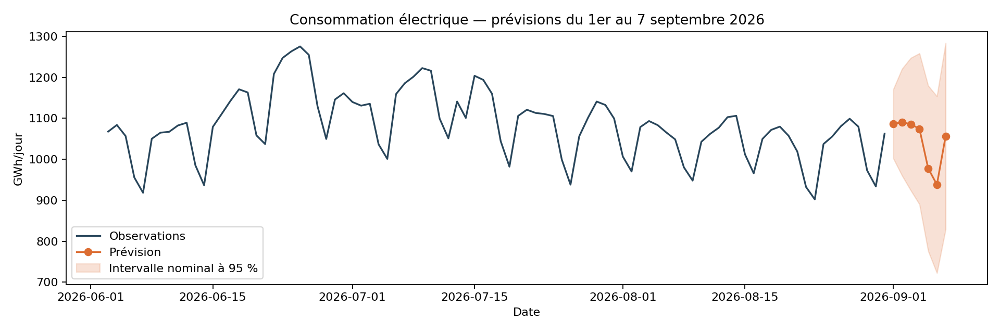

# 3.1 — Modélisation ARIMA et SARIMA

Texte préparé avec assistance IA à partir des calculs du projet, le 9 octobre 2026. Les résultats sont reproductibles dans `arima_sarima.ipynb`. Les données et les quatre notebooks de Fayfa sont conservés sans modification.

## Données et objectif

La variable cible est `conso_gwh`, consommation électrique quotidienne en GWh/jour. Le fichier préparé par Fayfa contient 3 896 observations du 1er janvier 2016 au 31 août 2026, sans date dupliquée ni jour manquant dans cet intervalle et sans valeur non finie de la cible. Les données sources brutes ne figurent pas dans l'archive ; la préparation initiale n'a donc pas été reconstruite ici. Les températures interpolées ne sont pas utilisées comme variables explicatives de ces modèles univariés.

L'objectif est de prévoir les sept jours suivant la dernière observation. Les prévisions finales correspondent donc au **1er–7 septembre 2026** ; elles ne constituent pas une prévision pour la semaine suivant la date de rédaction.

## Identification par stationnarité et autocorrélations

Les graphiques de Fayfa montrent une ACF persistante et des pics aux multiples de sept jours. Après une différence simple, le motif hebdomadaire reste marqué. Après une différence simple et une différence de période sept, les pics dominants vers les retards 1 et 7 motivent des termes non saisonniers de faible ordre et une composante MA saisonnière. Il subsiste néanmoins d'autres corrélations significatives : les graphiques proposent des candidats, sans prouver qu'un seul ordre est correct.

Les résultats ADF/KPSS fournis par Fayfa sur l'apprentissage complet sont ADF p=0,001 et KPSS p=0,0759 sur la série brute. Ils n'imposent pas une différence ordinaire au seuil de 5 %. Les tests recalculés dans le notebook portent sur l'estimation interne, légèrement plus courte, et ne doivent pas être confondus avec les valeurs de Fayfa. Les choix d=1, D=1 sont comparés à des variantes d=0 et/ou D=0. Le cycle annuel décrit par la décomposition de Fayfa n'est pas explicitement représenté par la seule période sept.

## Protocole d'estimation et de sélection

Le découpage externe respecte celui du groupe : 3 506 jours d'apprentissage jusqu'au 6 août 2025, puis 390 jours de test du 7 août 2025 au 31 août 2026. Dans l'apprentissage, les 56 derniers jours (12 juin–6 août 2025) servent à une validation interne, avec une estimation initiale sur 3 450 jours. Huit blocs successifs de sept jours sont prévus. Les paramètres restent fixes ; les observations d'un bloc ne sont incorporées qu'après émission de ses prévisions.

L'EDA de Fayfa avait déjà porté sur l'apprentissage complet, et quatre variantes ont été ajoutées après examen des premiers diagnostics : cette validation est exploratoire et partiellement réutilisée. Elle ne fournit pas une mesure indépendante définitive de généralisation. Le test externe est réservé jusqu'à la sélection et n'est pas utilisé pour modifier les ordres.

Les modèles manuels sont estimés avec `statsmodels`. Les modèles sans différenciation incluent une constante ; les autres candidats manuels n'incluent pas de dérive. `auto_arima` utilise une recherche stepwise bornée (p,q≤2 ; P,Q≤1), avec choix de d/D et de constante, sur l'estimation interne uniquement. Son optimum AIC dans cet espace n'est pas un optimum global garanti. Les paramètres et la constante qu'il choisit sont conservés. Les avertissements de recherche sont visibles dans le notebook ; les modèles non convergés ne sont pas admis comme candidats finaux.

La RMSE interne est le critère de classement principal parmi les ARIMA/SARIMA convergés ; MAE et modèles naïfs apportent des compléments. Les AIC/BIC figurent à titre informatif : les comparer entre différenciations différentes demande de la prudence. Deux références sont conservées : dernière valeur et répétition de la semaine précédente.

| modele | specification | MAE | RMSE | AIC | BIC |
| --- | --- | --- | --- | --- | --- |
| SARIMA_211_011 | [2, 1, 1] × [0, 1, 1, 7] | 32.604 | 42.675 | 35807.948 | 35838.667 |
| SARIMA_212_011 | [2, 1, 2] × [0, 1, 1, 7] | 32.739 | 42.807 | 35808.258 | 35845.121 |
| SARIMA_110_011 | [1, 1, 0] × [0, 1, 1, 7] | 31.108 | 42.967 | 35876.305 | 35894.736 |
| SARIMA_110_101 | [1, 1, 0] × [1, 0, 1, 7] | 31.144 | 43.009 | 35957.994 | 35982.577 |
| SARIMA_011_011 | [0, 1, 1] × [0, 1, 1, 7] | 30.988 | 43.053 | 35860.601 | 35879.032 |
| SARIMA_110_111 | [1, 1, 0] × [1, 1, 1, 7] | 32.093 | 43.247 | 35906.237 | 35930.812 |
| SARIMA_111_011 | [1, 1, 1] × [0, 1, 1, 7] | 31.119 | 43.373 | 35859.821 | 35884.397 |
| SARIMA_311_011 | [3, 1, 1] × [0, 1, 1, 7] | 33.837 | 43.466 | 35886.938 | 35923.801 |
| SARIMA_100_101 | [1, 0, 0] × [1, 0, 1, 7] | 34.380 | 47.250 | 36058.090 | 36088.821 |
| auto_SARIMA | [2, 1, 1] × [1, 0, 0, 7] | 36.825 | 48.105 | 37145.477 | 37176.207 |
| naif_saisonnier | Référence naïve | 44.042 | 55.215 | — | — |
| auto_ARIMA | [2, 1, 2] × [0, 0, 0, 0] | 59.014 | 74.225 | 39583.828 | 39614.557 |
| naif_derniere_valeur | Référence naïve | 67.726 | 88.594 | — | — |
| ARIMA_110 | [1, 1, 0] × [0, 0, 0, 0] | 67.683 | 88.918 | 40355.586 | 40367.878 |
| ARIMA_011 | [0, 1, 1] × [0, 0, 0, 0] | 67.843 | 89.211 | 40236.047 | 40248.338 |

## Modèle retenu et diagnostics

Le modèle retenu par la règle annoncée est **SARIMA(2, 1, 1)(0, 1, 1)[7]**, identifié par `SARIMA_211_011`. Sa MAE interne vaut 32.604 GWh/jour et sa RMSE interne 42.675 GWh/jour. Ce choix est enregistré dans `exports/selection_avant_test.json` avant l'évaluation externe. Une faible différence entre candidats ne démontre pas une supériorité statistiquement significative.

Les résidus sont examinés après exclusion des observations d'initialisation. Ljung–Box est calculé aux retards 7, 14 et 28 avec correction des degrés de liberté p+q+P+Q. Jarque–Bera évalue la normalité et ARCH-LM (7 retards) recherche un effet ARCH. Les degrés de liberté et le nombre de résidus figurent dans les exports. Une p-value supérieure à 0,05 n'est pas une preuve d'absence d'effet ; une valeur affichée à zéro peut résulter de la précision numérique.

Diagnostics après réajustement final :

| retard_LB | model_df | lb_stat | lb_pvalue | JB_p | ARCH_p |
| --- | --- | --- | --- | --- | --- |
| 7 | 4 | 46.249 | 5.020e-10 | 0.000 | 1.153e-70 |
| 14 | 4 | 72.804 | 1.271e-11 | 0.000 | 1.153e-70 |
| 28 | 4 | 112.025 | 2.493e-13 | 0.000 | 1.153e-70 |

Les résultats doivent être discutés avec les graphiques `diagnostics_selection.png` et `diagnostics_finaux.png`. On distingue la sélection du meilleur candidat prédictif parmi ceux testés de la vérification des hypothèses résiduelles : les rejets éventuels ne sont ni masqués ni transformés en validation du modèle. Les erreurs non normales, hétéroscédastiques ou autocorrélées limitent l'interprétation des intervalles gaussiens.

## Évaluation externe, sans nouveau choix d'ordres

Après sélection, le modèle est réestimé sur les 3 506 jours d'apprentissage. Les 390 jours de test sont prévus en 55 blocs complets de sept jours et un dernier bloc de cinq jours, avec actualisation de l'état et paramètres fixes. Les métriques agrègent donc les horizons 1 à 7 ; les horizons 6 et 7 ont une observation de moins que les autres. Le biais ci-dessous est la moyenne « prévision − observation ».

| modele | n | MAE | RMSE | biais_prevision | couverture_95 | largeur_moyenne_95 |
| --- | --- | --- | --- | --- | --- | --- |
| SARIMA_211_011 | 390 | 53.116 | 82.382 | 1.246 | 0.944 | 346.749 |
| naif_saisonnier | 390 | 76.660 | 113.927 | -1.060 | — | — |
| naif_derniere_valeur | 390 | 76.625 | 109.131 | 42.319 | — | — |

Par rapport au naïf saisonnier, la variation de RMSE correspond à un gain de **27.69 %** (un gain négatif signifierait une dégradation). Ce résultat est descriptif pour ce test, sans test de significativité de l'écart. La couverture empirique des intervalles nominaux à 95 % est de **94.36 %** sur les prévisions du modèle retenu. Il n'y a pas d'intervalles construits pour les références naïves : leur couverture est laissée manquante, et non assimilée à zéro.

Détail des erreurs du modèle retenu selon l'horizon :

| horizon | n | MAE | RMSE | biais_prevision | couverture_95 | largeur_moyenne_95 |
| --- | --- | --- | --- | --- | --- | --- |
| 1 | 56 | 22.991 | 33.829 | -0.837 | 0.964 | 170.461 |
| 2 | 56 | 41.767 | 60.663 | 5.177 | 0.946 | 262.945 |
| 3 | 56 | 51.299 | 72.476 | 3.730 | 0.982 | 326.095 |
| 4 | 56 | 59.322 | 82.462 | -2.345 | 0.911 | 371.697 |
| 5 | 56 | 60.410 | 90.304 | -3.241 | 0.964 | 406.591 |
| 6 | 55 | 64.804 | 101.158 | 6.899 | 0.927 | 434.697 |
| 7 | 55 | 71.759 | 111.376 | -0.594 | 0.909 | 458.319 |

## Prévisions finales et livraison

Le même ordre et la même règle de constante sont réestimés sur les 3 896 jours disponibles. Les intervalles sont des **intervalles de prévision nominaux à 95 %**, conditionnels au modèle et à ses hypothèses, et non des garanties de couverture ou des intervalles pour une moyenne observée. La variance des paramètres et l'incertitude de sélection ne sont pas intégralement prises en compte. Les bornes ne sont pas tronquées artificiellement.

| date | prevision | borne_inferieure_95 | borne_superieure_95 |
| --- | --- | --- | --- |
| 2026-09-01 | 1086.54 | 1002.32 | 1170.76 |
| 2026-09-02 | 1090.60 | 960.47 | 1220.73 |
| 2026-09-03 | 1085.84 | 924.27 | 1247.41 |
| 2026-09-04 | 1074.40 | 890.09 | 1258.72 |
| 2026-09-05 | 977.91 | 776.18 | 1179.65 |
| 2026-09-06 | 938.23 | 722.48 | 1153.98 |
| 2026-09-07 | 1056.45 | 828.94 | 1283.96 |

Le fichier `exports/previsions_7j.csv` contient les dates, prévisions et bornes. Les unités, ordres, dates d'apprentissage, protocole, empreinte du CSV source et métriques de test sont conservés dans `exports/metadonnees_previsions.json`. Le dossier `livraison_anas/` et son ZIP regroupent les fichiers à transmettre, sans envoi automatique.

## Limites et prolongements

La validation interne couvre huit semaines d'été et a servi aux ajustements exploratoires. Le test reste une seule période historique ; la prévision opérationnelle dépendrait aussi de la stabilité des usages et du contexte. Les fêtes, températures futures et changements structurels ne sont pas explicitement modélisés. Les résidus peuvent conserver de la structure malgré un gain sur les références. Une suite possible serait une validation couvrant plusieurs saisons, un modèle avec calendrier et termes annuels, ou des intervalles adaptés à la variance. Ces pistes ne sont pas présentées comme déjà évaluées et ne justifient pas de choisir de nouveaux ordres à partir du test réservé.

## Références techniques

- [Documentation statsmodels : actualisation avec append](https://www.statsmodels.org/stable/generated/statsmodels.tsa.statespace.sarimax.SARIMAXResults.append.html).
- [Documentation statsmodels : test de Ljung–Box et correction des degrés de liberté](https://www.statsmodels.org/stable/generated/statsmodels.stats.diagnostic.acorr_ljungbox.html).
- [Documentation pmdarima : auto_arima](https://alkaline-ml.com/pmdarima/modules/generated/pmdarima.arima.auto_arima.html).
